# Testatum — on-chain transaction flows and lifecycles

Status: static reading of branch `main` at `2bf5bde` (2026-10-23); nothing was built or run. Every transaction
shape cites the off-chain builder (`src/lib/offchain-lib/Palmares/TxBuilding/`) and the on-chain rule that checks
it (`src/lib/onchain-lib/Palmares/Onchain/`); where they disagree, §1.3 says so.

## 1. Purpose and reading guide

This is the **dynamic** view of the attestation protocol: how each transaction is shaped (inputs, reference
inputs, mint, outputs in order, signatures, validity interval), how each on-chain entity moves through its life,
what a user does end to end, and what every step costs in ADA, time and pause exposure. The **static** view —
datum and redeemer types, field meanings, the trace-code catalogue, the entity diagram — is the sibling document
[`onchain-protocol.md`](onchain-protocol.md), referred to by name only. Security reviews live under
[`docs/audit/`](../audit/).

### 1.1 Conventions

- **Builder** means the off-chain skeleton function in `src/lib/offchain-lib/Palmares/TxBuilding/Operations.hs`;
  **validator** means the PlutusTx script under `src/lib/onchain-lib/Palmares/Onchain/Validators/`.
- Trace codes (`M0`, `Mp5`, `D4`, …) are the validators' own; the sibling document lists all of them.
- `minLv` is the oracle's `opMinUTxOValue`; `deposit` is the oracle's `opDisputeDeposit`; `tip` is the slot the
  builder read from the provider (`slotOfCurrentBlock`).
- Paths are relative to the repository root; `path:line` cites the revision above.

### 1.2 Two contracts every flow relies on

1. **Output order is the skeleton's `mconcat` order, and the redeemer's index points into it.** The builder
   composes `GYTxSkeleton` pieces with `mconcat`; Atlas keeps the declared outputs in that order and appends the
   change output(s) after them, so "output 0" in a redeemer is the first `mustHaveOutput` in the list
   (`src/lib/offchain-lib/CLAUDE.md:14`, `src/lib/onchain-lib/CLAUDE.md:34-36`). Every validator looks the
   output up by that index with `checkTxOutAtIndexWithDatumMinValueAndAddress`
   (`src/lib/onchain-lib/Palmares/Onchain/Utils.hs:119-127`).
2. **The balancer may add lovelace to any output, never remove it.** Validators compare with `geq` and the
   builder declares the minimum (`NFT + minLv`), not the exact value (`Utils.hs:84-85`;
   `ProfilesValidator.hs:161`; `OracleValidator.hs:85`). The one exact-negative check — the user token must
   *not* be in the profile output — uses `valueAtOutputIdx` (`MintingPolicy.hs:357-379`). There is no
   exact-value output helper any more: `3654f57` deleted both halves of the pair (`Utils.hs:76-82`).

### 1.3 Findings at a glance (off-chain vs on-chain disagreements)

Re-judged at `2bf5bde` (2026-10-23) and **re-judged again at `f72af4e` (2026-10-24)**, after ~50
commits. Seven of the nine are now closed; `F8` is the only open row. Ids are kept even where a
finding is closed, so an older reference still resolves, and each closed row names the commit and
the code rather than the intent. The write-path refusals were measured against the running
interaction-api, not inferred from the diff.

| # | Status | Where | What |
|---|---|---|---|
| F1 | **CLOSED** by `fff93cd` | `Operations.hs:84-85` vs `Protocol/Lookup.hs:89` | `getFeeSkeleton` now short-circuits — `if feeAmount <= 0 then return mempty` — so a configured `FeeConfig` no longer emits a zero-lovelace output that Atlas's `adjustTxOut` raised to a full min-ADA. `feeFor MintActionDispute` is `const 0` by design, so every disputer had been paying ~1 ADA the chain never asked for while `checkFee` priced zero. `<= 0` and not `== 0`: `O6` permits a zero fee and nothing bounds a negative one. The comment at `Operations.hs:924` ("always empty") is now true. See §3.7 and §6. |
| F2 | **CLOSED** by `93e12ac` | `admin/Main.hs:753` + `Transactions.hs:157,172` vs `Operations.hs:1176-1183` / `OracleValidator.hs:86` | `rotate-admin` no longer builds-signs-submits in one step. Three commands: `rotate-admin --build-only > tx.hex`, `sign-tx < tx.hex > incoming.wit`, `submit-tx --tx tx.hex --witness incoming.wit`. `submit-tx` takes the transaction rather than rebuilding it, because a witness signs a BODY HASH. The flagless form refuses and names the three (`admin/Main.hs:876-879`). `O5` is now also *provable* by a script target: ADR 0005 made it `claimProofSkeleton` of a `Credential` rather than a signature (`Operations.hs:1176-1183`). Still true, and not this row: a script arbiter cannot resolve over HTTP yet, and the other six admin commands assume a key admin. See §3.9, §5.3. |
| F3 | **CLOSED** by `fff93cd` | `Operations.hs:998-999` vs `DisputesValidator.hs:146` | `resolveDisputeTX` now reads `opPaused` and refuses with `ProtocolPaused` → 503 before building. The builder already called `queryOracleParams` for `D1`'s proof, so the flag was in hand and simply unread; the "needs a careful look at the input set" obstacle the old comment named was not real — one `when`, no second reference input. `expireDisputeTX` is deliberately NOT gated, and that is D-A's guarantee rather than an oversight (`Operations.hs:963-968`). The misleading `400 InsufficientFunds` this row's last sentence described is itself gone — see `F9` and `OF-05`. See §8. |
| F4 | **CLOSED** by `ec18712` | `Operations.hs:848-864` vs `MintingPolicy.hs:468` | `Md8` now has its off-chain mirror, and the default changed rather than being checked. `deposit_to` omitted resolves to the address holding the opener's user NFT — the one address `Md8` is satisfied by for free, since spending that UTxO is how the opener authorises — returned by `spendUserNFTForProfileAt` so the lookup and the default cannot disagree. A named address must appear in `user_addresses` and is forced as an input, or it is refused as `DepositAddressNotSpendable` (`:859,863`) before anything is built; a script address is refused outright as `DepositAddressIsScript` (`:857`), through the protocol's own `isKeyAddress`. The old default was the CHANGE address, which need not be an input at all, so a multi-address wallet failed on the honest path and failed as "Not enough ADA". See §3.7. |
| F5 | **CLOSED** 2026-10-24 | `Lookups.hs:183-215` vs `Utils.hs:470-473` | The dust sweep's off-chain selector disagreed with the on-chain `Cleanup` rule **in both directions**, and this row recorded only the harmless one. Narrower: a UTxO holding some *other* protocol token with a hand-written datum is sweepable on chain and was never offered. Wider, and the real defect: a UTxO the validator REFUSES was offered, and because the sweep is one all-or-nothing transaction, one such plant bricks `cleanupDustTX` for everyone, for ever, for one min-ADA output. `getDustUTxOs` now takes the kind's label predicate, datum parser and id field and applies `isUnbackedDatum`'s own test; a datum-**hash** plant, which the ledger refuses before any validator runs, is skipped (`Lookups.hs:205`) — the one deliberate deviation from the arm. See §3.10. |
| F6 | **CLOSED** by `26d53f7` (D-C) | `AttestationsValidator.hs:127,139` | Acceptance was the one write the pause did not reach. `OnchainAttestation` now carries `attestationOracleToken`, written by the minting policy from its own compile-time parameter, and `A7` is the **first** conjunct of the acceptance chain — so a hand-built acceptance during a pause now fails on chain, and one built without the oracle reference input fails closed as `K1`. The off-chain `503` is now a courtesy ahead of a real rule, not a substitute for one; since `fff93cd` it arrives through the shared `getOracleAndValiditySkeleton` (`Operations.hs:113-121`). |
| F7 | **CLOSED** by `439de49` | `Transactions.hs:195-205` + `Skeletons.hs:193-196` | Reference scripts now go to Atlas's always-fail `limboValidatorV2`, which is literally `\datum redeemer sc -> ERROR`, so no key can take them — the fix was calling `addRefScriptSkeleton`, the function this row recorded as existing and unused. The price is stated rather than hidden: ~208.8 ADA is spent, not parked. The second half of the same change is bigger than this row: `verifyDeployedScriptsAreReady` was `all isJust`, so any reference script at the right ref passed including one from a different deployment; `deployedScriptsProblems` (`Operations.hs:175-203`) now makes compiled, configured and on-chain hashes agree, and `deploy-reference-scripts` fails before writing a config (`Transactions.hs:249-256`). See §2.3. |
| F8 | **open** | `Interactions.hs:103` + `ServiceRequests.hs:53,78,109,141,171,209,244,281,308` | The `recipient` field accepted by every write route is still read by no operation — verified by grep at HEAD: the only other occurrences in `src` are `TestRuns.hs` building an `Interaction` and an unrelated local parameter in `Skeletons.hs:81`. It is now on **nine** request types, not six, and documented to clients in nine places including the published document ("Address to receive unlocked funds"). |
| F9 | **CLOSED** by `bf3e1b6`; measured live 2026-10-24 and pinned by `publishedErrorTable` row 16 plus an emulator case | `Operations.hs:450-455` vs `MintingPolicy.hs:309` | The refusal is `issueAttestationTX`'s FIRST statement, so `/build-tx`'s `IssueAttestationAction` arm is covered by the same line, and it answers `400 AttestationKindIsCredentialBinding` rather than the misleading `InsufficientFunds` below. Measured: `POST /issue-attestation {"kind":"credential_claim",…}` → `400 {"code":"AttestationKindIsCredentialBinding","message":"A credential binding is not issued here: use /claim-credential or /withdraw-credential…"}`. Two conjuncts were unsatisfiable, not one: `Mc2` because the builder names no credential, and `Mc3` because it supplies no proof of control. A pattern match rather than `==`, because `AttestationKind` has no `Eq` instance by design. Residual, and cosmetic: `admin issue-attestation --kind` still advertises both credential spellings, because its help is derived from `[minBound .. maxBound]` (`admin/Main.hs:218-228`) — the attempt now fails as a clean 400 rather than a script error. |

## 2. Bootstrap / deployment sequence

One admin command, `admin deploy-reference-scripts` (`src/exe/admin/Main.hs:298-302`, dispatched at `560-564` /
`580-584`), runs `deployReferenceScripts` (`src/lib/offchain-lib/Palmares/TxBuilding/Transactions.hs:164-195`).
Before it, `admin new-operator-key` writes a 24-word mnemonic to `operation.prv` (mode 0600, never overwrites;
`Main.hs:778-796`) and `admin operator-address` prints **three** things the key identifies (`39365fe`): its CIP-129 DRep id
first, because that value carries no network byte and is what `scripts/smoke_attest_flow.sh` wants as
`ATTEST_SMOKE_DREP_ID`, then the address to fund in bech32 and in raw hex (`printOperatorAddress`,
`Main.hs:811-860`). The network comes from `ATLAS_CORE_CONFIG`, never a flag, so the printed address
cannot belong to a different chain than the deploy (`Main.hs:813-817`). The DRep id is rendered with
`claimCredentialToText`, the same function the read path uses, so `operator-address` and
`GET /profiles/by-credential/…` speak one encoding.

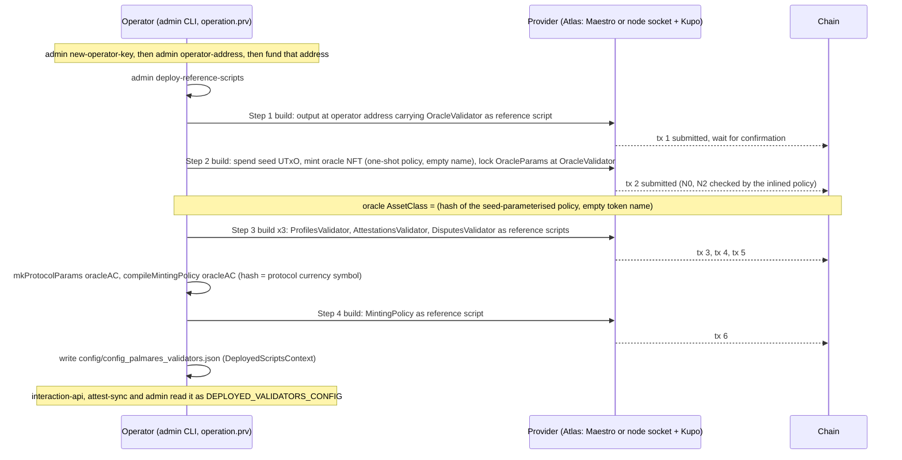

### 2.1 The steps, with the code that performs them

| Step | What happens | Code |
|---|---|---|
| 0 | Operator key, DRep id and address. | `Main.hs:778-860` |
| 1 | Deploy the **OracleValidator** reference script. One output at the operator's address, value `mempty` (the balancer raises it to the ledger minimum for the script's size), inline unit datum, `gyTxOutRefS = Just script`. The returned `TxOutRef` is `(txId, 0)` — output 0 by contract §1.2. | `Transactions.hs:146-156, 168-170`; `Skeletons.hs:182-184` |
| 2 | **Mint the oracle NFT and create the oracle UTxO.** A seed UTxO is picked from the operator wallet (`someUTxOWithoutRefScript`), the one-shot `OracleNFTPolicy` is compiled against that seed and **inlined** (`GYMintScript`, never a reference script), the token name is empty, the redeemer is unit. The initial `OracleParams` are: admin = operator key hash, `opPaused = False`, `opFeeConfig = Nothing`, `opMinUTxOValue = 1_000_000`, `opDisputeDeposit = 5_000_000`, and — since D-A — `opDisputeTimeoutMs = 2_592_000_000` (30 days; long on purpose, because after it **anyone** may close an undecided dispute). The oracle output carries the NFT plus 3.5 ADA at the OracleValidator address with an inline datum. | `Transactions.hs:198-250`, params at `:217-230`; `Validators.hs:96-99`; `OracleNFTPolicy.hs:33-42` |
| 3 | Deploy the three state validators (**Profiles, Attestations, Disputes**) as reference scripts, same shape as step 1. These validators are unparameterised, so their hashes are constants of the build. | `Transactions.hs:176-180`; `Validators.hs:27-73` |
| 4 | `mkProtocolParams oracleAC` bakes the three validator hashes and the oracle `AssetClass` into `ProtocolParams`; `compileMintingPolicy` applies them to the policy. **The policy's hash is the protocol currency symbol**: every profile, attestation and dispute id is an asset class under it. Deployed as the fifth reference script. | `Validators.hs:115-122, 149-151`; `Transactions.hs:182-185` |
| 5 | The six hash/ref pairs plus the oracle asset class are written as `DeployedScriptsContext` JSON to `config/config_palmares_validators.json`. | `Context.hs:23-32`; `Constants.hs:8-9`; `Main.hs:563,583` |
| 6 | Services load it: `interaction-api` and `admin` for building, `attest-sync` for the minting-policy hash that becomes its Kupo query pattern `<policyHex>.*` and its projection authenticity gate. | `src/exe/interaction-api/Main.hs:59`; `src/exe/attest-sync/Main.hs:84-94, 137` |

The order is forced: the minting policy cannot be compiled before the oracle NFT exists (compile-time
parameter) nor deployed before the three state validators exist (their hashes are in `ProtocolParams`). The
emulator's `deployValidators` deploys the state validators first and the oracle second
(`src/test/TestRuns.hs:117-161`); both orders end in the same context.

### 2.2 What a redeploy means

Changing any validator changes its hash, hence `ProtocolParams`, hence the minting policy's hash, hence every
id: "every existing id becomes an id under a dead policy" (`Utils.hs:121-124`). `attest-sync` detects a changed
policy hash at boot and wipes its projection tables before re-syncing (`src/exe/attest-sync/Main.hs:97-110`).
Kupo runs with `--match '*'` so no pattern needs editing in lockstep (`compose.yaml:183-194`); the named footgun
is `KUPO_SINCE` — a UTxO created before Kupo's start point is invisible forever (`compose.yaml:196-200`).

### 2.3 Where the reference scripts live, and who can spend them (finding F7)

`deployReferenceScript` pays each reference-script output to the operator's own payment-key address
(`Transactions.hs:148,152`). Only the operator's key guards them: a wallet sweep or a `cardano-cli` spend from
the same key removes them, after which every build fails and `/ready` turns 503
(`src/exe/interaction-api/InteractionAppMonad.hs:136-154`). `Skeletons.hs:177-180` still carries
`addRefScriptSkeleton`, targeting Atlas's always-fail `limboValidatorV2` address (immutable scripts); it has no
caller. "Recoverable by the operator" versus "immutable" is a deployment decision this document records, not makes.

### 2.4 Admin CLI command map

| Command | Kind | Does |
|---|---|---|
| `new-operator-key`, `operator-address`, `sign-tx` | no provider | key management; `sign-tx` is the stdin→stdout signer (`Main.hs:807-822`) |
| `deploy-reference-scripts` | provider, key | §2.1 |
| `write-blueprint`, `write-metrics-doc`, `reconcile-koios`, `apply-indexes`, `apply-roles` | no provider | artefacts and SQL, not part of the protocol flow |
| `pause-protocol`, `unpause-protocol`, `set-fees`, `set-min-utxo-value`, `set-dispute-deposit`, `set-dispute-timeout`, `rotate-admin` | provider, key | `OracleUpdate` transactions, §3.9 — **seven** commands since D-A added `set-dispute-timeout` (`Main.hs:436`, dispatched at `:610`) |
| `query-oracle` | provider, read-only | prints `OracleParams` |
| `update-profile`, `issue-attestation`, `accept-attestation`, `cleanup-dust` | provider, key | user/maintenance transactions built, signed and submitted with `operation.prv` (`Transactions.hs:127-137`) |

There is deliberately no `claim-profile`, `open-dispute`, `resolve-dispute` or `delete-profile` command
(`docs/deployment/attest-flow-smoke.md`), and the three routes added since `4eb9117` — `/claim-credential`,
`/withdraw-credential` and `/expire-dispute` — have no CLI command either.

## 3. Transaction anatomy

Common machinery used below:

- `getOracleRefInputSkeleton` finds the oracle UTxO by its NFT at the OracleValidator address, throws
  `ProtocolPaused` if `opPaused`, returns `mustHaveRefInput oracleRef` (`Operations.hs:45-52`; `Lookups.hs:125-137`).
  Two operations that mint nothing take the fee-free sibling `getOracleAndValiditySkeleton` instead
  (`Operations.hs:97-103`): `updateProfileTX` and `acceptAttestationTX`.
- `getFeeSkeleton` adds `mustHaveOutput fcFeeAddress (feeFor action)` when `opFeeConfig` is `Just`
  (`Operations.hs:60-71`); on chain `checkFee` runs right after `M0` on every mint (`MintingPolicy.hs:192-202`).
- `txIsValidForSafeEra tip` = `isInvalidBefore tip` + `isInvalidAfter (tip + 25920 slots)` (`Skeletons.hs:46-56`).
- State UTxOs are spent through the deployed reference script with inline datum and redeemer
  (`Skeletons.hs:75-85`); user tokens from the caller's `used_addresses` with the chosen witness (`Skeletons.hs:125-134`).
- The wallet's `reservedCollateral`, if sent, is the collateral; otherwise Atlas picks one (`Context.hs:91-94, 103`).

### 3.1 Oracle NFT mint (bootstrap step 2)

| Aspect | Value | Code |
|---|---|---|
| Builder | `mintOracleNFTAndLockDatum`, admin only | `Transactions.hs:197-245` |
| Inputs | seed UTxO (key witness) + funding | `Transactions.hs:207, 228` |
| Reference inputs | none | |
| Mint | exactly 1 × `(oneShotPolicy(seed), "")`, policy inlined, unit redeemer | `Transactions.hs:231-233`; `OracleNFTPolicy.hs:36-41` |
| Outputs | 0: OracleValidator, NFT + 3 500 000 lovelace, inline `OracleParams` (admin = operator, unpaused, no fees, minLv 1 ADA, deposit 5 ADA); then change | `Transactions.hs:217-236` |
| Signatures | operator key (seed owner) | `Transactions.hs:241` |
| Validity | none | |
| Trace codes | `N0` seed spent, `N2` exact mint, `N1` purpose | `OracleNFTPolicy.hs:38-42` |

### 3.2 Reference-script deployment (bootstrap steps 1, 3, 4)

| Aspect | Value | Code |
|---|---|---|
| Builder | `deployReferenceScript`, one transaction per script, five in total | `Transactions.hs:146-156` |
| Inputs | funding from the operator wallet | |
| Outputs | 0: operator's key address, inline unit datum, `gyTxOutRefS = Just script`, lovelace raised by the balancer; then change | `Skeletons.hs:182-184` |
| Signatures | operator key | `Transactions.hs:153` |
| Validity | none | |
| On chain | no script runs; a plain key spend | |

### 3.3 (a) MintProfile — claim a profile

**Purpose.** Create a profile: mint the CIP-68 reference token (locked with the datum) and user token (the
authority instrument, which goes to the claimant's wallet). **It claims no credential** — ADR 0003 removed
the `Maybe Credential` argument from `MintProfile` and the field from the profile datum, so binding a
credential is now a second transaction (§3.11).
**Built by** `claimProfileTX` (`Operations.hs:273-333`) via `POST /claim-profile`
(`src/exe/interaction-api/RestAPI.hs:128-133`, `ServiceHandlers.hs:36-40`) or `POST /build-tx` with
`ClaimProfileAction`; no admin command.

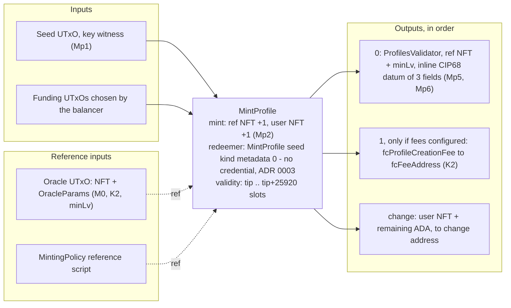

| Aspect | Value | Code |
|---|---|---|
| Inputs | seed = `someUTxOWithoutRefScript` from the wallet, key witness; funding. **No claim proof** | `Operations.hs:290-291, 323` |
| Reference inputs | oracle UTxO; minting-policy reference script | `Operations.hs:284, 327` |
| Mint | ref token and user token of the name derived from the seed, both +1, redeemer `MintProfile seed kind metadata 0` | `Operations.hs:301-304, 328`; `Skeletons.hs:159-168` |
| Outputs | 0: profile state (`valueSingleton ref 1 <> lovelace minLv`, inline `CIP68Datum OnchainProfile` with `protocolParams` from the context); 1 (optional): fee; change carries the user token because it is paid nowhere explicitly | `Operations.hs:306-330` |
| Signatures | owners of the seed/funding inputs only — nothing is `mustBeSignedBy` any more | `Operations.hs:321-333` |
| Validity | `[tip, tip + 25920 slots]`, attached though `MintProfile` carries no date | `Operations.hs:284, 326` |
| Trace codes | `M0`, `K2`, `K1` (oracle read), `Mp1`, `Mp2`, `Mp4`, `Mp5`, `Mp6`, `M1`, `U0` — **no `Mp3`**, which is retired, not renumbered | `MintingPolicy.hs:192-199, 347-379` |

`ClaimProfileRequest` has lost its `credential` and `witness` fields (`ServiceRequests.hs:47-56`), but
three descriptions of them survive: the route's Swagger text, the request schema's own `description`
plus a `describeField "credential"` for a property that no longer exists, and `claimProfileTX`'s
Haddock (`RestAPI.hs:129`; `ServiceRequests.hs:66-70`; `Operations.hs:259`). A documentation residue of
ADR 0003, not a behaviour — but it is the published API document, so a client reading it will send
fields this route now ignores.

**Off-chain failures (HTTP):** `ProtocolPaused` 503; `OracleNotFound` 404 / `OracleDatumInvalid` 500;
an empty wallet surfaces as Atlas `GYQueryUTxOException` → 400 `InsufficientFunds`
(`classifyWriteFailure`, `TxBuilding/Exceptions.hs`). `CredentialMalformed` and `ScriptCredentialHasNoUtxo` have moved to
the credential routes (§3.11).

### 3.4 (b) UpdateProfile

**Purpose.** Rewrite description and image; the name is immutable because the on-chain update never writes it
(`CIP68.hs:249-256`) and the builder keeps the old one (`Operations.hs:181-186`). **Built by** `updateProfileTX` (`Operations.hs:156-206`) via `POST /update-profile` or `admin update-profile`.

| Aspect | Value | Code |
|---|---|---|
| Inputs | profile **user** NFT from `used_addresses`, key witness; profile **state** UTxO at ProfilesValidator, reference-script witness, redeemer `UpdateProfile mergedFields 0`; funding | `Operations.hs:190-193` |
| Reference inputs | oracle UTxO — required on chain, read through the datum's own `protocolParams` (`P6`, `K1`) | `Operations.hs:169`; `ProfilesValidator.hs:116,134` |
| Mint | none | |
| Outputs | 0: same ProfilesValidator address, value ≥ spent (`geq`), datum = `updateCIP68DatumMetadata`; change | `Operations.hs:198-206` |
| Signatures | wallet keys for the user-NFT and funding inputs (no `mustBeSignedBy`) | |
| Validity | `[tip, tip + 25920 slots]`, not read by the validator | `Operations.hs:169` |
| Trace codes | `P0`, `P1`, `P6`, `P2`, `P3`, `P4`, `P5`, `K1`, `U1` | `ProfilesValidator.hs:97-162` |
| Off-chain failures | `ProtocolPaused` 503; `ProfileNotFound` 404 (state UTxO: `Lookups.hs:90`; user token not held: `Skeletons.hs:128`); `DatumParseError` 500; `NFTNotFound` 404 | |

### 3.5 (c) NewAttestation — issue

**Purpose.** An issuer profile records a claim about a subject. Only the **reference** token is minted (no
user token), so the record has no transferable owner; the subject's consent comes later (§3.6).
**Built by** `issueAttestationTX` (`Operations.hs:359-482`) via `POST /issue-attestation` or
`admin issue-attestation` (which always sends empty `other_metadata`, `Main.hs:487-501`). This builder
hardcodes the attestation's credential to `Nothing` (`Operations.hs:438,460`), which `Mc4` requires of
the five ordinary kinds — and which makes the two credential kinds unbuildable here; see **F9** below
and §3.11 for the routes that do build them.

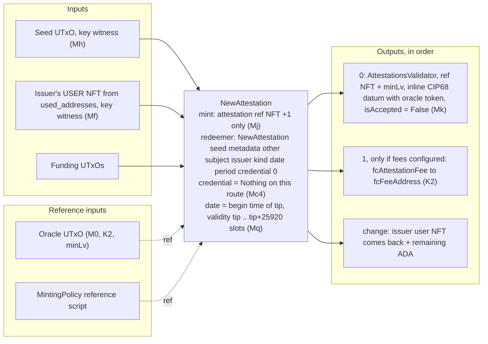

| Aspect | Value | Code |
|---|---|---|
| Pre-checks (before any skeleton) | reserved `other_metadata` keys; subject NFT exists — EXISTENCE only, since ADR 0006 made the kind the chain's business (`Mg`); claimed period not inverted | `Operations.hs:377-382, 392, 409-410`; `Lookups.hs:182-184` |
| Inputs | seed; issuer user NFT (derived from the issuer profile id, looked up at `used_addresses`); funding | `Operations.hs:413-417` |
| Reference inputs | oracle; minting policy | `Operations.hs:386, 476` |
| Mint | attestation ref token +1, redeemer `NewAttestation seed metadata other subject issuer kind attestationDate claimedPeriod Nothing 0` | `Operations.hs:426-444` |
| Outputs | 0: attestation state at AttestationsValidator, `ref NFT + minLv`, datum with `attestationIsAccepted = False`, `attestationCredential = Nothing` and `attestationOracleToken` from the context — which `Mk` compares whole, so a wrong token here is a mint that does not validate; 1 (optional): fee; change | `Operations.hs:446-482` |
| Signatures | wallet keys (no `mustBeSignedBy`) | |
| Validity | `[tip, tip + 25920 slots]`; `attestationDate = slotToBeginTime tip`, i.e. the interval's lower bound | `Operations.hs:401-402`; `TxBuilding/Utils.hs:117-118` |
| Trace codes | `M0`, `K2`, `K1`, `Mq`, `Mm`, `Mn`, `Mf`, `Mg`, `Mc1`–`Mc4`, `Mh`, `Mj`, `Mk` — the four `Mc` rules run on every issuance, and on this route they are satisfied by `Mc4` alone (not a credential kind, names no credential) | `MintingPolicy.hs:288-316` |
| Off-chain failures | `AttestationOtherMetadataReservedKeys` 400; `SubjectProfileNotFound` 404; `AttestationPeriodInverted` 400; `ProfileNotFound` 404 (issuer token not held); `ProtocolPaused` 503 | |

Not checked on chain: that the subject EXISTS. `Mg` requires policy + the profile label, so since ADR 0006 it does rule out an attestation id, a dispute id and a user token — but not a profile id nobody minted. Nothing about `claimedPeriod` is checked either (`MintingPolicy.hs:244-251`).

**Finding F9 — CLOSED.** `kind` is passed straight through (`Interactions.hs:136-144`) and
`AttestationType`'s `FromJSON` accepts `credential_claim` and `credential_withdrawal`
(`DomainTypes/Core/Types.hs:143-165`), so both are still reachable on this route — and both are now
refused off chain, by the FIRST statement of `issueAttestationTX`, with
`400 AttestationKindIsCredentialBinding` naming the two routes that do take a credential (§3.11).

The fix went to the shared builder rather than the route handler deliberately: `/build-tx`'s
`IssueAttestationAction` arm reaches the same function, so a guard in the handler would have left it
behind and created a second place to keep in step.

Two conjuncts were unsatisfiable, not one. The builder sets the credential to `Nothing`, so `Mc2`
("a credential record must name a credential") cannot hold; and `Mc3` ("the named credential must
control the transaction") has no claim proof to check, because this route collects neither a
credential nor a witness. Measured live: a credential kind answers the 400 before any chain read,
while `kind: endorsement` on the same body gets as far as `404 SubjectProfileNotFound`.

### 3.6 (d) AcceptAttestation — countersign

**Purpose.** The subject spends its own user NFT beside the attestation UTxO, re-locking it with
`isAccepted = True`. Irreversible — though not uniquely so, which is the correction D-C's own comment
makes: a verdict is also written once and nothing here burns, so every mint is permanent too. What
made acceptance the urgent case was the conjunction of irreversible **and** out of the pause's reach
(`AttestationsValidator.hs:132-138`).
**Built by** `acceptAttestationTX` (`Operations.hs:607-666`) via `POST /accept-attestation` or
`admin accept-attestation`.

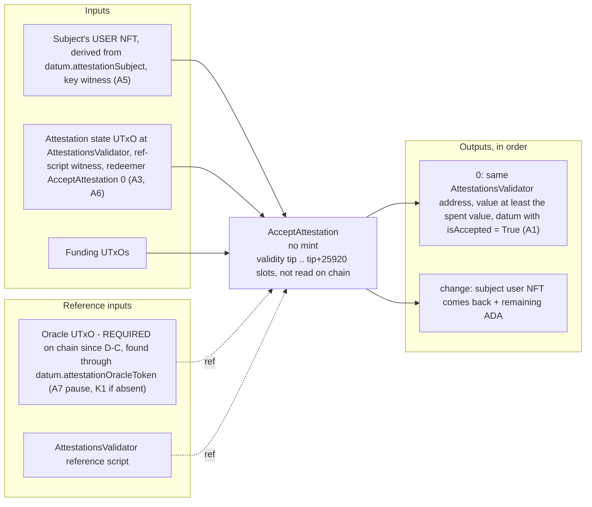

| Aspect | Value | Code |
|---|---|---|
| Inputs | subject user NFT (`deriveUserFromRefAC attestationSubject`) from `used_addresses`, key witness; attestation state UTxO via reference script with redeemer `AcceptAttestation 0`; funding | `Operations.hs:627, 650` |
| Reference inputs | oracle — gate off chain **and** on (`A7`); AttestationsValidator reference script | `Operations.hs:616-618, 665` |
| Mint | none | |
| Outputs | 0: attestation re-locked, same value, `attestationIsAccepted = True`; change | `Operations.hs:637-638, 654-658` |
| Signatures | wallet keys | |
| Validity | `[tip, tip + 25920 slots]`, unused on chain | `Operations.hs:664` |
| Trace codes | `A0`, `A2`, `K1`, `A7`, `A3`, `A1`, `A5`, `A6`, `U1` | `AttestationsValidator.hs:97-178` |
| Off-chain failures | `AttestationAlreadyAccepted` 400 (`Operations.hs:635-636`); `AttestationNotFound` 404; `ProfileNotFound` 404 (the subject's user token is not in `used_addresses`); `ProtocolPaused` 503 | |

**The builder's oracle reference input is now load-bearing, not decorative (F6 closed).** The validator
looks the oracle up by `attestationOracleToken` out of the attestation's own datum; the builder attaches
the one `queryOracleParams` finds, which for a protocol attestation is the same UTxO. A hand-built
acceptance that omits it fails as `K1`, and one built during a pause fails as `A7` — so there is no
longer a route by which an acceptance lands while the protocol is stopped.

A **lineage** attestation (subject = another attestation id) is REFUSED AT THE MINT since ADR 0006 — `Mg`
requires a profile id. Before that it was mintable and then stuck for ever, because no user token was ever minted for
an attestation, so `A5` is unsatisfiable and the builder fails earlier with `ProfileNotFound`
(`AttestationsValidator.hs:14-28`; `Attestation` test 5.11b). A `CredentialClaim` or
`CredentialWithdrawal`, by contrast, **is** acceptable: `Mc1` makes it self-issued, so its subject is a
profile and that profile's user token satisfies `A5`.

### 3.7 (e) OpenDispute

**Purpose.** A profile contests an attestation by locking a deposit in a new dispute UTxO that points at it.
The attestation is neither spent nor referenced (`MintingPolicy.hs:323-328`).
**Built by** `openDisputeTX` (`Operations.hs:693-830`) via `POST /open-dispute`; no admin command.

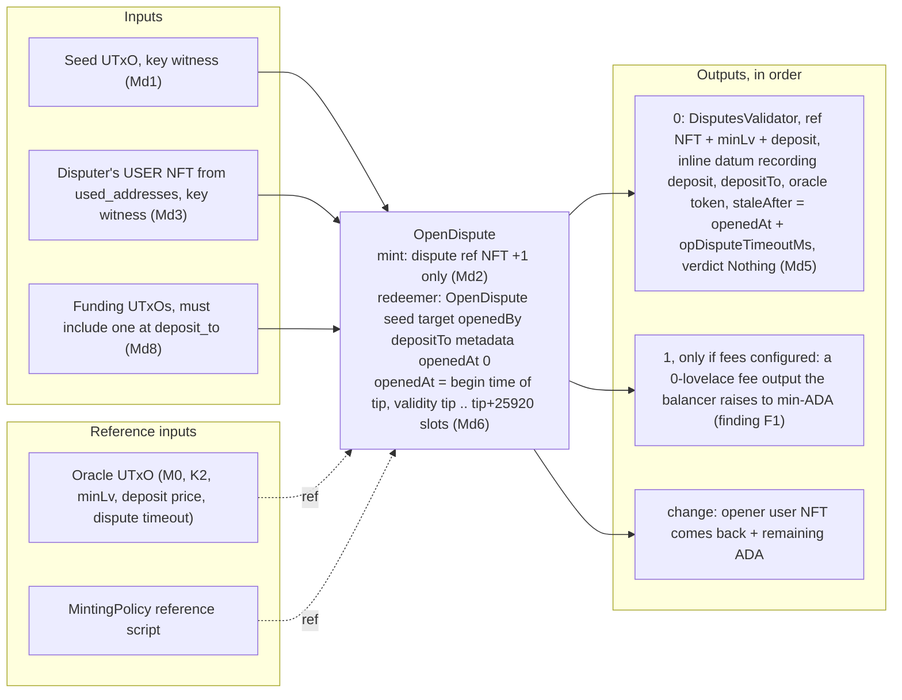

| Aspect | Value | Code |
|---|---|---|
| Pre-checks | target attestation exists (`AttestationNotFound`); no open dispute against it, by scanning the whole Disputes address (`DisputeAlreadyOpen`) | `Operations.hs:714-718`; `Lookups.hs:208-214` |
| Inputs | seed; opener user NFT; funding | `Operations.hs:733, 736` |
| Reference inputs | oracle; minting policy | `Operations.hs:720, 792` |
| Mint | dispute ref token +1, redeemer `OpenDispute seed target openedBy depositTo metadata openedAt 0` | `Operations.hs:745-758` |
| Outputs | 0: dispute state, `ref NFT + minLv + deposit`, datum records `disputeDeposit = opDisputeDeposit` **and** `disputeStaleAfter = openedAt + opDisputeTimeoutMs`, both read from the oracle **at open time**, plus `disputeOracleToken`; then the fee skeleton; change | `Operations.hs:760-795` |
| `deposit_to` | request field, default = `change_address` | `Interactions.hs:150-159` |
| Signatures | wallet keys | |
| Validity | `[tip, tip + 25920 slots]`; `openedAt = slotToBeginTime tip` | `Operations.hs:728-729` |
| Trace codes | `M0`, `K2`, `K1`, `Md1`, `Md2`, `Md3`, `Md4`, `Md8`, `Md5`, `Md6`, `Md7` | `MintingPolicy.hs:462-471` |
| Off-chain failures | `AttestationNotFound` 404; `DisputeAlreadyOpen` 400; `ProfileNotFound` 404; `ProtocolPaused` 503 | |

**The deadline is set here and nowhere else.** `disputeStaleAfter` is absolute, computed once from the
oracle's `opDisputeTimeoutMs`, so a later `set-dispute-timeout` cannot move an open dispute's deadline
in either direction (`MintingPolicy.hs:455-458`). One sharp edge the type records: `openedAt` is redeemer
data bounded only by `Md6`'s 14.4-hour window, so an opener can shift their own deadline by up to that
much — immaterial against a 30-day default, and not against one measured in hours (`Types.hs:110-113`).

**Finding F1 — the fee output.** `feeFor MintActionDispute = const 0` (`Lookup.hs:71`) and `checkFee` passes
without inspecting outputs when the fee is `≤ 0` (`Lookup.hs:89`). `getFeeSkeleton` (`Operations.hs:65-71`)
only distinguishes `Nothing`/`Just` and under `Just` calls `txMustPayValueToAddress gyFeeAddr (valueFromLovelace 0)`.
Atlas raises every declared output to the ledger minimum (the behaviour the validators' `geq` checks tolerate,
§1.2), so under a configured fee the dispute carries an unrequested ≈1 ADA output to `fcFeeAddress` that never
comes back; likewise for a profile or attestation whose own fee is `0` while the other is priced. No emulator
test mints under a configured fee (`UnitTests.Oracle` 0.3 sets and clears fees with no mint between;
`MutationGuards` 8.12–8.16 are validator-level). Fix: a zero short-circuit in `getFeeSkeleton` mirroring `Lookup.hs:89`.

**Finding F4 — `Md8` has no off-chain mirror.** `Md8` requires an input at `depositTo` (`MintingPolicy.hs:468`);
the builder never checks it. With one wallet address (smoke script, emulator) the seed comes from the change
address and `Md8` holds; with a multi-address wallet whose change address contributes no input, script
evaluation fails at build time and the route answers 400 `ScriptRefused` naming `Md8` (`OF-05`).
`Dispute` test 6.8 pins the on-chain half only. A second consequence of `Md8`'s breadth, found by the D-A
audit: it permits `deposit_to` to be the Disputes Validator's own address, which lets one output discharge
both `D2`'s floor and `D4` and destroys the deposit instead of returning it
(`DisputesValidator.hs:259-267`). The loser is the opener who named that address.

### 3.8 (f) ResolveDispute

**Purpose.** The oracle admin writes a **finding** — upheld or rejected — once, and the deposit goes
back either way to the address recorded in the datum. It cannot write `expired`: that is `Da`, and the
builder mirrors it with a 400 (`DisputeVerdictNotAFinding`, `Operations.hs:851-852`). The clock's exit
is §3.12.
**Built by** `resolveDisputeTX` (`Operations.hs:833-891`) via `POST /resolve-dispute` only
(`RestAPI.hs:158-163`). The route returns an **unsigned** transaction; the admin signs it
(`admin sign-tx`) because `D1` wants `opAdminPkh` in `txInfoSignatories`. There is no admin command.

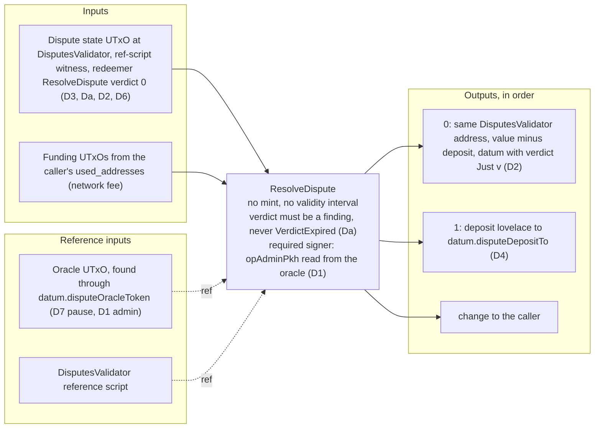

| Aspect | Value | Code |
|---|---|---|
| Pre-checks | `disputeVerdict` must be `Nothing` (`DisputeAlreadyResolved`); the verdict must not be `expired` (`DisputeVerdictNotAFinding`, the 400 mirroring `Da`) | `Operations.hs:846-852` |
| Inputs | dispute state UTxO via reference script, redeemer `ResolveDispute verdict 0`; funding from the request's wallet | `Operations.hs:864-865` |
| Reference inputs | oracle, read with `queryOracleParams` (no pause check); DisputesValidator reference script | `Operations.hs:854, 887` |
| Mint | none | |
| Outputs | 0: resolved dispute, `value − deposit`, datum from `resolveDispute verdict` (the same function the validator uses); 1: `deposit` to `disputeDepositTo`; change | `Operations.hs:874-882` |
| Signatures | `mustBeSignedBy opAdminPkh`; plus the caller's wallet keys for funding inputs | `Operations.hs:855, 890` |
| Validity | **none** (no `isInvalidBefore`/`isInvalidAfter`) | |
| Trace codes | `D0`, `D5`, `D7`, `D3`, `D1`, `Da`, `D2`, `D4`, `D6`, `K1`, `U1` | `DisputesValidator.hs:108-168, 231-269` |
| Off-chain failures | `DisputeNotFound` 404; `DisputeAlreadyResolved` 400; `DisputeVerdictNotAFinding` 400; `DatumParseError` 500; `OracleNotFound` 404; **not** `ProtocolPaused` (F3) | |

The deposit amount is the datum's `disputeDeposit`, never the oracle's current price
(`DisputesValidator.hs:224-228`; `Operations.hs:869`). `D6` allows one dispute per transaction; the builder builds one.
`D2`, `D4` and `D6` are not this arm's own rules: they are `disputeClosesWith`, shared verbatim with
`ExpireDispute` (`DisputesValidator.hs:217-269`), so the two closing paths cannot drift about what
happens to the record or where the deposit goes.

### 3.9 (g) OracleUpdate — the seven admin actions

**Purpose.** Spend the oracle UTxO and re-lock it with `applyOracleAdminAction action params`. **Built by**
`updateOracleTX` (`Operations.hs:966-1006`), admin CLI only: `AdminActionType`'s `FromJSON` always fails, so no HTTP route can carry one (`Actions.hs:394-399`).

Six until D-A added `OracleSetDisputeTimeout` at index 6.

| Aspect | Value | Code |
|---|---|---|
| Inputs | the oracle UTxO (datum already known from the query), reference-script witness, redeemer `OracleUpdate 0 action`; funding from the admin wallet | `Operations.hs:972-988` |
| Reference inputs | none | |
| Mint | none | |
| Outputs | 0: OracleValidator address, same value (balancer may add), inline datum `newParams`; change | `Operations.hs:988` |
| Signatures | `mustBeSignedBy opAdminPkh` (current admin); for `RotateAdminAction` also `mustBeSignedBy newAdmin` | `Operations.hs:990, 1000-1002` |
| Validity | none | |
| Trace codes | `O0`, `O4`, `O3`, `O1`, `O2`, `O5`, `O6`, `U1` | `OracleValidator.hs:72-94` |
| Off-chain failures | `OracleNotFound` 404 / `OracleDatumInvalid` 500; a non-admin cannot even submit (required signer missing) | `Oracle` test 0.6 |

| `AdminActionType` (CLI) | `OracleAdminAction` | Datum delta | Extra on-chain guard |
|---|---|---|---|
| `PauseProtocolAction` (`pause-protocol`) | `OraclePause` (0) | `opPaused = True` | — |
| `UnpauseProtocolAction` (`unpause-protocol`) | `OracleUnpause` (1) | `opPaused = False` | — |
| `SetFeesAction (Maybe FeeConfig)` (`set-fees --clear-fees` or `--fee-address --profile-fee --attestation-fee`) | `OracleSetFees` (2) | `opFeeConfig` | — |
| `SetMinUTxOValueAction n` (`set-min-utxo-value -n`) | `OracleSetMinUTxOValue` (3) | `opMinUTxOValue` | `O6`: must be ≥ 0 |
| `RotateAdminAction pkh` (`rotate-admin --new-admin`) | `OracleSetAdmin` (4) | `opAdminPkh` | `O5`: incoming key must also sign |
| `SetDisputeDepositAction n` (`set-dispute-deposit -n`) | `OracleSetDisputeDeposit` (5) | `opDisputeDeposit` (new disputes only) | `O6`: must be ≥ 0 |
| `SetDisputeTimeoutAction ms` (`set-dispute-timeout`) — **D-A** | `OracleSetDisputeTimeout` (6) | `opDisputeTimeoutMs` (new disputes only) | `O6`: must be ≥ 0, and zero is permitted — it makes every new dispute expirable on open |

`adminActionToOracleAdminAction` and `applyAdminAction` (`Operations.hs:1008-1026`) mirror
`applyOracleAdminAction` (`Types.hs:169-176`); `O2` compares the whole output datum, so they cannot drift silently.
`PropertyTests.oracleMirrorTests` asserts that mirror over a hand-written `allAdminActions` list that
was **not** extended for the seventh action, so it currently pins six of the seven
(`src/test/PropertyTests.hs:87,108-116`) — a test gap, not a protocol one.

**Finding F2 — `rotate-admin` cannot complete a real handover.** The CLI runs `runActionWithPK`, which builds,
signs with `[skey]` — the one key in `operation.prv` — and submits (`Transactions.hs:127-137`; `Main.hs:617`).
The body lists `newAdmin` as a required signer (`Operations.hs:1000-1002`), so for any key but the operator's own
the node rejects the transaction for a missing vkey witness before any script runs. The emulator needs
`adminRotateInteraction`, whose comment says exactly this about the single-key runner (`TestRuns.hs`,
`Oracle` tests 0.9, 0.11b), and the CLI has no build-only admin path to feed `admin sign-tx` from a second
checkout. Until it grows a second-witness step, rotation is an emulator-only flow.

**Dynamic consequence of every oracle update.** The oracle UTxO is a reference input of every user transaction;
an update spends it, so every user transaction built against the previous oracle `TxOutRef` and not yet
included fails phase-1 validation (reference input gone): rejected by the node, no collateral lost, rebuild
required. Expect in-flight user transactions to bounce around each update.

### 3.10 (h) Cleanup — dust sweep

**Purpose.** Anyone reclaims ADA parked at the three state validator addresses without touching protocol state.
**Built by** `cleanupDustTX` (`Operations.hs:1053-1067`) via `POST /build-tx` with `ProtocolAction CleanupDustAction`
(no dedicated service route; `Interactions.hs:169-172`) or `admin cleanup-dust` (`Main.hs:508`, dispatched at `:664`).

| Aspect | Value | Code |
|---|---|---|
| Discovery | for each of Profiles, Attestations, Disputes: every UTxO at the address whose value holds **no** token under the protocol policy | `Lookups.hs:148-156`; `Operations.hs:1035-1047` |
| Inputs | every such UTxO, spent through that validator's reference script with that validator's own `Cleanup` redeemer, inline datum passed if present (`Nothing` otherwise); funding/collateral from the caller | `Skeletons.hs:100-107`; `Operations.hs:1057-1062` |
| Reference inputs | the three validator reference scripts; **no oracle** | |
| Mint | none | |
| Outputs | **none declared** — the recovered ADA lands in the caller's change output | `Operations.hs:1067` |
| Signatures | caller's wallet keys | |
| Validity | none | |
| Trace codes | `P7` / `A4` / `D8` ("backed state, may not sweep"), `P1` / `A2` / `D5` purpose | `ProfilesValidator.hs:87-96`; `AttestationsValidator.hs:91-96`; `DisputesValidator.hs:99-107` |
| Off-chain failures | `NoDustFound` 404 | `Operations.hs:1065-1066` |

Not pausable, by design (`ProfilesValidator.hs:130-133`; `Pause` test 7.3). The OracleValidator has no
`Cleanup` arm: a datum-less UTxO parked at the oracle address hits `O3` and stays forever
(`OracleValidator.hs:72, 94`). **Finding F5 — CLOSED 2026-10-24, and it was two defects, not one.**

The off-chain selector used to be "any UTxO at this address with no token of our policy", which
disagreed with the arm in both directions. The direction this section used to describe was the benign
one: a UTxO holding a protocol token other than the NFT its datum names is sweepable on chain
(`Utils.hs:470-473`) and was never offered, so real dust accumulated. The direction it missed was the
dangerous one: a UTxO the validator REFUSES was offered. Since `cleanupDustTX` builds **one
all-or-nothing transaction**, a single such UTxO makes every sweep fail on `P7`/`A4`/`D8` — so for the
price of one min-ADA output carrying a token whose name starts with this address's CIP-67 label plus a
hand-written datum naming it, anybody can brick the protocol's only cleanup path permanently. The
redeemer is permissionless and deliberately not pause-gated, so there is no administrative recovery.

`getDustUTxOs` now takes the address's own label predicate, datum parser and id field and applies
`isUnbackedDatum`'s own test, so the selector and the arm agree by construction, and each call site
names the validator, its redeemer and its datum together. It deviates from the arm in exactly one
place, deliberately: a UTxO with a datum **hash** rather than an inline datum is skipped, because
`txMustSpendUTxOFromRefScript` witnesses with `Nothing` and the ledger refuses the transaction before
any validator runs — the same brick by a different door, and one an address scan cannot supply a
preimage for.

The comment at `TestRuns.hs:447-453` ("the validator must refuse, because its datum parses") predates
`isUnbackedDatum`; `Cleanup` test 3.5 asserts the opposite and is right, and test 3.8 now pins the
griefing case from both sides — the sweep skips the plant, and a hand-built sweep of it fails `D8`.

### 3.11 (i) CredentialClaim and CredentialWithdrawal — bind a credential, and end that binding

**Purpose.** Record a profile's binding to a Cardano credential, or record its end. **ADR 0003**: this
used to be a field on the profile datum set at mint by `Mp3` and cleared by a `RevokeCredential`
redeemer; both are gone, and a binding is now an append-only attestation that no redeemer can erase.
Registering a credentialled profile therefore costs **two transactions** — §3.3 then this one — and
that cost is stated and accepted in the ADR, which also notes that four of the six profile kinds
(Organization, Community, Vendor, Auditor) correspond to no on-chain credential and never need it.

On chain this is a `NewAttestation` mint like §3.5, so it runs the same codes; what distinguishes it is
`kind`, the `Maybe Credential` argument, and the four `Mc` rules. **Built by** `credentialAttestationTX`
(`Operations.hs:504-600`) — one builder for both kinds — via `POST /claim-credential` and
`POST /withdraw-credential` (`RestAPI.hs:170-180`, `ServiceHandlers.hs:104-120`), or `POST /build-tx`
with `ClaimCredentialAction` / `WithdrawCredentialAction` (`Interactions.hs:117-135`). No admin command.

| Aspect | `CredentialClaim` | `CredentialWithdrawal` | Code |
|---|---|---|---|
| Pre-checks | credential text parsed as CIP-129 before any chain query (`CredentialMalformed` 400); the profile must exist | same | `Conversions.hs:111-115`; `Operations.hs:528` |
| Inputs | seed, key witness; **the profile's user NFT** from `used_addresses`; the credential's proof; funding | seed; **no profile user NFT**; the credential's proof; funding | `Operations.hs:531, 535-539, 544-545` |
| Reference inputs | oracle; minting-policy reference script | same | `Operations.hs:523, 594` |
| Mint | attestation ref token +1, redeemer `NewAttestation seed metadata [] profileId profileId CredentialClaim recordedAt Nothing (Just credential) 0` — subject and issuer are the **same** profile id (`Mc1`), and the claimed period is always `Nothing` | same with `CredentialWithdrawal` | `Operations.hs:550-566` |
| Outputs | 0: the binding record at AttestationsValidator, `ref NFT + minLv`, `attestationCredential = Just credential`, `isAccepted = False`; 1 (optional): `fcAttestationFee` — it is a `MintActionAttestation` | same | `Operations.hs:568-598` |
| Signatures | wallet keys, plus the credential's key when it is a key credential | the credential's key only | `Operations.hs:531` |
| Validity | `[tip, tip + 25920 slots]`; `attestationDate = slotToBeginTime tip` (`Mq`) | same | `Operations.hs:541-542` |
| Trace codes | `M0`, `K2`, `K1`, `Mq`, `Mm`, `Mn`, `Mf`, `Mg`, `Mc1`, `Mc2`, `Mc3`, `Mc4`, `Mh`, `Mj`, `Mk` | the same list **minus `Mf`**, which the policy exempts for this kind | `MintingPolicy.hs:288-316` |
| Off-chain failures | `CredentialMalformed` 400; `ScriptCredentialHasNoUtxo` 400; `SubjectProfileNotFound` 404; `ProfileNotFound` 404 (user token not held); `ProtocolPaused` 503 | the same minus `ProfileNotFound` | |

**The two parties, and which rule speaks for each.** A claim needs both: `Mf` is the profile's consent
(its user NFT is spent) and `Mc3` is the credential's (it controls the transaction). A withdrawal needs
only `Mc3`, and that asymmetry is the whole point — "the case it exists for is a profile that claimed
somebody else's credential, and that profile's token is held by whoever did it. Requiring it would hand
the remedy to the only party that must not have it" (`MintingPolicy.hs:291-303`). The builder mirrors
this exactly: it spends the user NFT on a claim and returns `mempty` on a withdrawal
(`Operations.hs:535-539`).

**The proof is the old `Mp3` proof, unchanged.** `claimProofSkeleton` (`Operations.hs:241-257`) still
builds it and `checkCredentialControl` (`Utils.hs:326-334`) still checks it, with the same three
variants and the same documented limit — a script that holds no UTxO at its own address sends itself
one first:

| Credential | `witness` in the request | What the skeleton adds | On-chain proof (`Mc3`) |
|---|---|---|---|
| key (`PubKeyCredential`) | ignored | `mustBeSignedBy pkh` | `pkh ∈ txInfoSignatories` (`Utils.hs:329`) |
| script, `{"tag":"simple_script","script":…}` | native script | `mustHaveInput` of the first reference-script-free UTxO at that script's payment credential, witnessed by the native script | an input whose **payment** credential is the script (`Utils.hs:330-334`) |
| script, `{"tag":"plutus_script","script":"<cbor>","redeemer":…}` | PlutusV3 script + redeemer | same input, witnessed by the inlined script with the given redeemer and no datum | same |

A script credential with `witness` absent or `{"tag":"key"}` is refused as `ScriptCredentialHasNoUtxo`
(`Operations.hs:252-257`): the match only accepts the two script witnesses. The credential is now
**required**, not optional, so there is no "omitted" row any more — `Mc2` refuses a credential record
that names none.

**What is not checked, on either side.** That a claim is the first, that a withdrawal has a claim to
end, or that one credential is claimed by only one profile. The log is the record and the read layer
resolves it: the latest `CredentialClaim` for a subject with no later `CredentialWithdrawal` naming the
same credential (`docs/adr/0003-credential-claim-as-attestation.md:17-19`). A bogus claim is also
disputable through §3.7, which is one of the ADR's stated gains.

### 3.12 (j) ExpireDispute — the exit with no key

**Purpose.** Close an undecided dispute whose deadline has passed, recording `VerdictExpired` and
returning the deposit to the address the **opener** named. **D-A**, and the only write in this protocol
that needs no authority at all: a dispute used to have one exit and one key, so an admin who simply did
not act produced the same state as a lost key, and a pause on top of a lost key froze every open dispute
forever — with the cost falling on the **target**, who carried a permanent accusation with no on-chain
move available to anyone (`Types.hs:471-492`).
**Built by** `expireDisputeTX` (`Operations.hs:905-956`) via `POST /expire-dispute`
(`RestAPI.hs:164-168`, `ServiceHandlers.hs:96-102`) or `POST /build-tx` with `ExpireDisputeAction`
(`Interactions.hs:166-168`). No admin command — deliberately, since the admin is the party this exit
exists to work around.

| Aspect | Value | Code |
|---|---|---|
| Pre-checks | `disputeVerdict` must be `Nothing` (`DisputeAlreadyResolved` 400, mirroring `D3`); the deadline must have passed (`DisputeNotStaleYet` 400, mirroring `D9`) | `Operations.hs:915-924` |
| Inputs | dispute state UTxO via reference script, redeemer `ExpireDispute 0`; funding from the caller's wallet | `Operations.hs:931-933` |
| Reference inputs | **no oracle** — `ExpireDispute` reads none; DisputesValidator reference script only | `Operations.hs:950-956` |
| Mint | none | |
| Outputs | 0: expired dispute, `value − deposit`, datum from `resolveDispute VerdictExpired` (the same function the validator computes with); 1: `deposit` to `disputeDepositTo`; change | `Operations.hs:940-948` |
| Signatures | **none required** — only the caller's wallet keys for its own funding inputs | |
| Validity | `[tip, tip + 25920 slots]`, and here it **is** read: `D9` compares the whole range against `disputeStaleAfter` | `Operations.hs:953`; `Utils.hs:262-264` |
| Trace codes | `D0`, `D5`, `D3`, `D9`, `D2`, `D4`, `D6`, `U1` — **no `K1`, no `D7`, no `D1`** | `DisputesValidator.hs:185-199, 231-269` |
| Off-chain failures | `DisputeNotFound` 404; `DisputeAlreadyResolved` 400; `DisputeNotStaleYet` 400; `DatumParseError` 500 | |

**Why no pause and no signature.** "An escape hatch that the admin can gate — by pausing, or by simply
holding the only key — is not an escape hatch" (`DisputesValidator.hs:172-176`). What stops abuse is
that there is nothing to gain: `D4` pays the deposit to the opener's address, `D3` means a decided
dispute cannot be reopened, and `disputeStaleAfter` is in the dispute's own datum so no admin action can
move it. The cost is real and was the owner's call — a legitimate dispute awaiting a verdict can be
closed by anyone once the clock runs out, which is why the deployed default is 30 days.

**Why `checkDateHasPassed` and not `checkDateInRange`.** Containment asks the chain to agree a date is
inside a window and must cap that window's width, because a wide range is the attack. Here only the
lower bound is compared, so widening upwards is neutral and widening downwards fails — there is nothing
to cap. An open lower bound (`NegInf`) is not contained, so a transaction that declines to say when it
is valid fails closed (`Utils.hs:246-264`). The builder's own guard uses `<=` for the same reason: the
range it builds starts at `now`, so a transaction built exactly at the deadline is valid
(`Operations.hs:920-924`).

## 4. Lifecycles

Transitions are redeemers, parenthesised codes are guards. No entity is ever removed: nothing burns or
deletes, and `Cleanup` refuses any UTxO that backs its own datum. A dispute does reach a **terminal
state** — three of them, since D-A — meaning no further redeemer can change its datum; its UTxO stays
where it is.

### 4.1 Profile

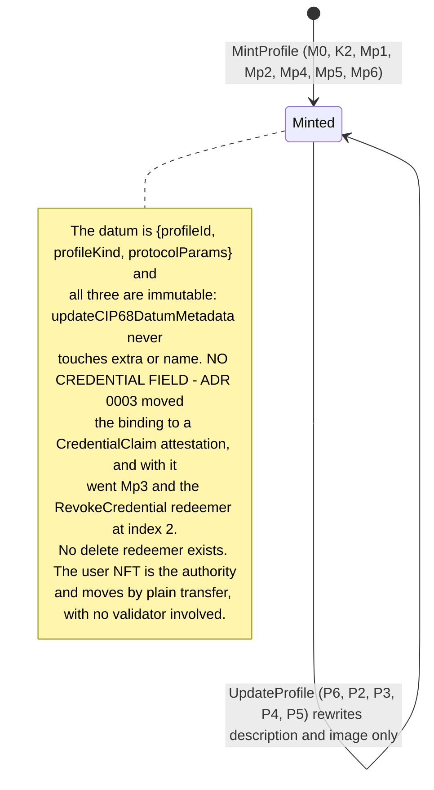

The user token is minted once (`Mp2`), must not sit beside the state (`Mp6`), and is all that `P3`, `Mf`, `A5`
and `Md3` ask for: its holder *is* the profile for every write. It is not bound to any credential, and
since ADR 0003 the profile mint does not name one (`MintingPolicy.hs:358-378`).

### 4.2 Attestation

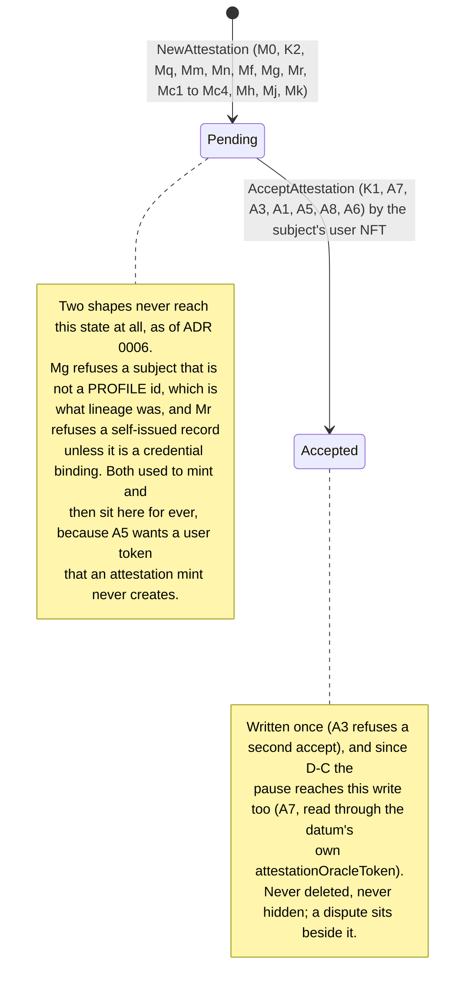

The two credential kinds ADR 0003 added travel this same path. `Mc1` makes them self-issued, so the
subject is a profile and the profile's own user token satisfies `A5` — a binding record is acceptable
like any other, and `isAccepted` on one means the profile endorsed the record, not that the credential
did. A `CredentialWithdrawal` minted by a credential against an unwilling profile stays `Pending`
unless that profile chooses to accept it.

### 4.3 Dispute

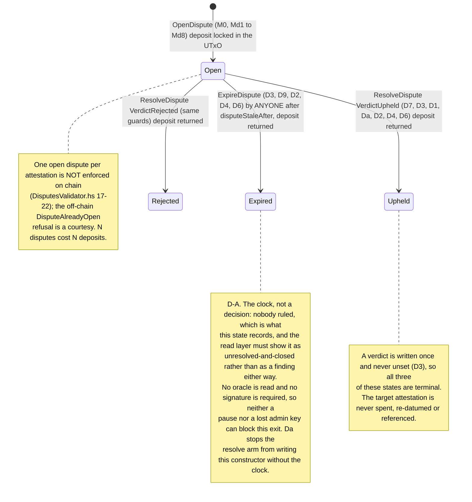

The deposit comes back on **all three** outcomes — there is no punitive verdict, because a registry that
charged for contesting a false claim would discourage contesting one (`DisputesValidator.hs:245-250`).

### 4.4 Oracle

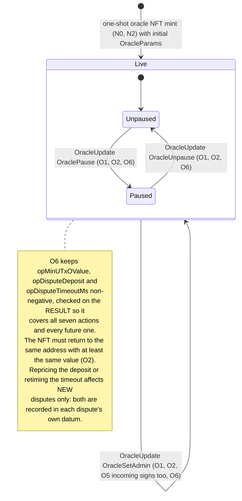

## 5. End-to-end journeys

Asynchronous boundaries are marked. `attest-sync` feeds the read surface by polling Kupo, so a projection appears
some time after confirmation and clients poll for it; neither service reports `attest-sync`'s lag
(`docs/deployment/attest-flow-smoke.md`). Bodies carry `user_addresses = {usedAddresses, changeAddress,
reservedCollateral?}` (camelCase inside, snake_case around: `scripts/smoke_attest_flow.sh:191-196`) and
addresses as **raw CBOR hex**, not bech32.

### 5.1 A DRep claims a profile and an organisation attests it

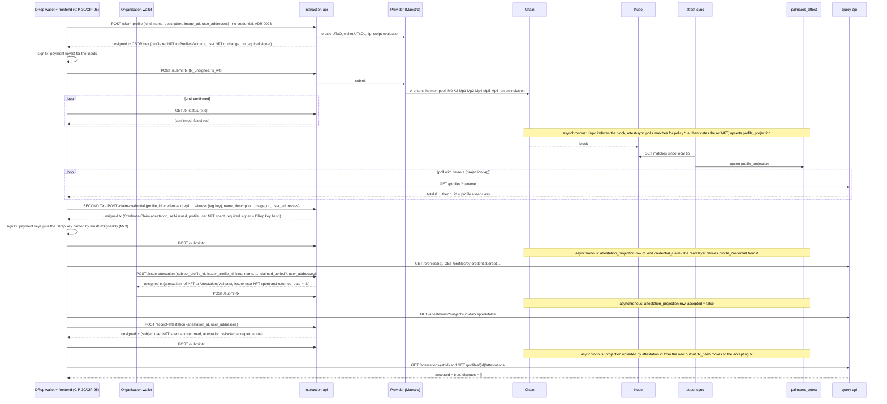

`scripts/smoke_attest_flow.sh` drives this sequence with `admin sign-tx` as the wallet signer. A
credentialled profile is now **two** transactions, which is ADR 0003's stated cost: the profile mint
claims nothing, and the binding is a second call to `/claim-credential`. For a key-credential claim the
wallet signs that second transaction with the DRep (or committee) key, which CIP-95 exposes beside the
payment keys; a script credential is proven by spending (§3.11) and needs no extra signature. The DRep
id to use is what `admin operator-address` now prints first (§2).

### 5.2 A dispute from open to verdict

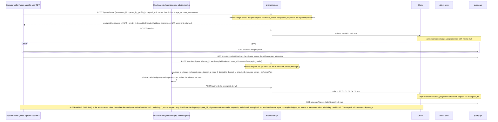

If the protocol is paused, the route still builds, `D7` trips during script evaluation and the route answers `400 ScriptRefused` naming `D7` (§8, `OF-05`): unpause first. `/expire-dispute` is the one dispute route a pause cannot reach.

### 5.3 Operator pauses, reprices the deposit, rotates the admin

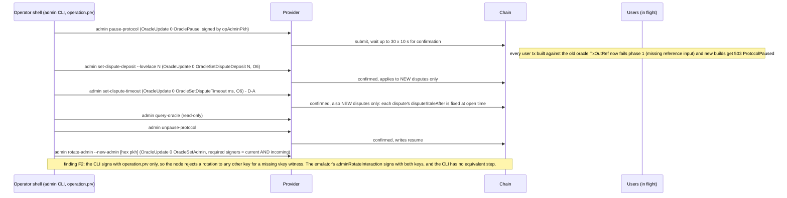

Each admin command builds, signs and submits in one step and blocks until confirmed (`Transactions.hs:72-80,
127-137`). While paused, `/status` reports `oracle_paused: true` (`ServiceStatus.hs:53-67, 93`) and every
mint/update route answers 503.

## 6. Economic model

| Transaction | Network fee paid by | Protocol fee (`feeFor`, only if `opFeeConfig` is `Just`) | Locked in the new/continuing state UTxO | Returned later | Collateral |
|---|---|---|---|---|---|
| Oracle NFT mint | operator | — | NFT + 3.5 ADA (`Transactions.hs:236`) | never | operator |
| Reference script (×5) | operator | — | min-ADA per script output, at the operator's key address | only if the operator spends them (which breaks the protocol) | operator |
| MintProfile | claimant | `fcProfileCreationFee` | ref NFT + `minLv` (+ balancer bump) | never | claimant |
| UpdateProfile | holder | — | unchanged (≥ spent) | — | holder |
| NewAttestation | issuer | `fcAttestationFee` | ref NFT + `minLv` | never | issuer |
| CredentialClaim / CredentialWithdrawal | the profile (claim) or the credential's holder (withdrawal) | `fcAttestationFee` — it is a `MintActionAttestation` | ref NFT + `minLv` **per record**, so a claim and a later withdrawal each lock their own | never | the builder's wallet |
| AcceptAttestation | subject | — | unchanged (≥ spent) | — | subject |
| OpenDispute | disputer | `0` by design (`Lookup.hs:62-71`); see F1 for what the builder adds anyway | ref NFT + `minLv` + `deposit` | the `deposit` when the dispute closes, to `disputeDepositTo` | disputer |
| ResolveDispute | the wallet in the request body (the admin signs; it need not fund) | — | ref NFT + `minLv` stays | — | that wallet |
| ExpireDispute | whoever builds it — a stranger pays the network fee and keeps nothing | — | ref NFT + `minLv` stays | — | that wallet |
| OracleUpdate | admin | — | unchanged (≥ spent) | — | admin |
| Cleanup | caller | — | — (dust ADA flows to the caller's change) | — | caller |

Fees go to `fcFeeAddress` as an ordinary output and are not recoverable. `minLv` is read from the oracle at
build time (`Operations.hs:286, 387, 524, 722`), so repricing `opMinUTxOValue` changes the floor for new records only;
continuing outputs keep what they hold (`P5`, `A1`, `D2` compare against the spent value, not the oracle).
ADR 0003's price, in this column: a credentialled profile now locks min-ADA twice — once for the profile
and once for the claim record — and a withdrawal locks a third. That is the cost of a log nothing rewrites.

**Value locked for the life of the chain** (`Utils.hs:114-119`):

| Entity | Permanently locked | Why it cannot come back |
|---|---|---|
| Profile state | reference NFT + ≥ `opMinUTxOValue` at mint time | no burn redeemer; `Cleanup` refuses a backed datum (`P7`) |
| Attestation state | reference NFT + ≥ `opMinUTxOValue` | same (`A4`); accepted or pending alike, credential records included |
| Dispute state (after closing) | reference NFT + ≥ `opMinUTxOValue` | same (`D8`); only the deposit leaves (`D4`) |
| Dispute state (open) | the above + `disputeDeposit` | posted collateral, returned on any of the three outcomes |
| Oracle | NFT + 3.5 ADA | `O2` requires re-locking at least the same value at the same address |
| User tokens | nothing | they live in wallets; a lost user token is a profile nobody can act for |

Network fees scale with datum size; `otherMetadata` is capped at 16 entries of 64/256 bytes (`CIP68.hs:129-139`)
because the **subject** must re-lock the whole attestation to accept it (`CIP68.hs:115-119`).

## 7. Time model

| Stored date | Builder sets it to | Chain check | Code |
|---|---|---|---|
| `attestationDate` | begin time of the tip slot read at build time | `Mq`: contained in the validity interval, interval finite and ≤ `maxDateWindow` | `Operations.hs:401-402, 541-542`; `MintingPolicy.hs:288`; `Utils.hs:239-244` |
| `disputeOpenedAt` | same | `Md6`, same rule | `Operations.hs:728-729`; `MintingPolicy.hs:470` |
| `disputeStaleAfter` | not set by the builder at all — the **policy** computes `openedAt + opDisputeTimeoutMs` from the oracle it is already reading, and `Md5` compares the whole datum | at open: none of its own, since it is derived. At close: `D9` requires the expiring transaction's **whole validity range** to be at or after it — `checkDateHasPassed`, no width cap | `MintingPolicy.hs:455-458`; `DisputesValidator.hs:198`; `Utils.hs:246-264` |
| `attestationPeriod` (`claimed_period`) | whatever the issuer sent; always `Nothing` on a credential record | **none**, deliberately; only `from ≤ to` off chain | `Types.hs:394-414`; `Operations.hs:355-357, 409-410, 560` |

**The validity window.** Every user-side builder attaches `[tip, tip + 25920 slots]` (`Skeletons.hs:46-56`); at
one second per slot (preprod, mainnet) the width is 25 920 000 ms = 7.2 h. `checkDateInRange` requires both
bounds finite, `hi − lo ≤ maxDateWindow = 51 840 000 ms` (14.4 h, exactly twice the honest width), and
`date ∈ range` (`Utils.hs:235-244`). The stored date is the interval's lower bound, so an honest record is dated
at or before its block by at most 7.2 h. `ResolveDispute`, `OracleUpdate`, `Cleanup` and the deployment
transactions carry no validity interval; no validator reads a date from them. `ExpireDispute` is the one
spending path that does carry one and does have it read (`D9`), and `expireDisputeTX` attaches the same
`txIsValidForSafeEra tip` window the mint paths use (`Operations.hs:953`).

**Practical deviation.** A hand-built transaction may choose any finite interval of width ≤ 14.4 h containing
its inclusion slot, so a stored date can sit up to 14.4 h either side of block time and no validator can tell
(`Utils.hs:212-227`). The read layer can narrow that by comparing the date with the projected slot
(`Utils.hs:232-234`); projections store chain time from the slot, never wall clock
(`src/lib/offchain-lib/CLAUDE.md`, "Time"). A wallet that widens the validity interval past 14.4 h makes an
honest issuance fail `Mq`/`Md6` — but **not** `D9`, which caps no width because widening cannot make it
easier to satisfy.

**The 14.4 h window reaches a dispute's deadline too.** `disputeStaleAfter` is `openedAt + timeout`, and
`openedAt` is redeemer data bounded only by `Md6`, so an opener can shift their own deadline by up to
`maxDateWindow`. Immaterial against the 30-day default; it matters if a timeout measured in hours is ever
configured (`Types.hs:110-113`).

**Self-reported means self-reported.** `claimed_period` is shown beside `issued_at` as a claim, never sorted or
filtered as a fact; the only guarantee is the subject's counter-signature on the record (`Types.hs:401-413`).

## 8. Pause model

`opPaused` is a write lever: off chain `getOracleRefInputSkeleton` checks it (`Operations.hs:48-52`), on chain exactly **four** codes do — `M0`, `P6`, `D7` and, since D-C, `A7`.

| Action | Off-chain guard (`ProtocolPaused`, HTTP 503) | On-chain gate | Behaviour while paused |
|---|---|---|---|
| MintProfile | yes (`Operations.hs:284`) | `M0` | refused at build; a hand-built tx fails `M0` |
| NewAttestation | yes (`386`) | `M0` | same |
| CredentialClaim / CredentialWithdrawal | yes (`523`) | `M0` | same — they are `NewAttestation` mints |
| OpenDispute | yes (`720`) | `M0` | same |
| UpdateProfile | yes (`169`) | `P6` | same (`Pause` test 7.1 reaches `P6` with the guard removed) |
| AcceptAttestation | yes (`618`) | `A7` **(F6 closed by D-C)** | refused at build, and a hand-built acceptance now fails too — as `A7` if it supplies the oracle, as `K1` if it omits it. The attestation datum carries `attestationOracleToken`, so the validator can find the oracle without a parameter |
| ResolveDispute | **no** (`854` calls `queryOracleParams` directly; comment `823-828`) (F3) | `D7` | the route builds; script evaluation during balancing fails on `D7`; `runWithTxErrorHandling` maps the resulting `GYBuildTxException` to **400 `InsufficientFunds`** with the message "Not enough ADA in your wallet…" (`InteractionAppMonad.hs:93, 100-109`) — wrong code, wrong text. `Pause` test 7.2 pins the on-chain refusal only. |
| ExpireDispute | **no**, and correctly so | **none, by design** | runs. The arm reads no oracle at all, because an escape hatch the admin can gate by pausing is not one (`DisputesValidator.hs:172-176`) |
| Cleanup | no | none (deliberate, `ProfilesValidator.hs:130-133`) | runs (`Pause` test 7.3) |
| OracleUpdate | no | none (so the admin can unpause) | runs |

What a pause now stops, stated as the lever's actual scope: every mint, every profile metadata rewrite,
every acceptance and every dispute **resolution**. What it does not stop: dust sweeps, oracle updates
(including the unpause) and dispute **expiry**. The last of those is the only one that writes protocol
state while paused, and it is the one write no key can authorise either.

`/status.oracle_paused` goes through the same `getOracleRefInputSkeleton` and is `null` when the oracle cannot be read (`ServiceStatus.hs:63-65, 93`).

## 9. Failure catalogue

HTTP statuses from `txBuildingExceptionToHttpStatus` (`Exceptions.hs:153-168`); bodies are
`{"code": <constructor>, "message": …}` (`InteractionAppMonad.hs:70-72`). The last column names the on-chain
code that would refuse the same mistake in a hand-built transaction, or says that nothing would.

| Constructor | Raised by | HTTP | If bypassed, caught on chain by |
|---|---|---|---|
| `ProfileNotFound` | user token not in `used_addresses` (`Skeletons.hs:128`); profile state UTxO missing (`Lookups.hs:90`) | 404 | `Mf` / `P3` / `A5` / `Md3` — the token is not yours to spend |
| `WrongProfileType` | `getOrganizationInformation` (`Lookups.hs:114`), not on a tx path | 400 | — |
| `AttestationNotFound` | `getAttestationDatumAndValue` (`Lookups.hs:167`) on accept and on open-dispute target lookup | 404 | accept: ledger (missing input); open-dispute: `Md4` now requires the target to carry the ATTESTATION label (ADR 0006), so a profile or a dispute is refused — but a deposit can still be locked against an attestation id nobody minted |
| `AttestationAlreadyAccepted` | `Operations.hs:635-636` | 400 | `A3` |
| `AttestationOtherMetadataReservedKeys` | `Operations.hs:377-382` | 400 | `Mn` (`CIP68.hs:183-185`) |
| `AttestationPeriodInverted` | `Operations.hs:409-410` | 400 | nothing, by design |
| `SubjectProfileNotFound` | `Lookups.hs:182-184` | 404 | nothing — a permanently pending, unremovable record |
| `CredentialMalformed` | `Conversions.hs:111-115` via `Interactions.hs:119,128`; `Operations.hs:250` | 400 | n/a (the redeemer carries a `Credential`; `Mc3` checks whatever is encoded) |
| `ScriptCredentialHasNoUtxo` | `Operations.hs:257` | 400 | `Mc3` |
| `DisputeNotFound` | `Lookups.hs:195` | 404 | ledger (missing input) |
| `DisputeAlreadyOpen` | `Operations.hs:717-718` | 400 | nothing — not a protocol rule |
| `DisputeAlreadyResolved` | `Operations.hs:846-847` (resolve), `:915-916` (expire) | 400 | `D3`, on either closing arm |
| `DisputeVerdictNotAFinding` | `Operations.hs:851-852` | 400 | `Da` — a resolution may not name `expired` |
| `DisputeNotStaleYet` | `Operations.hs:923-924` | 400 | `D9` — the deadline has not passed |
| `OracleNotFound` | `Lookups.hs:131, 137` | 404 | `K1` (no reference input carries the oracle token) |
| `OracleDatumInvalid` | `Lookups.hs:136` | 500 | `K1` on read, `O0` on spend |
| `ProtocolPaused` | `Operations.hs:50-51` | 503 | `M0` / `P6` / `D7` / `A7` — including accept, since D-C. Nothing for `ExpireDispute`, deliberately |
| *missing:* a refusal of `kind = credential_claim`/`credential_withdrawal` on `/issue-attestation` | — | — | `Mc2` refuses it on chain, surfacing as `400 InsufficientFunds` (**F9**) |
| *dead:* `ProfileClaimsNoCredential` | nothing — it has no call site (`Exceptions.hs:79,131`) | 400 | n/a. It belonged to the D-E `RevokeCredential` path and its message still mentions `@P8@`, a trace code that no longer exists |
| `DeployedScriptsNotReady` | `Operations.hs:146-148`, from the `/ready` probe only (`InteractionAppMonad.hs:141`) | 503 | ledger (reference script missing) |
| `InvalidAssetClass` | `Skeletons.hs:35`; `Lookups.hs:50`; `TxBuilding/Utils.hs:168` | 400 | `Mg` / `Md4` |
| `NFTNotFound` | `Lookups.hs:52` (state spend lookups, `Skeletons.hs:78, 111`) | 404 | ledger / `P2`, `A6`, `D2` |
| `MultipleUtxosFound` | `Lookups.hs:45, 69` | 400 | n/a |
| `DatumParseError` | `Lookups.hs:85`; `TxBuilding/Utils.hs:164` | 500 | `P0` / `A0` / `D0` |
| `NoDustFound` | `Operations.hs:1065-1066` | 404 | n/a |
| a script-evaluation failure during balancing | a validator refused the transaction | 400 `ScriptRefused` | **named in the message** — the trace codes, read out of the rendered Plutus failure (`OF-05`) |
| Atlas `GYQueryUTxOException`, `GYBuildTxBalancingError`, `GYBuildTxCollateralShortFall`, `GYNoSuitableCollateralException` | empty wallet, cannot balance, no collateral | 400 `InsufficientFunds` | — |
| Atlas `GYBuildTxExUnitsTooBig` / `GYBuildTxSizeTooBig` | the transaction exceeds a protocol ceiling | 400 `TxTooExpensive` / `TxTooLarge` | — (adding ADA does not help, which is what the old answer implied) |
| a provider failure or a rejected submission (`SubmitTxException`, an HTTP failure) | upstream of this service | 502 `ProviderError` | — (used to escape to Warp's text/plain 500) |
| any other exception | — | 500 `InternalError`, with a `code` in the body | — |
| `AdminActionType` in a body | `Actions.hs:394-399` (`FromJSON` always fails) | 400 (body parse) | `O1` — the admin must sign anyway |

## 10. How to keep this document true

The flows above are pinned by the emulator runners in `src/test/TestRuns.hs`, which drive the **production**
`interactionToTxSkeleton` path, plus the "malicious" builders that reach on-chain codes the production path cannot:

| Runner / builder | Pins |
|---|---|
| `deployValidators`, `mintTestOracleNFT` | §2 (order, initial params including `opDisputeTimeoutMs`, one-shot mint) |
| `profileInteraction` | §3.3–§3.6 and §3.11 through the real pipeline (it takes a `ProfileActionType`, so the two credential actions travel it) |
| `disputeInteraction` | §3.7, §3.8. It takes a `DisputeActionType`, so `ExpireDisputeAction` would travel it too, but **nothing calls it with one**: §3.12 is pinned at validator level only (`UnitTests.DisputeRules`, the `D9` boundary cases), never through `interactionToTxSkeleton` |
| `protocolInteraction` | §3.10 |
| `adminInteraction`, `adminRotateInteraction` | §3.9 (the second one is the two-key rotation, F2) |
| `malicious*` | `N2`, `O1`, `Mp2`, `Mq`, `Mf`, `Mc1`–`Mc4`, `A3`, `A7`, `P6`, `P7/A4/D8`, `D1/D3`, `D6`, `D9`, `Da` — **not `Mp3`**, which no longer exists |

Line numbers are omitted from this table on purpose: `TestRuns.hs` moved by ~150 lines between
`4eb9117` and `2bf5bde` and the names are the stable handles.

Test suites, by section of this document:

- §2, §3.9: `UnitTests.Oracle` 0.1–0.13 (deployment, admin actions, `O1`, `O2`, `O5`, `N2`);
  `UnitTests.OracleRules` (`applyOracleAdminAction`, indices); `UnitTests.DisputeRules` oracle-output rules.
  `PropertyTests.oracleMirrorTests` covers six of the seven admin actions — `SetDisputeTimeoutAction` is
  missing from its hand-written `allAdminActions`.
- §3.3, §3.11: `UnitTests.Profile` (the profile mint, now credential-free, and the four `Mc` rules each
  isolated by one changed input); `UnitTests.Claim` (`checkCredentialControl`, the rule that is `Mc3` now);
  `UnitTests.WritePath` (CIP-129 parsing, script-with-no-UTxO).
- §3.5–§3.6: `UnitTests.Attestation` 5.1–5.14 (issue, accept, `A3`, `Mq`, `Mf`, lineage refused 5.11, self-issue refused 5.11b, `Mn`);
  `UnitTests.MutationGuards` (`A1`, `A5`, `A6`, `A7`, seeds, `K1`); `UnitTests.MintInputs`.
- §3.7–§3.8, §3.12: `UnitTests.Dispute` 6.1–6.10 (`D1`, `D3`, `Md8`, `Md4`, `D6`); `UnitTests.DisputeRules`
  (`D2`, `D4`, `D9`, `Da`, `Md2`, `Md3`, `Md6`); `UnitTests.Satisfaction`; `UnitTests.MutationGuards`.
- §3.10: `UnitTests.Cleanup` 3.1–3.7. §6: `UnitTests.Fees`; `UnitTests.MutationGuards` 8.12–8.16 (`K2`).
- §7: `UnitTests.OracleRules` `checkDateInRange` cases; `UnitTests.Attestation` 5.12; `UnitTests.DisputeRules` `Md6`, `D9`.
- §8: `UnitTests.Pause` (7.1–7.3 plus the `A7` cases D-C added); `UnitTests.MutationGuards` 8.1;
  `UnitTests.Attestation` `pauseStopsEverything`.
- §5: `UnitTests.InteractionApi` (typed routes, admin refusal, `/status`); `UnitTests.SignTx`;
  `UnitTests.Projections`, `UnitTests.ChainSyncReplay` (projection authentication, rollback replay); live:
  `scripts/smoke_attest_flow.sh` (F1 check 11).

Gaps that would let this document drift unnoticed, as of this revision: no emulator mint under a configured
`FeeConfig` (F1); no test of `admin rotate-admin` as the CLI runs it (F2); no test of `resolveDisputeTX` while
paused through the HTTP error mapping (F3); no multi-address-wallet test for `Md8` (F4). **Four of
these gaps are now closed:** `/issue-attestation`'s credential-kind refusal is pinned by
`publishedErrorTable` row 16 and by an emulator case (F9); `SetDisputeTimeoutAction` is covered, and
the exhaustiveness of that list is now structural rather than asserted in prose, derived from the
type's `Generic` representation — which is how a THIRD incomplete list was found, `profileArms` at 4
of 6 constructors, missing both ADR 0003 credential actions; `ExpireDisputeAction` now runs through
the production pipeline in three emulator cases, including a stranger closing a stale dispute and
both of `expireDisputeTX`'s own 400s; and the stale comment at `TestRuns.hs:447-453` is corrected
along with the `Cleanup` codes it named wrong (test 3.5 itself was always right).

Rules of thumb: a new `mustHaveOutput` before an indexed output moves every redeemer index after it; a new date
in a datum needs `checkDateInRange` on chain and a tip-derived value off chain, unless it is a *deadline*, in
which case it is `checkDateHasPassed` and is derived on chain rather than sent; a new write redeemer needs a
pause gate on chain **and** `getOracleRefInputSkeleton` off chain, and if it is deliberately ungated the
reason belongs at the site (`ExpireDispute` is the only one); a new redeemer argument that only some
constructors may carry needs both halves of the rule, the one that requires it and the one that forbids it
(`Mc2` and `Mc4`); any new spend of the oracle UTxO invalidates in-flight user transactions (§3.9).
