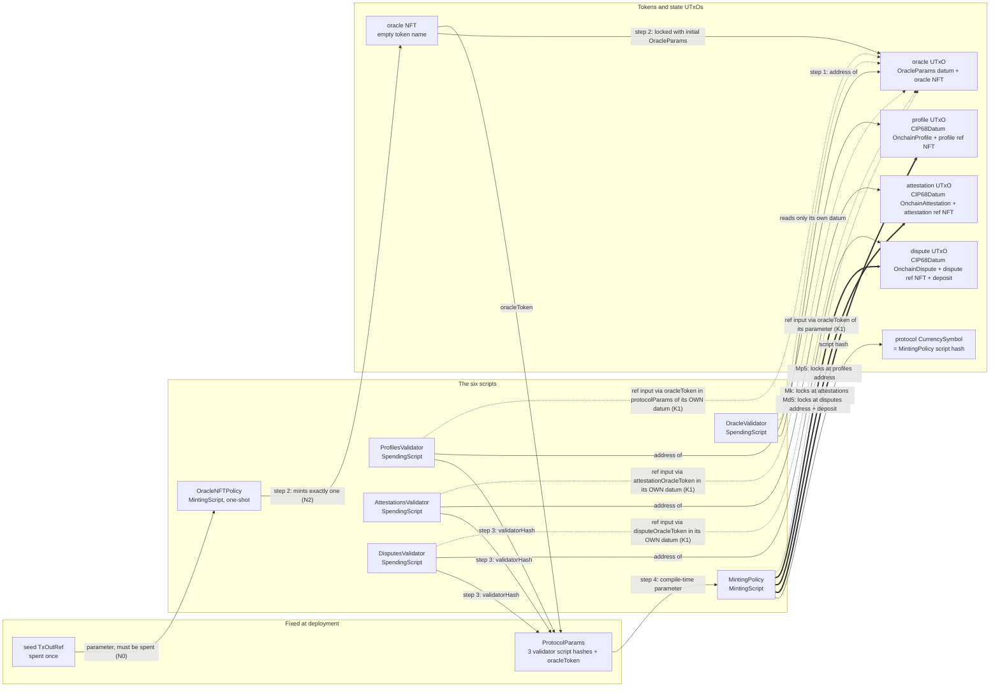
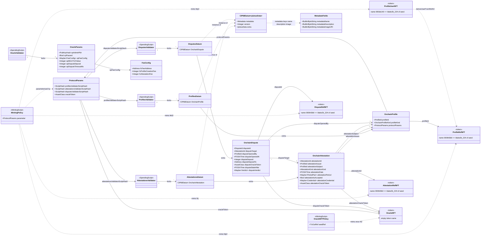
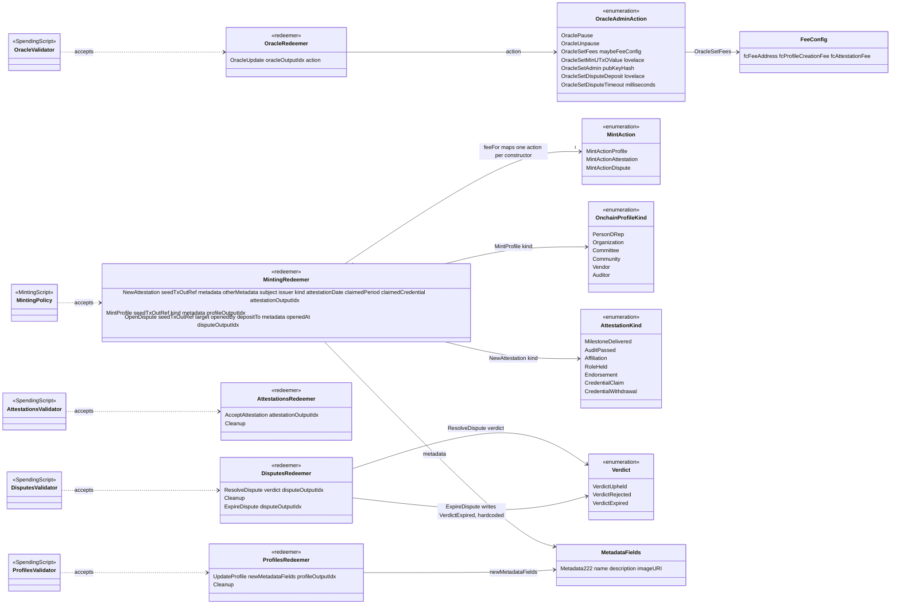

# Palmares on-chain protocol reference

The structural view of the Palmares attestation protocol as deployed on chain: the six scripts, what
each one is parameterised by, the state it locks (datums), the actions it accepts (redeemers), and the
tokens that tie the scripts together. Written against commit `2bf5bde` on `main` (2026-10-23); every
rule below is cited to a source line and should be re-verified against the code when that commit moves.

## 1. Purpose and reading guide

| Document | What it answers |
|---|---|
| **This file** | What exists on chain and how the pieces relate — the static picture. Types, fields, constructor indices, trace codes, token derivations, authorisation, and the rules each validator does and does not enforce. |
| `onchain-flows.md` | How a transaction is assembled for each action and how a profile, attestation, dispute and the oracle move through their lifecycles. Not repeated here. |
| `docs/audit/` | Audit findings against the protocol. This document describes the code as it is; it does not grade it. |
| `docs/generated/` | The CIP-57 blueprint rendered by `admin write-blueprint` from `Palmares.Onchain.Blueprint` (`src/lib/onchain-lib/Palmares/Onchain/Blueprint.hs:3-4`). The machine-readable form of sections 4 and 5. |

Source map (all paths under `src/lib/onchain-lib/Palmares/Onchain/` unless stated):

| Module | Holds |
|---|---|
| `Protocol/Types.hs` | `ProtocolParams`, `FeeConfig`, `OracleParams`, `OracleAdminAction`, `MintAction`, `OnchainProfileKind`, `OnchainProfile`, `AttestationKind`, `OnchainAttestation`, `Verdict`, `OnchainDispute`, plus the pure state transitions `applyOracleAdminAction`, `resolveDispute`, `oracleParamsAreWellFormed`, `checkNoOpenDispute` |
| `Protocol/Lookup.hs` | `readOracleParams` (`K1`), `feeFor`, `checkFee` (`K2`) — and nothing else since `3654f57` deleted the three uncalled profile lookups and with them trace code `K3` (`Lookup.hs:5-10`) |
| `CIP68.hs` | `CIP68Datum`, `MetadataFields`, metadata size limits, CIP-67 prefixes and ref/user derivations, the three PER-KIND labels and the typed `isProfileId`/`isAttestationId`/`isDisputeId` (ADR 0006) |
| `Utils.hs` | `mkUntypedLambda` (`U0`), `nameFromTxOutRef`, output-index checks, `isUnbackedDatum`, `checkCredentialControl`, `checkDateInRange`/`checkDateHasPassed`/`maxDateWindow`, `spentExactlyOnceFromAddress` |
| `Validators/*.hs` | One module per script (section 7) |
| `Blueprint.hs` | CIP-57 document; declares the minting policy by parameter and omits `OracleNFTPolicy` (`Blueprint.hs:384-386`) |
| `src/lib/offchain-lib/Palmares/TxBuilding/Validators.hs`, `Context.hs` | Compilation, hashes, `mkProtocolParams`, script sizes; `DeployedScriptsContext` — what is deployed as a reference script |

Conventions: trace codes are quoted as they appear in the source; "not enforced on chain" bullets
reproduce the reason the code itself gives; `path:line` cites the line a statement was read from.

## 2. The six scripts at a glance

| Script | Module | Purpose | Parameterised by | Datum it locks | Redeemer | Deployed as | Size (bytes) |
|---|---|---|---|---|---|---|---|
| MintingPolicy | `Validators/MintingPolicy.hs` | `MintingScript` (`MintingPolicy.hs:175`) | `ProtocolParams` = `{profilesValidatorScriptHash, attestationsValidatorScriptHash, disputesValidatorScriptHash, oracleToken}`, applied with `unsafeApplyCode`/`liftCode plcVersion110` (`MintingPolicy.hs:486-487`, `Types.hs:24-38`) | none (mints only) | `MintingRedeemer` | reference script, `mintingPolicyHashAndRef` (`Context.hs:24`), used via `GYMintReference` (`Skeletons.hs:152`) | 12618 |
| OracleNFTPolicy | `Validators/OracleNFTPolicy.hs` | `MintingScript` (`OracleNFTPolicy.hs:36`), one-shot | seed `TxOutRef` (`OracleNFTPolicy.hs:33,57-60`) | none | ignored — pattern `_` (`OracleNFTPolicy.hs:34`); off-chain passes `()` (`Transactions.hs:237`) | **inlined** in the oracle-mint tx via `GYMintScript` (`Transactions.hs:236`); not in `DeployedScriptsContext` | not pinned |
| ProfilesValidator | `Validators/ProfilesValidator.hs` | `SpendingScript` (`ProfilesValidator.hs:83`) | unparameterised | `ProfilesDatum = CIP68Datum OnchainProfile` (`ProfilesValidator.hs:70`) | `ProfilesRedeemer` | reference script, `profilesValidatorHashAndRef` (`Context.hs:25`), spent via `GYInReference` (`Skeletons.hs:84,94,106`) | 8355 |
| AttestationsValidator | `Validators/AttestationsValidator.hs` | `SpendingScript` (`AttestationsValidator.hs:85`) | unparameterised | `AttestationsDatum = CIP68Datum OnchainAttestation` (`AttestationsValidator.hs:76`) | `AttestationsRedeemer` | reference script, `attestationsValidatorHashAndRef` (`Context.hs:26`) | 8293 |
| DisputesValidator | `Validators/DisputesValidator.hs` | `SpendingScript` (`DisputesValidator.hs:90`) | unparameterised | `DisputesDatum = CIP68Datum OnchainDispute` (`DisputesValidator.hs:81`) | `DisputesRedeemer` | reference script, `disputesValidatorHashAndRef` (`Context.hs:27`) | 9439 |
| OracleValidator | `Validators/OracleValidator.hs` | `SpendingScript` (`OracleValidator.hs:72`) | unparameterised | `OracleParams` (bare, not CIP-68) | `OracleRedeemer` | reference script, `oracleValidatorHashAndRef` (`Context.hs:28`), spent via `txMustSpendFromRefScriptWithKnownDatum ovRef` (`Operations.hs:984`) | 7688 |

Size caveats, from `ScriptSize.hs` itself: the figures are the `expected` table at
`src/test/UnitTests/ScriptSize.hs:372-379`, flat-encoded bytes as deployed in the reference-script
output, measured with traces preserved — "the default build and therefore the one that gets deployed"
(`ScriptSize.hs:70-73`). The MintingPolicy is measured against a placeholder oracle token
(`ScriptSize.hs:50-52,68`); a real 28-byte currency symbol "adds a few bytes to this figure and
nothing structural". The suite also asserts every script is under 14,000 bytes so the deploying
transaction fits in `maxTxSize` (`ScriptSize.hs:39-47`). The table is updated in the same commit as
any change that moves a size, so the numbers above are only true of `2bf5bde`. All five moved since
`4eb9117`: `A7` cost the AttestationsValidator +494 and the `ExpireDispute` arm cost the
DisputesValidator +944 (`ScriptSize.hs:241-272`), while ADR 0003 is the table's first net refund —
−404 on the Profiles validator against +225 and +130 elsewhere, −49 bytes across the protocol
(`ScriptSize.hs:349-371`).

Compiler settings: Plutus V3 (`PlutusLedgerApi.V3` throughout; `preamblePlutusVersion = PlutusV3`,
`Blueprint.hs:98`), plutus-core target 1.1.0 (`-fplugin-opt PlutusTx.Plugin:target-version=1.1.0`,
`palmares.cabal:67`), traces kept (`preserve-logging`, `palmares.cabal:94`; `optimize`, `:95`).

## 3. Diagram A — scripts, parameters and run-time reads



Legend: solid edges are deployment-time dependencies, thick edges are the outputs the minting policy
pins, dotted edges are run-time reads through reference inputs. The step numbers are the four steps of
`deployReferenceScripts` (`src/lib/offchain-lib/Palmares/TxBuilding/Transactions.hs:158-195`): (1)
deploy the OracleValidator reference script (`:170`); (2) mint the oracle NFT with the one-shot policy
and lock the initial `OracleParams` at the OracleValidator (`:174`, `mintOracleNFTAndLockDatum`
`:198-250`; the token name is empty, `OracleNFTPolicy.hs:37`); (3) deploy the Profiles, Attestations
and Disputes reference scripts (`:178-180`), whose hashes are deployment-independent because the
scripts are unparameterised; (4) build `ProtocolParams` from the three hashes and the oracle NFT asset
class (`mkProtocolParams`, `Validators.hs:115-122`), apply it to the minting policy and deploy that
(`:184-185`). The policy's hash is the protocol's currency symbol, so every protocol token id is
deployment-specific.

Where each script gets the oracle token from, which is the only external fact a validator needs:

| Script | Oracle token source | Line |
|---|---|---|
| MintingPolicy | `oracleToken protocolParams` — its compile-time parameter | `MintingPolicy.hs:176` |
| ProfilesValidator | `oracleToken (protocolParams profile)` — the `ProtocolParams` the minting policy pinned into the profile datum at `Mp5` | `ProfilesValidator.hs:116` |
| DisputesValidator | `disputeOracleToken dispute` — copied from the policy's parameter into the dispute datum at `Md5` (`MintingPolicy.hs:454`) | `DisputesValidator.hs:125` |
| AttestationsValidator | `attestationOracleToken attestation` — copied from the policy's parameter into the attestation datum at `Mk` (`MintingPolicy.hs:255`), added by **D-C** so the pause could reach acceptance. Read on `AcceptAttestation` only; `Cleanup` reads no oracle | `AttestationsValidator.hs:127` |
| OracleValidator | none — it *is* the oracle; reads only the datum being spent | `OracleValidator.hs:72-75` |

`ExpireDispute` is the one write redeemer that reads **no** oracle at all, deliberately: "an escape
hatch that the admin can gate — by pausing, or by simply holding the only key — is not an escape
hatch" (`DisputesValidator.hs:172-176`).

## 4. Diagram B — the entity-relationship view

The view is split in two because one diagram would exceed the readable node budget: **B1** is scripts,
datums and tokens; **B2** is redeemers and enumerations. Field names and types are copied from
`Protocol/Types.hs` and `CIP68.hs`. Mermaid cannot show a tuple inside a member line, so
`attestationPeriod :: Maybe (POSIXTime, POSIXTime)` is written `Maybe~PeriodPair~`.

### B1 — scripts, datums, tokens



Notes on B1: `ProfileId`, `AttestationId` and `DisputeId` are all aliases of `AssetClass`
(`Types.hs:218-222`), so the arrows from `attestationIssuer`/`attestationSubject`/`disputeOpenedBy`
and `disputeTarget` are references by asset class that no validator dereferences — only their shape
is checked, and since ADR 0006 so is the KIND's label (`Mg` profiles, `Md4` attestation target + profile opener). `OnchainProfile.profileOracleToken` is the one field the profiles validator ever read, pinned by
`Mp5` (`MintingPolicy.hs:344,357`). No user token exists for an attestation or a dispute
(`MintingPolicy.hs:233,437` derive only the ref name); `ProfileUserNFT` is the sole authority
instrument. `OracleParams` is locked bare, not inside a `CIP68Datum` (`OracleValidator.hs:72-73`).
**A profile datum carries no credential** — ADR 0003 removed `profileCredential`, so a binding is an
attestation (`attestationCredential` on a `CredentialClaim`) and the read layer derives
`profile_credential` from the log (`Types.hs:297-305`, `docs/adr/0003-credential-claim-as-attestation.md`).
`attestationOracleToken` and `disputeOracleToken` are the same field twice over, for the same reason:
an unparameterised validator cannot tell which reference input *is* the oracle without the token that
identifies it (`Types.hs:429-445`).

### B2 — redeemers and enumerations



Notes on B2: the three `MintingRedeemer` constructors map one-to-one onto `MintAction` through
`feeFor` (`Lookup.hs:67-71`, `MintingPolicy.hs:194-202`), which is exhaustive, so a new redeemer
without an action is a compile error (`Types.hs:252-253`). In `NewAttestation` the two `ProfileId`
arguments are **subject first, issuer second** (`MintingPolicy.hs:116,194,227`). `Cleanup` is a
constructor of three different redeemer types, always at index 1. No validator branches on
`OnchainProfileKind` (`Types.hs:232-238`); the minting policy branches on `AttestationKind` only to
separate the two credential kinds from the other five (`Mc1`–`Mc4`, `MintingPolicy.hs:266-272`), and
never on *which* of the five (`Types.hs:334-337`). The spending validators branch on neither.
`OracleNFTPolicy` is absent from B2 because it ignores its redeemer (`OracleNFTPolicy.hs:34`).
`ExpireDispute` takes no `Verdict` argument — the constructor is written by the arm itself
(`DisputesValidator.hs:199`), which is what `Da` makes exclusive.

## 5. Constructor index tables

Every index below is a deployed-data contract: constructors are appended, never reordered
(`src/lib/onchain-lib/CLAUDE.md:24-25`; `Types.hs:136-137`). Field order is the encoding order.

| Type | Constructor | Index | Fields, in order | Defined at |
|---|---|---|---|---|
| `ProtocolParams` | `ProtocolParams` | 0 | `profilesValidatorScriptHash :: ScriptHash`, `attestationsValidatorScriptHash :: ScriptHash`, `disputesValidatorScriptHash :: ScriptHash`, `oracleToken :: AssetClass` | `Types.hs:24-37` |
| `FeeConfig` | `FeeConfig` | 0 | `fcFeeAddress :: Address`, `fcProfileCreationFee :: Integer`, `fcAttestationFee :: Integer` | `Types.hs:48-59` |
| `OracleParams` | `OracleParams` | 0 | `opAdminPkh :: PubKeyHash`, `opPaused :: Bool`, `opFeeConfig :: Maybe FeeConfig`, `opMinUTxOValue :: Integer`, `opDisputeDeposit :: Integer`, `opDisputeTimeoutMs :: Integer` (**D-A**, milliseconds) | `Types.hs:63-119` |
| `OracleAdminAction` | `OraclePause` | 0 | — | `Types.hs:123-164` |
| | `OracleUnpause` | 1 | — | |
| | `OracleSetFees` | 2 | `Maybe FeeConfig` | |
| | `OracleSetMinUTxOValue` | 3 | `Integer` | |
| | `OracleSetAdmin` | 4 | `PubKeyHash` | |
| | `OracleSetDisputeDeposit` | 5 | `Integer` | |
| | `OracleSetDisputeTimeout` | 6 | `Integer` (milliseconds) — **D-A**, appended | |
| `MintAction` | `MintActionProfile` | 0 | — | `Types.hs:254-270` |
| | `MintActionAttestation` | 1 | — | |
| | `MintActionDispute` | 2 | — | |
| `OnchainProfileKind` | `PersonDRep` | 0 | — | `Types.hs:272-293` |
| | `Organization` | 1 | — | |
| | `Committee` | 2 | — | |
| | `Community` | 3 | — | |
| | `Vendor` | 4 | — | |
| | `Auditor` | 5 | — | |
| `OnchainProfile` | `OnchainProfile` | 0 | `profileId :: ProfileId`, `profileKind :: OnchainProfileKind`, `protocolParams :: ProtocolParams` — **exactly three fields since ADR 0003**; `profileCredential` was removed, not nulled | `Types.hs:306-315` |
| `AttestationKind` | `MilestoneDelivered` | 0 | — | `Types.hs:340-383` |
| | `AuditPassed` | 1 | — | |
| | `Affiliation` | 2 | — | |
| | `RoleHeld` | 3 | — | |
| | `Endorsement` | 4 | — | |
| | `CredentialClaim` | 5 | — (**ADR 0003**, appended) | |
| | `CredentialWithdrawal` | 6 | — (**ADR 0003**, appended) | |
| `OnchainAttestation` | `OnchainAttestation` | 0 | `attestationId :: AttestationId`, `attestationIssuer :: ProfileId`, `attestationSubject :: ProfileId`, `attestationKind :: AttestationKind`, `attestationDate :: POSIXTime`, `attestationPeriod :: Maybe (POSIXTime, POSIXTime)`, `attestationIsAccepted :: Bool`, `attestationCredential :: Maybe Credential` (**ADR 0003**), `attestationOracleToken :: AssetClass` (**D-C**) | `Types.hs:385-450` |
| `Verdict` | `VerdictUpheld` | 0 | — | `Types.hs:468-496` |
| | `VerdictRejected` | 1 | — | |
| | `VerdictExpired` | 2 | — (**D-A**, appended; not a finding, and only `ExpireDispute` may write it — `Da`) | |
| `OnchainDispute` | `OnchainDispute` | 0 | `disputeId :: DisputeId`, `disputeTarget :: AttestationId`, `disputeOpenedBy :: ProfileId`, `disputeOpenedAt :: POSIXTime`, `disputeDeposit :: Integer`, `disputeDepositTo :: Address`, `disputeOracleToken :: AssetClass`, `disputeStaleAfter :: POSIXTime` (**D-A**), `disputeVerdict :: Maybe Verdict` | `Types.hs:538-564` |
| `CIP68Datum a` | `CIP68Datum` | 0 | `metadata :: Metadata`, `version :: Integer`, `extra :: a` | `CIP68.hs:66-77` |
| `MetadataFields` | `Metadata222` | 0 | `metadataName`, `metadataDescription`, `metadataImageURI` (all `BuiltinByteString`) | `CIP68.hs:79-88` |
| `MintingRedeemer` | `NewAttestation` | 0 | `TxOutRef`, `MetadataFields`, `[(BuiltinByteString, BuiltinByteString)]`, `ProfileId` (subject), `ProfileId` (issuer), `AttestationKind`, `POSIXTime`, `Maybe (POSIXTime, POSIXTime)`, `Maybe Credential` (**ADR 0003**, before the index), `Integer` (output index) | `MintingPolicy.hs:105-141` |
| | `MintProfile` | 1 | `TxOutRef`, `OnchainProfileKind`, `MetadataFields`, `Integer` (output index) — **four arguments since ADR 0003**; the `Maybe Credential` moved to `NewAttestation` | |
| | `OpenDispute` | 2 | `TxOutRef`, `AttestationId`, `ProfileId`, `Address`, `MetadataFields`, `POSIXTime`, `Integer` (output index) | |
| `ProfilesRedeemer` | `UpdateProfile` | 0 | `MetadataFields`, `Integer` (output index) | `ProfilesValidator.hs:52-68` |
| | `Cleanup` | 1 | — | |
| | *index 2* | 2 | **burnt, not reused** — the D-E `RevokeCredential` arm lived there and ADR 0003 removed it (`ProfilesValidator.hs:63-67`) | |
| `AttestationsRedeemer` | `AcceptAttestation` | 0 | `Integer` (output index) | `AttestationsValidator.hs:67-74` |
| | `Cleanup` | 1 | — | |
| `DisputesRedeemer` | `ResolveDispute` | 0 | `Verdict`, `Integer` (output index) | `DisputesValidator.hs:68-79` |
| | `Cleanup` | 1 | — | |
| | `ExpireDispute` | 2 | `Integer` (output index) — **D-A**, appended; no `Verdict` argument, the arm hardcodes `VerdictExpired` | |
| `OracleRedeemer` | `OracleUpdate` | 0 | `Integer` (output index), `OracleAdminAction` | `OracleValidator.hs:48-52` |

Library types inside these records (`Maybe`, pairs, `Credential`, `Address`, `AssetClass`, `Bool`) use
the encodings defined by `plutus-tx`/`plutus-ledger-api`, not by this repository; the rendered
blueprint is the place to read them.

### `CIP68Datum` layout

A profile, attestation or dispute datum is `CIP68Datum extra` with (`mkCIP68Datum`, `CIP68.hs:223-236`):

| Field | Content | Source |
|---|---|---|
| `metadata` | `AssocMap` built from `[("name", metadataName), ("description", metadataDescription), ("image", metadataImageURI)] <> otherMetadata` — UTF-8 keys | `CIP68.hs:227-234` |
| `version` | `metadataVersion = 1` | `CIP68.hs:60-62,235` |
| `extra` | the typed record (`OnchainProfile`, `OnchainAttestation` or `OnchainDispute`) | `CIP68.hs:236` |

`otherMetadata` is non-empty only for attestations: `MintProfile` and `OpenDispute` pass `[]`
(`MintingPolicy.hs:346,461`), and so does the off-chain builder for a `CredentialClaim` or a
`CredentialWithdrawal` (`Operations.hs:580`), although the policy would accept entries there. Size
limits enforced at mint (`Mm`/`Mp4`/`Md7` via `validateMetadataFields`, `Mn` via
`validateOtherMetadata`) and on update (`P4`):

| Limit | Value | Source |
|---|---|---|
| `maxNameLength` | 128 bytes | `CIP68.hs:93` |
| `maxDescriptionLength` | 1024 bytes | `CIP68.hs:97` |
| `maxImageURILength` | 256 bytes | `CIP68.hs:101` |
| `maxOtherMetadataEntries` | 16 | `CIP68.hs:132` |
| `maxOtherMetadataKeyLength` | 64 bytes | `CIP68.hs:136` |
| `maxOtherMetadataValueLength` | 256 bytes | `CIP68.hs:140` |
| other-metadata keys | no duplicates; none of `name`, `description`, `image` | `CIP68.hs:179-191` |

`UpdateProfile` replaces only `description` and `image` (`updateCIP68DatumMetadata`,
`CIP68.hs:250-256`); the `name` key is never rewritten, which is what makes the name immutable.

## 6. Token model

Derivations, all in `CIP68.hs` and `Utils.hs`:

- `nameFromTxOutRef (TxOutRef (TxId txIdbs) txIdx) = blake2b_224 (txIdbs <> integerToByteString BigEndian 0 txIdx)` — 28 bytes from the seed (`Utils.hs:66-68`).
- `refTokenPrefixBS = integerToByteString BigEndian 4 0x000643b0` (CIP-67 label 100) and
  `userTokenPrefixBS = … 0x000de140` (label 222) — the CIP-68 pair a PROFILE is.
- `attestationTokenPrefixBS = … 0x00001070` (private-use label 1) and
  `disputeTokenPrefixBS = … 0x000020e0` (label 2) — ADR 0006. An attestation and a dispute have no
  user token, so they are not CIP-68 pairs and must not wear 100; and a kind-specific label is what
  lets `Mg` require a profile subject, `Md4` an attestation target, and `Mr` compare the two at all.
  Both checksums were computed with CIP-67's own CRC-8 and verified by reproducing all four
  registered CIP-68 labels with the same encoder first.
- `generateRefAndUserTN bs = (TokenName (refTokenPrefixBS <> bs), TokenName (userTokenPrefixBS <> bs))` — 32-byte names (`CIP68.hs:266-268`).
- `deriveUserFromRefAC (AssetClass (cs, tn)) = AssetClass (cs, deriveUserFromRefTN tn)`, where `deriveUserFromRefTN` replaces the first four bytes with the user prefix (`CIP68.hs:270-276`). This is how every validator turns an id into the token that must be spent (`Mf`, `Md3`, `P3`, `A5`).
- `isRefTokenName`, plus `isAttestationTokenName` and `isDisputeTokenName`, and the typed `isProfileId`/`isAttestationId`/`isDisputeId` that pair each with the currency-symbol check (`CIP68.hs`). `Mg` uses `isProfileId`, `Md4` uses `isAttestationId` and `isProfileId`, and `isUnbackedDatum` now TAKES the caller's kind predicate rather than hardcoding one (`Utils.hs`) — hardcoding it would have made every real attestation and dispute look sweepable the moment the labels diverged.
- The oracle NFT is `AssetClass (oracleNFTPolicyId, TokenName emptyByteString)` (`OracleNFTPolicy.hs:37`).

| Token | Policy | Token name | Minted by | Where it lives | What it does | Burned? |
|---|---|---|---|---|---|---|
| Profile ref NFT (= `ProfileId`) | MintingPolicy | `000643b0` ++ `blake2b_224(seed)` | `MintProfile`, `Mp2` | locked at ProfilesValidator inside the profile UTxO (`Mp5`) | identifies the profile; `P2` requires the spent input to hold it; `P7` refuses to sweep a datum it backs | never |
| Profile user NFT | MintingPolicy | `000de140` ++ same hash | `MintProfile`, `Mp2` | the holder's wallet — `Mp6` forbids it in the state output (`MintingPolicy.hs:379`) | the authority instrument: `UpdateProfile` (`P3`), issue as issuer (`Mf`), accept as subject (`A5`), open a dispute (`Md3`), bind a credential (`Mf` on a `CredentialClaim`) | never |
| Attestation ref NFT (= `AttestationId`) | MintingPolicy | `000643b0` ++ `blake2b_224(seed)` | `NewAttestation`, `Mj` | locked at AttestationsValidator (`Mk`) | identifies the record; `A6` requires it in the spent input; no user token is ever minted for it | never |
| Dispute ref NFT (= `DisputeId`) | MintingPolicy | `000643b0` ++ `blake2b_224(seed)` | `OpenDispute`, `Md2` | locked at DisputesValidator together with the deposit (`Md5`) | identifies the dispute; `D2` requires it in the spent input on either closing arm; no user token | never |
| Oracle NFT | OracleNFTPolicy (seed-parameterised) | empty | one-shot, `N0`/`N2` | locked at OracleValidator with the `OracleParams` datum | authenticates the oracle UTxO: `readOracleParams` finds the reference input by `assetClassValueOf txOutValue oracleAC == 1` (`Lookup.hs:45-46`) | never |

Nothing burns. Every `MintingRedeemer` branch requires the burned value to be empty
(`mintValueBurned txInfoMint == mempty`, `MintingPolicy.hs:315,350,465`), the oracle policy does the
same (`OracleNFTPolicy.hs:41`), and no spending validator can drop its token: each continuing output
carries at least the spent value at the same address (`P5`, `A1`, `O2`) or the spent value less the
deposit (`D2`). The min-ADA under every record is therefore locked for good — "the price of a record
that cannot be retracted" (`Utils.hs:108-113`). Quantities are always exactly 1 because every mint
compares the whole minted value (section 9).

## 7. Per-script reference

Reading the tables: *Reads* names the parts of the `ScriptContext` a rule inspects; "valueSpent" is the
sum of all input values (`PlutusLedgerApi.V3.Contexts.valueSpent`); "outputs[idx]" is
`txInfoOutputs !! idx`, and an out-of-range index fails the script without a protocol code
(`Utils.hs:350-351`). `U0` (context does not parse, `Utils.hs:60`) precedes every table.

### 7.1 MintingPolicy

Datum: none. Redeemer: `MintingRedeemer`. Parameter: `ProtocolParams`. Runs for every mint or burn
under the protocol currency symbol; every branch is preceded by the oracle read and the pause gate.

| Code | Rule | Redeemer | Reads | Source |
|---|---|---|---|---|
| `M1` | Script purpose must be `MintingScript` | all | scriptInfo | `MintingPolicy.hs:203` |
| `K1` | Oracle UTxO must be a reference input holding `oracleToken protocolParams` with an inline `OracleParams` datum | all | reference inputs | `MintingPolicy.hs:176`, `Lookup.hs:35-46` |
| `M0` | `opPaused` must be `False` | all | oracle datum | `MintingPolicy.hs:192` |
| `K2` | If `opFeeConfig` is `Just` and `feeFor action > 0`, some output must pay ≥ that many lovelace to `fcFeeAddress`; zero fee or `Nothing` means no check | all | outputs, oracle datum | `MintingPolicy.hs:195,198,201`, `Lookup.hs:79-99` |
| `Mq` | `attestationDate` inside the validity interval, both bounds finite, width ≤ `maxDateWindow` | `NewAttestation` | validity range | `MintingPolicy.hs:288`, `Utils.hs:239-244` |
| `Mm` | `validateMetadataFields metadata` | `NewAttestation` | redeemer | `:289` |
| `Mn` | `validateOtherMetadata otherMetadata` — count, sizes, reserved keys, duplicates | `NewAttestation` | redeemer | `:290` |
| `Mf` | `valueSpent` holds exactly 1 of `deriveUserFromRefAC issuer` — **unless `kind` is `CredentialWithdrawal`**, the one deliberate exemption (ADR 0003: the profile whose token would be asked for may be exactly the party that claimed a credential it does not control) | `NewAttestation` | redeemer, all inputs | `:304` |
| `Mg` | `subject` and `issuer` are both `isProfileId` under this policy's symbol — the symbol AND CIP-67 label 100 | `NewAttestation` | redeemer, own symbol | `:244-245`, `:326` |
| `Mr` | An attestation may not be self-issued: `isCredentialKind \|\| subject /= issuer`. The two credential kinds are **exempt**, because `Mc1` requires `subject == issuer` of them — applying the rule literally would make the two contradict and every credential record unmintable (`OC-05`) | `NewAttestation` | redeemer | `:341` |
| `Mc1` | If `kind` is `CredentialClaim` or `CredentialWithdrawal`, `subject == issuer` — a credential record is self-issued | `NewAttestation` | redeemer | `:308` |
| `Mc2` | Those two kinds must name a credential (`claimedCredential` is `Just`) | `NewAttestation` | redeemer | `:309` |
| `Mc3` | The named credential must control this transaction — `checkCredentialControl`, the rule `Mp3` used to be: a key credential in `txInfoSignatories`, a script credential in the **payment** half of some input's address | `NewAttestation` | redeemer, signatories, inputs | `:310`, `Utils.hs:326-334` |
| `Mc4` | The other five kinds must **not** name a credential | `NewAttestation` | redeemer | `:311` |
| `Mh` | `seedTxOutRef` is among the inputs | `NewAttestation` | inputs | `:312` |
| `Mj` | Whole minted value == attestation ref NFT ×1, burned value empty | `NewAttestation` | mint | `:313-315` |
| `Mk` | outputs[attestationOutputIdx] at `scriptHashAddress attestationsValidatorScriptHash`, inline datum = computed attestation datum, value ≥ NFT + `opMinUTxOValue` | `NewAttestation` | outputs[idx] | `:316` |
| `Ms` | outputs[attestationOutputIdx] holds 0 of `deriveUserFromRefAC issuer` — `Mp6`'s rule on this path (`OC-03`). Nothing burns an attestation, so an issuer's user token locked into the record is gone for good. **A `CredentialWithdrawal` is NOT exempt here**, unlike under `Mf`: that exemption is about what the transaction spends, this is about what the output holds | `NewAttestation` | outputs[idx] | `:361` |
| `Mp1` | seed spent | `MintProfile` | inputs | `:347` |
| `Mp2` | Whole minted value == profile ref NFT + profile user NFT, burned empty | `MintProfile` | mint | `:348-350` |
| `Mp4` | `validateMetadataFields metadata` | `MintProfile` | redeemer | `:356` |
| `Mp5` | outputs[profileOutputIdx] at profiles address, datum = computed profile datum, value ≥ ref NFT + minLv | `MintProfile` | outputs[idx] | `:357` |
| `Mp6` | outputs[profileOutputIdx] holds 0 of the profile user NFT | `MintProfile` | outputs[idx] | `:379` |
| `Md1` | seed spent | `OpenDispute` | inputs | `:462` |
| `Md2` | Whole minted value == dispute ref NFT ×1, burned empty | `OpenDispute` | mint | `:463-465` |
| `Md3` | `valueSpent` holds exactly 1 of `deriveUserFromRefAC openedBy` | `OpenDispute` | all inputs | `:466` |
| `Md4` | `isAttestationId target` (label 1) **and** `isProfileId openedBy` (label 100) — a dispute names an attestation and is opened by a profile | `OpenDispute` | redeemer, own symbol | `:517` |
| `Md8` | Some input's address == `depositTo` | `OpenDispute` | inputs | `:468` |
| `Mda` | `isKeyAddress depositTo` — the refund address must be a key address, not a script. `D4` pays the deposit back as a DATUM-LESS output, which is unspendable at a Plutus address, so one credential test closes all three ways a dispute could lose its own deposit (`OC-06` parts 2-4). The staking half is not inspected | `OpenDispute` | redeemer | `:545` |
| `Md5` | outputs[disputeOutputIdx] at disputes address, datum = computed dispute datum, value ≥ NFT + minLv + `opDisputeDeposit` lovelace | `OpenDispute` | outputs[idx], oracle datum | `:469` |
| `Md9` | outputs[disputeOutputIdx] holds 0 of `deriveUserFromRefAC openedBy` — `Mp6`'s rule on this path (`OC-03`). `Md5` is a `geq` and the output already holds the deposit, so without this the opener's user token could ride along and never come back: resolution returns the deposit and re-locks the dispute, and nothing burns a dispute | `OpenDispute` | outputs[idx] | `:551` |
| `Md6` | `openedAt` inside the validity interval (same rule as `Mq`) | `OpenDispute` | validity range | `:470` |
| `Md7` | `validateMetadataFields metadata` | `OpenDispute` | redeemer | `:471` |

`Mp3` is **gone** and its name is not reused: it required a claimed credential to control the profile
mint, and ADR 0003 moved the claim out of that path entirely. The rule it became is `Mc3`, on the
`CredentialClaim` attestation, "where the transaction's whole visible purpose is the binding — so a
signature on it is far harder to misrepresent than one on a profile mint that happened to carry a
credential" (`MintingPolicy.hs:351-355`).

Output-index contract (the datum is recomputed on chain and compared byte-for-byte as inline datum,
`isGivenInlineDatum`, `Utils.hs:358-362`):

| Redeemer field | Output must contain |
|---|---|
| `NewAttestation … attestationOutputIdx` | `CIP68Datum` with metadata + otherMetadata, `version 1`, `extra = OnchainAttestation {attestationId = ref AC, attestationSubject = subject, attestationIssuer = issuer, attestationKind = kind, attestationDate, attestationPeriod = claimedPeriod, attestationIsAccepted = False, attestationOracleToken = oracleToken <policy parameter>, attestationCredential = claimedCredential}` (`MintingPolicy.hs:237-260`) |
| `MintProfile … profileOutputIdx` | `CIP68Datum` with metadata, `version 1`, `extra = OnchainProfile {profileId = ref AC, profileKind = kind, protocolParams = <policy parameter>}` (`:340-346`) — three fields, no credential; user NFT absent (`Mp6`) |
| `OpenDispute … disputeOutputIdx` | `CIP68Datum` with metadata, `version 1`, `extra = OnchainDispute {disputeId = ref AC, disputeTarget = target, disputeOpenedBy = openedBy, disputeOpenedAt = openedAt, disputeDeposit = opDisputeDeposit <from oracle>, disputeDepositTo = depositTo, disputeOracleToken = oracleToken <policy parameter>, disputeStaleAfter = openedAt + opDisputeTimeoutMs <from oracle>, disputeVerdict = Nothing}` (`:445-461`) |

Both oracle-derived numbers in a dispute datum — the deposit and the deadline — are **recorded, not
referenced**: read from the oracle at closing time instead, an admin could lower the price and keep
the difference, or raise the timeout and postpone every open dispute's deadline forever
(`MintingPolicy.hs:451-458`).

Authorisation: `NewAttestation` — spend the issuer's user NFT (`Mf`) and the seed (`Mh`); on the two
credential kinds also prove control of the named credential (`Mc3`), and on a `CredentialWithdrawal`
that proof is the **only** authority the chain asks for, because `Mf` exempts it.
`MintProfile` — spend the seed (`Mp1`), and nothing else: a profile mint claims nothing.
`OpenDispute` — spend the opener's user NFT (`Md3`), the seed (`Md1`), and something at `depositTo`
(`Md8`); lock the deposit (`Md5`). Credentials are tokens, not signature lists, by design
(`src/lib/onchain-lib/CLAUDE.md:48-52`).

Not enforced on chain (by design, reasons from the code):

- **Existence of subject, issuer, target, opener.** Only the asset-class shape is checked (`Mg`,
  `Md4`); the off-chain `ensureSubjectProfileExists` exists because "the minting policy checks only
  that the subject's asset class carries the protocol currency symbol … and nothing in this protocol
  burns" (`src/lib/offchain-lib/Palmares/TxBuilding/Lookups.hs:169-184`) — existence only, not kind.
- **The claimed period**: "deliberately NOT validated against the validity interval, and must never
  be … nothing on chain can confirm when a membership began" (`Types.hs:401-406`); an inverted period
  is a 400 off chain (`MintingPolicy.hs:244-251`).
- **One open dispute per attestation**: "cannot be enforced on chain without an index UTxO that every
  dispute would have to contend for … What bounds dispute spam is the deposit" (`Types.hs:576-588`).
- **The disputed attestation**: "not spent, not re-datumed, not even read as an input" (`:383-386`).
- **Where the user token goes**: `Mp6` keeps it out of the state output, and that is all it can do;
  binding it to anybody is not attempted (`:358-378`).
- **That a credential claim is a *first* claim.** `Mc1`–`Mc4` constrain the shape of a credential
  record, never the log it joins: nothing refuses a second `CredentialClaim`, a `CredentialWithdrawal`
  with no claim before it, or a claim by two profiles of one credential. "Bound since March, withdrawn
  in October, re-bound in November" is a fact pattern the **read layer** resolves — the latest claim
  for a subject with no later withdrawal naming the same credential
  (`docs/adr/0003-credential-claim-as-attestation.md:17-19`).
- **Kind**: no branch on `OnchainProfileKind`, and on `AttestationKind` only the credential/non-credential
  split (`Types.hs:334-337`). **Extra value** in state outputs: `Mk`/`Mp5`/`Md5` are `geq` checks that
  "positively permit extra tokens" (`Utils.hs:350-353`). **A dispute fee**:
  `feeFor MintActionDispute = const 0` (`Lookup.hs:62-71`).

### 7.2 OracleNFTPolicy

Datum: none. Redeemer: ignored. Parameter: seed `TxOutRef`.

| Code | Rule | Reads | Source |
|---|---|---|---|
| `N1` | Purpose must be `MintingScript` | scriptInfo | `OracleNFTPolicy.hs:42` |
| `N0` | Some input's `txInInfoOutRef == seedRef` | inputs | `:38` |
| `N2` | Whole minted value == 1 of `(ownSymbol, TokenName emptyByteString)`, burned empty | mint | `:37-41` |

No output check: where the NFT goes is the deploying transaction's business
(`Transactions.hs:241` locks it at the OracleValidator with 3,500,000 lovelace and the initial
`OracleParams`: unpaused, no fees, `opMinUTxOValue = 1000000`, `opDisputeDeposit = 5000000`,
`opDisputeTimeoutMs = 2592000000` — 30 days, the D-A default, `:217-230`). Not in the blueprint
(`Blueprint.hs:384-386`).

### 7.3 ProfilesValidator

Datum: `CIP68Datum OnchainProfile`. Redeemers: `UpdateProfile MetadataFields Integer`, `Cleanup`.
Index 2 is burnt (section 5).

| Code | Rule | Redeemer | Reads | Source |
|---|---|---|---|---|
| `P1` | Purpose must be `SpendingScript` | all | scriptInfo | `ProfilesValidator.hs:136` |
| `P7` | `Cleanup` on a datum that parses: `isUnbackedDatum isRefTokenName (profileId profile)` must hold — the named token does not carry THIS KIND's label, or the spent input holds 0 of it | `Cleanup` | own datum, own input value | `:87-96`, `Utils.hs:432-450` |
| `P0` | Datum absent or not a `CIP68Datum OnchainProfile` | `UpdateProfile` | own datum | `:97-100` |
| `U1` | Own input must be findable by `spendingTxOutRef` | `UpdateProfile` | inputs | `:102`, `Utils.hs:364-370` |
| `K1` | Oracle reference input found via `oracleToken (protocolParams profile)` | `UpdateProfile` | reference inputs, own datum | `:116` |
| `P6` | `opPaused` must be `False` | `UpdateProfile` | oracle datum | `:134` |
| `P2` | Own input value holds exactly 1 of `profileId` | `UpdateProfile` | own input value | `:158` |
| `P3` | `valueSpent` holds exactly 1 of `deriveUserFromRefAC profileId` | `UpdateProfile` | all inputs | `:159` |
| `P4` | `validateMetadataFields newFields` | `UpdateProfile` | redeemer | `:160` |
| `P5` | outputs[profileOutputIdx] at own address, datum = `updateCIP68DatumMetadata newFields profileDatum`, value ≥ own input value | `UpdateProfile` | outputs[idx] | `:161` |
| `Pa` | outputs[profileOutputIdx] holds 0 of `deriveUserFromRefAC profileId` — `Mp6`'s rule on the UPDATE path (`OC-03`). Locking the user NFT into the state output would leave the identity **permanently world-writable**, because `P3` would then be satisfied by the profile's own input; only the holder can trigger it, and nothing burns a user token, so it is irreversible rather than third-party | `UpdateProfile` | outputs[idx] | `:178` |

`Cleanup` with no datum or an unparseable datum succeeds unconditionally (`:87-90`). `P2`–`P5` and `Pa`
are evaluated in one `and [...]`, so a failing update logs every failing code, not only the first
(`ScriptSize.hs:198-204`). `P8` and `P9` are **retired, not reassigned**: they belonged to the D-E
`RevokeCredential` arm that ADR 0003 removed, and the module records that so an operator who finds
`P8` in an old log can tell that the rule is gone rather than renamed (`:164-168`).

Output-index contract: `UpdateProfile _ profileOutputIdx` → own address; same `version` and `extra`;
`metadata` with `description` and `image` replaced (`CIP68.hs:250-256`); value ≥ spent value.

Authorisation: spend the profile's user NFT (`P3`). `Cleanup` is permissionless.

Not enforced on chain (by design):

- **Deletion.** "Profile deletion is intentionally not supported to preserve lineage integrity"
  (`:49-50`).
- **Pause on `Cleanup`.** "deliberately NOT gated … making housekeeping pausable would let an admin
  freeze the dust sweep while the clutter accumulates" (`:130-133`).
- **`profileKind` and `protocolParams`** are never re-validated or changeable after mint; `P5` pins
  `extra` unchanged. There is nothing else in `extra` to change: **this validator has no credential
  path at all** since ADR 0003, so the only write it offers is a metadata rewrite.

### 7.4 AttestationsValidator

Datum: `CIP68Datum OnchainAttestation`. Redeemers: `AcceptAttestation Integer`, `Cleanup`. On
`AcceptAttestation` it reads the oracle as a reference input (`A7`, added by **D-C**); it still reads
no validity range, no signatories and no mint field, and `Cleanup` still reads nothing outside its own
input.

| Code | Rule | Redeemer | Reads | Source |
|---|---|---|---|---|
| `A2` | Purpose must be `SpendingScript` | all | scriptInfo | `AttestationsValidator.hs:178` |
| `A4` | `Cleanup` on a datum that parses: `isUnbackedDatum (attestationId (extra parkedDatum))` | `Cleanup` | own datum, own input value | `:91-96` |
| `A0` | Datum absent or not an `AttestationsDatum` | `AcceptAttestation` | own datum | `:97-100` |
| `U1` | Own input findable | `AcceptAttestation` | inputs | `:103` |
| `K1` | Oracle reference input found via `attestationOracleToken attestation` | `AcceptAttestation` | reference inputs, own datum | `:127` |
| `A7` | `opPaused` must be `False` | `AcceptAttestation` | oracle datum | `:139` |
| `A3` | `attestationIsAccepted` must be `False` | `AcceptAttestation` | own datum | `:151` |
| `A1` | outputs[outputIdx] at own address, datum = same datum with `attestationIsAccepted = True`, value ≥ own value | `AcceptAttestation` | outputs[idx] | `:163-171` |
| `A5` | `valueSpent` holds exactly 1 of `deriveUserFromRefAC attestationSubject` | `AcceptAttestation` | all inputs | `:174` |
| `A6` | Own input value holds exactly 1 of `attestationId` | `AcceptAttestation` | own input value | `:177` |
| `A8` | outputs[outputIdx] holds 0 of `deriveUserFromRefAC attestationSubject` — `Mp6`'s rule on the ACCEPT path (`OC-03`). The pair is the point: `A5` says the subject's token must move, `A8` says where it may not move to, and accepting an attestation about yourself would otherwise cost you your own authority instrument | `AcceptAttestation` | outputs[idx] | `:183` |

`A7` is the **first, unconditional conjunct** of the acceptance chain, and that position is
load-bearing: the oracle binding is non-strict, so what forces the read is being reached
unconditionally. "Reorder it behind a condition and the oracle read becomes optional again"
(`:112-116`). An acceptance built without the oracle reference input therefore fails closed, as `K1`
rather than `A7` (`:108-111`).

Output-index contract: `AcceptAttestation outputIdx` → own address; `metadata` and `version`
unchanged; `extra` unchanged except `attestationIsAccepted = True` (`:106`); value ≥ spent value.

Authorisation: spend the **subject's** user NFT (`A5`). `Cleanup` is permissionless.

A `CredentialClaim` or `CredentialWithdrawal` is an ordinary attestation here: `Mc1` makes it
self-issued, so its subject is the profile it names and that profile's own user token satisfies `A5`.
Nothing in this validator distinguishes the credential kinds.

Not enforced on chain (by design):

- **Lineage acceptance**: an attestation about an attestation "can never be accepted … No user token
  for an attestation exists" (`AttestationsValidator.hs:14-28`, pinned by `UnitTests.Attestation` 5.11b).
- **Issuer involvement and dates**: neither is read at acceptance. **Rejection**: there is no
  decline path; an unaccepted attestation stays pending.
- **That the attestation's named oracle is the protocol's.** The token comes from the datum the minting
  policy wrote from its own parameter, so a *protocol* attestation cannot aim `A7` at a forged oracle —
  but this validator is unparameterised and cannot establish that for a UTxO planted here with a
  hand-written datum. "`A5` and `A6` read the same planted datum and fall the same way; nothing about
  `A7` is weaker than its neighbours" (`:117-126`).

### 7.5 DisputesValidator

Datum: `CIP68Datum OnchainDispute`. Redeemers: `ResolveDispute Verdict Integer`, `Cleanup`,
`ExpireDispute Integer` (**D-A**).

| Code | Rule | Redeemer | Reads | Source |
|---|---|---|---|---|
| `D5` | Purpose must be `SpendingScript` | all | scriptInfo | `DisputesValidator.hs:200` |
| `D8` | `Cleanup` on a datum that parses: `isUnbackedDatum (disputeId (extra parkedDatum))` — `disputeId`, never `disputeTarget` | `Cleanup` | own datum, own input value | `:99-107` |
| `D0` | Datum absent or not a `DisputesDatum` | `ResolveDispute`, `ExpireDispute` | own datum | `:108-111`, `:185-188` |
| `U1` | Own input findable | `ResolveDispute`, `ExpireDispute` | inputs | `:121`, `:192` |
| `K1` | Oracle reference input found via `disputeOracleToken dispute` | `ResolveDispute` | reference inputs, own datum | `:125` |
| `D7` | `opPaused` must be `False` | `ResolveDispute` | oracle datum | `:146` |
| `D3` | `disputeVerdict dispute == Nothing` | `ResolveDispute`, `ExpireDispute` | own datum | `:152`, `:197` |
| `D1` | `opAdminPkh oracle` is a signatory | `ResolveDispute` | signatories, oracle datum | `:153` |
| `Da` | `verdict /= VerdictExpired` — a resolution must be a finding; only the clock writes `expired` | `ResolveDispute` | redeemer | `:165` |
| `D9` | `checkDateHasPassed (disputeStaleAfter dispute) txInfoValidRange` — the whole validity range is at or after the deadline | `ExpireDispute` | validity range, own datum | `:198`, `Utils.hs:262-264` |
| `D2` | outputs[outputIdx] at own address, datum = `resolveDispute verdict`, value ≥ own value − `disputeDeposit` lovelace; **and** own input holds exactly 1 of `disputeId` | both closing arms | outputs[idx], own input value | `:231-244` |
| `D4` | Some output pays ≥ `disputeDeposit` lovelace to `disputeDepositTo` | both closing arms | outputs (any) | `:268` |
| `D6` | Exactly one input is spent from the validator's own address | both closing arms | inputs | `:269`, `Utils.hs:161-171` |

`D2`, `D4` and `D6` are **one definition shared by both closing arms**, `disputeClosesWith`
(`:217-269`): "what happens to the record, where the deposit goes, and how many disputes one
transaction may settle" is the same statement whichever way a dispute closes, and writing it twice
would be three invariants kept equal by hand on a path that moves money. The arms differ in four
places, not two: who may ask, which verdict is written, `D7` (only the resolve path reads the pause)
and `D9` (only the expiry path checks the deadline) (`:202-216`).

**`ExpireDispute` reads no oracle and requires no signature**, and both omissions are the point: after
`disputeStaleAfter` anyone may close an undecided dispute as `VerdictExpired`, because "an escape hatch
that the admin can gate — by pausing, or by simply holding the only key — is not an escape hatch"
(`:169-184`). What stops abuse is that there is nothing to gain: `D4` pays the deposit to the address
the **opener** named at open time, `D3` means a decided dispute cannot be rewritten, and the deadline
is in the dispute's own datum so the admin cannot move it after the fact. The cost, stated at the site:
a legitimate dispute awaiting a verdict can be closed by anyone once the clock runs out, which is why
`opDisputeTimeoutMs` wants to be generous.

`Da` exists because `Verdict` is an unconstrained redeemer argument on the resolve arm, so appending
`VerdictExpired` silently handed the oracle admin the power to assert a timeout with no clock — one
second after a dispute opens, byte-identical on chain to a real expiry. Found by an independent audit
of D-A (`:154-164`).

Output-index contract: `ResolveDispute verdict outputIdx` and `ExpireDispute outputIdx` → own address;
`extra` unchanged except `disputeVerdict = Just verdict` (`Types.hs:573-574`); value ≥ spent value
minus the deposit recorded **in the datum** (`:224-228`). The deposit payout is found by `any` over all
outputs, which `D6` makes sound (`:252-267`).

Authorisation: the oracle admin's signature (`D1`), read from the oracle the dispute's own datum names
— on `ResolveDispute` only. `ExpireDispute` and `Cleanup` are both permissionless.

Not enforced on chain (by design):

- **One open dispute per attestation**: "it would need an index UTxO that every dispute had to contend
  for … N disputes cost N deposits" (`:17-22`); `checkNoOpenDispute` (`Types.hs:590-593`) is an
  off-chain courtesy that "has no trace code here because there is no check".
- **`D6` is not a cap on disputes**: "Opening is unbounded; resolving is serialised" (`:24-26`). And
  `D6` bounds **instances, not outputs**, which is narrower than it reads: if a dispute's
  `disputeDepositTo` is the Disputes Validator's own address — which `Md8` permits — one output carrying
  the whole `ownValue` satisfies `D2`'s floor and `D4` at once inside a single invocation, and the
  deposit is re-locked into a closed dispute that `D3` and `D8` both refuse to spend. It is destroyed
  rather than returned; the only loser is the opener, who chose that address. Pre-existing, found by an
  independent audit of D-A (`:259-267`).
- **The target attestation** is never read or modified; "the attestation is never hidden or deleted"
  is a read-layer property (`:8-15`, `Types.hs:463-467`). **No punitive verdict**: the deposit returns
  on every outcome, expiry included (`:245-250`). **No time check at resolution**: `ResolveDispute`
  reads no validity range; only `ExpireDispute` does, through `D9`.
- **A pause on expiry**: `ExpireDispute` has no `D7`, deliberately (`:172-176`).

### 7.6 OracleValidator

Datum: `OracleParams`. Redeemer: `OracleUpdate Integer OracleAdminAction`. Reads no reference inputs.

| Code | Rule | Reads | Source |
|---|---|---|---|
| `O3` | Purpose must be `SpendingScript` **with** a datum attached (`SpendingScript spendingRef (Just (Datum bdatum))`); anything else, including a datum-less spend | scriptInfo | `OracleValidator.hs:72,94` |
| `O0` | Datum must decode as `OracleParams` | own datum | `:73-74` |
| `O4` | Redeemer must decode as `OracleRedeemer` (decoded with `fromBuiltinData`, so a malformed redeemer gets this code) | redeemer | `:76-77` |
| `U1` | Own input findable | inputs | `:79` |
| `O1` | `opAdminPkh currentParams` is a signatory | signatories | `:84` |
| `O2` | outputs[oracleOutputIdx] at own address, datum = `applyOracleAdminAction action currentParams`, value ≥ own value | outputs[idx] | `:85` |
| `O5` | For `OracleSetAdmin newAdmin`, `newAdmin` is also a signatory; other actions pass | signatories | `:86,111-112` |
| `O6` | `oracleParamsAreWellFormed newParams`: `opMinUTxOValue >= 0 && opDisputeDeposit >= 0 && opDisputeTimeoutMs >= 0` | computed datum | `:92`, `Types.hs:203-210` |

`applyOracleAdminAction` (`Types.hs:169-176`): `OraclePause` → `opPaused = True`; `OracleUnpause` →
`opPaused = False`; `OracleSetFees m` → `opFeeConfig = m`; `OracleSetMinUTxOValue n` →
`opMinUTxOValue = n`; `OracleSetAdmin pkh` → `opAdminPkh = pkh`; `OracleSetDisputeDeposit n` →
`opDisputeDeposit = n`; `OracleSetDisputeTimeout ms` → `opDisputeTimeoutMs = ms`. The expected datum
is computed on chain and compared whole, so every field an action does not name is provably untouched —
which is also why `O6` checks the **result** rather than each action, and so covers the seventh action
without a change (`OracleValidator.hs:87-92`; the comment there still says "all six").

Output-index contract: `OracleUpdate oracleOutputIdx _` → own address; bare `OracleParams` inline
datum equal to the computed one; value ≥ spent value, which is what keeps the oracle NFT locked
(`:10-12`).

Authorisation: current admin's signature (`O1`); for a handover, the incoming admin's too (`O5`).

Not enforced on chain (by design):

- **Pause**: the oracle path "bypasses the pause on purpose, so the admin who paused can unpause"
  (`DisputesValidator.hs:132-135`). **No `Cleanup`**: `OracleRedeemer` has one constructor, so dust at
  the oracle address has no sweep path.
- **Fee amounts and the fee address** are not validated; `O6` checks only the three numeric parameters,
  because a negative lovelace parameter makes every `geq` check in the protocol vacuous and a negative
  timeout would make every new dispute expirable the instant it opened (`Types.hs:178-210`).
- **An upper bound on `opDisputeTimeoutMs`.** Zero is permitted and is the sharper edge of the two:
  it hands the target of every dispute an immediate dismissal with no admin action at all, while a very
  large value simply restores the pre-D-A behaviour (`Types.hs:104-108`).

### 7.7 Shared helper codes

| Code | Where | Reachable from | Meaning |
|---|---|---|---|
| `U0` | `Utils.hs:60` (`parseData c "U0"`) | all six scripts | `ScriptContext` does not parse |
| `U1` | `Utils.hs:370` | every spending path that resolves its own input, and `isUnbackedDatum` on `Cleanup` | own input not found by `TxOutRef` |
| `U2` | — | **RETIRED.** Its only site was `checkAndGetCurrentStateDatumAndValue`, which had no caller anywhere in `src` — only its own definition, the export list and comments. The function is now deleted, so the code is retired rather than reassigned, exactly as `K3` was | (was: state NFT not found at expected address) |
| `U3` | — | **RETIRED** by the same chain: `checkAndGetInlineDatum` was called only from the function above, so the two died together | (was: non-inline datum) |
| `K1` | `Lookup.hs:41-43` | MintingPolicy, ProfilesValidator (`UpdateProfile`), AttestationsValidator (`AcceptAttestation`, since D-C), DisputesValidator (`ResolveDispute`) — **four of the six scripts** | oracle reference input missing, non-inline, or undecodable |
| `K2` | `Lookup.hs:94` | MintingPolicy, all three redeemers | fee output missing |

The Haddock at `Lookup.hs:7-9` used to be wrong about this, and it was the one place in the library
that was: it said the deleted lookups were redundant because "every validator reads a profile through
`Utils.checkAndGetCurrentStateDatumAndValue` directly". None did — that function had no caller at
all, which is exactly why `U2` and `U3` were unreachable and why both the function and the comment
are now gone. Each state validator resolves its own input with `unsafeFindOwnInputByTxOutRef`
instead, and the comment now records the refutation rather than the claim.

Inventory, **76 names, of which 74 are live** and all described above — `U2` and `U3` are retired:

```
A0 A1 A2 A3 A4 A5 A6 A7 A8   D0 D1 D2 D3 D4 D5 D6 D7 D8 D9 Da   K1 K2
M0 M1 Mc1 Mc2 Mc3 Mc4   Md1 Md2 Md3 Md4 Md5 Md6 Md7 Md8 Md9 Mda
Mf Mg Mh Mj Mk Mm Mn Mq Mr Ms   Mp1 Mp2 Mp4 Mp5 Mp6
N0 N1 N2   O0 O1 O2 O3 O4 O5 O6   P0 P1 P2 P3 P4 P5 P6 P7 Pa   U0 U1 U2 U3
```

**How 74 is counted, because six different numbers are each defensible and only one is the answer.**
This section said **70** for as long as there were 74, and the six it had no row for were `A8`, `Md9`,
`Mda`, `Mr`, `Ms` and `Pa` — `OC-03`'s four user-token conjuncts, `OC-05`'s `Mr` and `OC-06`'s `Mda`.
The numbers a reader can honestly arrive at, and what each one is:

| Number | What it is |
|---|---|
| **74** | live codes. **This is the answer.** |
| 73 | emitted directly by a `traceIfFalse`/`traceError` whose literal is in the source |
| 72 | 73 minus `Mda`, which the regex printed below this table until 2026-10-24 could not match — a three-character code ending in a letter. The bug that makes a seventh number, found by running the documented command rather than trusting it |
| 67 | what a ONE-LINE grep sees: six codes put their literal on the line **after** their `traceIfFalse` (`A1`, `D2`, `Mj`, `Mp2`, `Md2`, `N2`), which is why the command below needs `-A1` |
| 76 | the block above, which keeps `U2` and `U3` as retired names so an operator reading an old log can tell "the rule is gone" from "the rule was renamed" |
| 68/70 | this section's two previous answers. Both were right when written and neither was re-derived |

`U0` is the 74th and is in none of the grep counts: it is passed as an ARGUMENT to the local
`parseData` inside `mkUntypedLambda`, so the literal never sits next to a `traceError`. It needs its
own command, which is why there are two below and not one.

Five arrived between `4eb9117` and `2bf5bde` — `A7` (D-C), `D9` and `Da` (D-A), `Mc1`–`Mc4` (ADR 0003) — and two left:
`K3`, retired with `unsafeGetProtocolParamsFromProfileRefInput` (`3654f57`), and `Mp3`, retired with the
profile credential (ADR 0003). **Neither name is reused**, and nor are `Mp3`'s off-chain neighbours
`P8`/`P9`. There are gaps in the alphabet by design: `Mp3` is missing from the `Mp` run, `Mi`/`Ml`/`Mo`
never existed (`i`, `l` and `o` are skipped because a monospace terminal cannot tell them from digits —
`MintingPolicy.hs:282-287`), and `Da` continues the `D` run past `D9` for the same reason. `U0`, `U2`,
`U3`, `K1` and `K2` live outside the validator modules and are the easy ones to miss.

## 8. Authorisation matrix

| Action | Script / redeemer | Proof the chain demands | Typically performed by | Pause-gated |
|---|---|---|---|---|
| Mint the oracle NFT | OracleNFTPolicy | spend the seed `TxOutRef` (`N0`) | the deployer, once | n/a — no oracle exists yet |
| Create a profile | MintingPolicy / `MintProfile` | spend the seed (`Mp1`) — nothing else, since ADR 0003 | the actor claiming the identity | yes, `M0` |
| Bind a profile to a credential | MintingPolicy / `NewAttestation` with `kind = CredentialClaim` | **both parties**: spend the profile's user NFT (`Mf`) **and** prove control of the credential (`Mc3`); self-issued (`Mc1`) | the profile holder, co-signed or co-spent by the credential | yes, `M0` |
| End that binding | MintingPolicy / `NewAttestation` with `kind = CredentialWithdrawal` | **the credential alone** (`Mc3`); `Mf` is exempted here on purpose | whoever controls the credential, including against the profile's wishes | yes, `M0` |
| Update a profile's description/image | ProfilesValidator / `UpdateProfile` | **spend** the profile's user NFT (`P3`) | the profile holder | yes, `P6` |
| Issue an attestation | MintingPolicy / `NewAttestation` | **spend** the issuer's user NFT (`Mf`) + seed (`Mh`) | the issuing profile's holder | yes, `M0` |
| Accept an attestation | AttestationsValidator / `AcceptAttestation` | **spend** the subject's user NFT (`A5`) | the subject | yes, `A7` (added by D-C; it was off-chain only before) |
| Open a dispute | MintingPolicy / `OpenDispute` | **spend** the opener's user NFT (`Md3`) + seed (`Md1`) + an input at `depositTo` (`Md8`); lock the deposit (`Md5`) | any profile holder | yes, `M0` |
| Resolve a dispute | DisputesValidator / `ResolveDispute` | **signature** of `opAdminPkh` (`D1`), and the verdict must be a finding (`Da`) | the oracle admin | yes, `D7` |
| Expire a dispute | DisputesValidator / `ExpireDispute` | **none at all** — only that the deadline has passed (`D9`) | anyone, once `disputeStaleAfter` is behind the validity range | **no**, deliberately: a gated escape hatch is not one |
| Pause / unpause / set fees / set min UTxO / set deposit / set dispute timeout | OracleValidator / `OracleUpdate` | **signature** of the current admin (`O1`) | the oracle admin | no, by design |
| Rotate the admin key | OracleValidator / `OracleUpdate (OracleSetAdmin)` | signatures of **both** current (`O1`) and incoming (`O5`) admin | the oracle admin | no |
| Sweep dust | Profiles / Attestations / Disputes `Cleanup` | none — refused only when the datum is backed (`P7`/`A4`/`D8`) | anyone | no (`ProfilesValidator.hs:130-133`) |

Fee payments (`K2`) apply to profile creation and attestation issuance when the oracle configures them,
never to disputes (`Lookup.hs:67-71`). A credential claim or withdrawal is a `NewAttestation`, so it
pays `fcAttestationFee`.

## 9. Cross-validator invariants

1. **One state NFT per state UTxO, named in its own datum.** Minted exactly once because every mint
   compares the whole minted value (`Mp2`, `Mj`, `Md2`), pinned into an output whose datum names it
   (`Mp5`, `Mk`, `Md5`), required in the spent input on every state change (`P2`, `A6`, `D2`) and
   re-locked at the same address with at least the same value (`Utils.hs:392-397`).
2. **Unbacked datums are sweepable, backed ones are not.** `isUnbackedDatum stateNFT ref inputs =
   not (isRefTokenName tn) || assetClassValueOf ownValue stateNFT == 0` (`Utils.hs:432-436`) is the
   whole `Cleanup` guard (`P7`, `A4`, `D8`): a datum naming a user token, or a token the UTxO does
   not hold, is dust.
3. **Every output check is a min-value check.** All validators use
   `checkTxOutAtIndexWithDatumMinValueAndAddress` (`geq`, `Utils.hs:119-127`); the exact-value variant
   that used to sit beside it had no callers and `3654f57` **deleted both halves of it**, so the
   min-value shape is now the only one the module offers (`Utils.hs:76-82`;
   `src/lib/onchain-lib/CLAUDE.md:13-16`). The one absence check, `Mp6`, uses `valueAtOutputIdx`
   (`Utils.hs:354-356`). The balancer may add lovelace; extra tokens are permitted.
4. **Addresses are compared whole, staking credential included.** Every protocol address is
   `scriptHashAddress` with no staking part (`MintingPolicy.hs:178-180`), so a state output carrying
   any staking credential is refused (`Utils.hs:87-106`).
5. **Exact mint, no burns.** `mintValueMinted txInfoMint == expected && mintValueBurned txInfoMint
   == mempty` in all three policy branches (`MintingPolicy.hs:315,350,465`) and in `N2`
   (`OracleNFTPolicy.hs:41`).
6. **Stored dates are bound to the validity interval, except the claimed period.** `checkDateInRange`
   requires both bounds finite, `hi - lo <= maxDateWindow` and membership (`Utils.hs:239-244`), with
   `maxDateWindow = POSIXTime 51840000` ms (`Utils.hs:235-237`) — 14.4 h, twice the off-chain
   `safeEraTime = 25920` slots (`Skeletons.hs:47-48`). Applies to `attestationDate` (`Mq`) and
   `disputeOpenedAt` (`Md6`); `attestationPeriod` is self-reported (`Types.hs:394-414`). Acceptance
   reads no clock, and nor does resolution. **`disputeStaleAfter` is read, not bound**, and that is a
   different question: `D9` uses `checkDateHasPassed`, which asks that the whole validity range sit at
   or after a moment and caps no width, because widening can never make it easier
   (`Utils.hs:246-264`).
7. **The oracle is authenticated by its NFT, never by address**, and each reader takes the asset class
   from a place an attacker cannot choose: the policy's parameter or a datum the policy pinned
   (section 3). `readOracleParams` matches `assetClassValueOf == 1` (`Lookup.hs:45-46`).
8. **`ProtocolParams` is the same value everywhere.** The policy's parameter is written into every
   profile datum (`MintingPolicy.hs:344`) and its `oracleToken` into every dispute datum (`:454`) and,
   since D-C, every attestation datum (`:255`).
9. **Protocol ids are checked by shape, not existence.** The typed predicates — `isProfileId`,
   `isAttestationId` — are right currency symbol AND the kind's own CIP-67 label (`Mg` profiles,
   `Md4` attestation target + profile opener); the unparameterised validators check the label only,
   because they are not given the symbol (`Utils.hs`, `isUnbackedDatum`). `isProtocolRefToken` is the
   untyped ancestor these replaced and survives only in `UnitTests.MintInputs`; it is byte-identical
   to `isProfileId`.
10. **Pause stops the writes that can reach the oracle**: `M0`, `P6`, `D7` and, since D-C, `A7`. Not
    gated: `ExpireDispute` (deliberately — the admin must not be able to gate the escape hatch), every
    `Cleanup`, and `OracleUpdate` (so the admin who paused can unpause).
11. **Oracle well-formedness guards every `geq`.** `O6` rejects a negative `opMinUTxOValue`,
    `opDisputeDeposit` or `opDisputeTimeoutMs` on the result of any action, because `geq` against a
    negative amount is satisfied by anything and a negative timeout would put every new dispute's
    deadline in the past (`Types.hs:178-210`).
12. **Multiple satisfaction.** `D4` finds the deposit payout with `any` over outputs, so `D6`
    (`spentExactlyOnceFromAddress`, `Utils.hs:139-171`) limits a transaction to one dispute **instance**
    — which is not the same as one output, and the difference is a known residue: a dispute whose
    `disputeDepositTo` is the Disputes Validator's own address can have `D2`'s floor and `D4` discharged
    by a single output, destroying the deposit instead of returning it (`DisputesValidator.hs:259-267`).
    `K2` also uses `any`, but a policy runs once per transaction. The deposit a dispute owes comes from
    its own datum, never from the oracle, and so does its deadline (`DisputesValidator.hs:224-228`).
13. **Nothing is deleted.** No burn path, no profile deletion, no attestation retraction, no dispute
    removal; `Cleanup` touches only what is not state. ADR 0003 is this invariant applied to the one
    place that broke it: a credential binding ends by appending a `CredentialWithdrawal`, never by
    clearing a field.

## 10. Glossary

| Term | Meaning in this protocol |
|---|---|
| **Profile** | A `CIP68Datum OnchainProfile` UTxO at the ProfilesValidator, identified by its ref NFT (`profileId`), with a user NFT in some wallet. The only entity with authority. Three datum fields and no credential (`Types.hs:295-315`). |
| **Attestation** | A `CIP68Datum OnchainAttestation` UTxO at the AttestationsValidator, minted pending (`attestationIsAccepted = False`) by an issuer profile and made permanent by the subject's acceptance (`Types.hs:385-450`). |
| **Credential claim / withdrawal** | The two `AttestationKind`s ADR 0003 added (indices 5 and 6): a self-issued attestation carrying a `Maybe Credential`, which is where a profile's binding to a DRep or committee credential lives now. A claim needs both parties (`Mf` + `Mc3`); a withdrawal needs the credential alone. Neither deletes anything (`Types.hs:340-383`). |
| **Dispute** | A `CIP68Datum OnchainDispute` UTxO at the DisputesValidator pointing at an attestation, backed by a deposit, closed once — by the oracle admin as a finding, or by anyone as `VerdictExpired` after `disputeStaleAfter` (`Types.hs:508-564`). |
| **Oracle** | The single UTxO at the OracleValidator holding `OracleParams` and the oracle NFT; read as a reference input by the writers (`Types.hs:61-119`). |
| **Oracle admin** | `opAdminPkh`; signs oracle updates (`O1`) and dispute resolutions (`D1`); rotated with `OracleSetAdmin` (`O5`). Cannot block an expiry: `ExpireDispute` reads no oracle. |
| **Ref token / user token** | The CIP-68 pair: ref name `000643b0 ++ hash` locked with the datum, user name `000de140 ++ hash` held by the owner (`CIP68.hs:258-268`). Profiles have both; attestations and disputes have only the ref token. |
| **Seed** | The `TxOutRef` a mint must spend (`Mh`, `Mp1`, `Md1`, `N0`); its `blake2b_224` is the token name, so a name cannot be replayed (`Utils.hs:66-68`). |
| **Protocol params** | `ProtocolParams`: the three validator hashes plus the oracle token; the minting policy's parameter and the content of every profile datum's `protocolParams` (`Types.hs:21-38`). |
| **Currency symbol** | The minting policy's script hash; deployment-specific because the policy is parameterised by the oracle token (`Blueprint.hs:102-124`). |
| **Lineage attestation** | An attestation whose subject is an attestation id rather than a profile id. Issuable (`Mg` only checks the ref prefix) but never acceptable, because no user token exists for an attestation (`AttestationsValidator.hs:14-28`). |
| **Claimed period** | `attestationPeriod :: Maybe (POSIXTime, POSIXTime)`: the interval the issuer asserts and the subject counter-signs; deliberately unchecked on chain (`Types.hs:394-414`). |
| **Unbacked datum** | A datum at a state address whose own UTxO value does not hold the token the datum names, where the token must carry THAT VALIDATOR's kind label; sweepable by `Cleanup` (`Utils.hs:372-450`). A dispute datum parked at the attestations address is unbacked there however well its value backs it. |
| **Deposit** | `opDisputeDeposit` lovelace locked with a dispute at open time, recorded as `disputeDeposit`, returned to `disputeDepositTo` however the dispute closes — upheld, rejected or expired (`D4`). |
| **Stale dispute** | One whose `disputeStaleAfter` (= `disputeOpenedAt + opDisputeTimeoutMs`, fixed at open time) is behind the closing transaction's whole validity range. Anyone may then close it as `VerdictExpired` (`D9`). |
| **Pause** | `opPaused`; gates `M0`, `P6`, `D7`, `A7`. |
| **Min-value check** | `checkTxOutAtIndexWithDatumMinValueAndAddress`: output at the redeemer's index, exact inline datum, exact address, value `geq` the expected (`Utils.hs:119-127`). |
| **Inherited fix #n** | Numbered fixes relative to the Decentralized Belt System this code descends from (`README.md:94-96`); the code comments cite them by number. |

## How to keep this document true

The facts above are pinned by tests; when one of these fails, this document is the next thing to update.

| Fact | Pinned by |
|---|---|
| Script sizes (section 2) and the 14,000-byte ceiling | `UnitTests.ScriptSize` (`src/test/UnitTests/ScriptSize.hs:31-48,372-379`); the size table is updated in the same commit as the change that moved it |
| The minting policy is declared by `parameters` with no `compiledCode`/`hash`; the four unparameterised validators publish both; the blueprint is deployment-independent | `UnitTests.Blueprint` (`src/test/UnitTests/Blueprint.hs:37-76`) |
| `applyOracleAdminAction` ≡ off-chain `applyAdminAction` — but for **six of the seven** actions. `allAdminActions` is hand-written and was not extended when D-A appended `OracleSetDisputeTimeout`, so the assertion still reads `[0,1,2,2,3,4,5]` and its own comment ("the line that fails when a seventh admin action is added") no longer holds. A gap, not a drift of this document | `PropertyTests.oracleMirrorTests` (`src/test/PropertyTests.hs:73-117`) |
| Every datum and enum type round-trips through `toBuiltinData`/`fromBuiltinData` (section 5 encodings) | `PropertyTests.dataRoundTripTests` (`src/test/PropertyTests.hs:125-160`) |
| `feeFor` covers every `MintAction` | `UnitTests.Fees`, driven off `[minBound .. maxBound]` (`Types.hs:258-261`) |
| `isProtocolRefToken` rejects a user token as a profile id; `validateOtherMetadata` bounds; `checkDateInRange` bound semantics | `UnitTests.MintInputs` (`src/test/UnitTests/MintInputs.hs:42`; `ScriptSize.hs:172`); `UnitTests.OracleRules` (`ScriptSize.hs:197-201`). These three assertions are the **only** remaining reference to `isProtocolRefToken`, which no validator calls and which is byte-identical to `isProfileId`; retiring the binding means swapping them to `isProfileId` in the same commit, or the test module stops compiling |
| A lineage attestation cannot be accepted | `UnitTests.Attestation` 5.11b (`AttestationsValidator.hs:27`) |
| `checkNoOpenDispute` semantics and constructor indices read back from encodings | `UnitTests.Dispute` (`src/test/UnitTests/Dispute.hs:113-121`; `PropertyTests.hs:168-169`) |
| The four rules ADR 0003 added, each isolated by one changed input (`Mc1`–`Mc4`), and the `Mf` exemption | `UnitTests.Profile`, `UnitTests.Claim`, `UnitTests.MutationGuards` (added by `2bf5bde`) |
| `A7`, `D9` and `Da` — the pause on acceptance, the stale-dispute deadline, and the refusal of a resolution naming `VerdictExpired` | `UnitTests.Pause`, `UnitTests.MutationGuards`, `UnitTests.DisputeRules` |
| End-to-end behaviour of every redeemer on the emulator | `UnitTests.Cleanup`, `Pause`, `Oracle`, `Attestation`, `Profile`, `Dispute.disputeEmulatorTests` (`src/test/UnitTests.hs:89-96`) |

Regenerate the trace-code inventory (sections 7.1–7.7) rather than editing it by hand:

```sh
# -A1 because six codes (A1, D2, Mj, Mp2, Md2, N2) sit on the line after their traceIfFalse.
# The last character class is [0-9a-z] and not [0-9]*: `Mda` ends in a LETTER, and with the old
# pattern it matched nothing and was silently absent — 72 instead of 73, with no error to notice.
grep -rnE -A1 'trace(IfFalse|Error)' src/lib/onchain-lib --include='*.hs' | grep -oE '"[A-Z][a-z]?[0-9a-z]?"' | sort -u   # 73
grep -n 'parseData c "' src/lib/onchain-lib/Palmares/Onchain/Utils.hs   # U0 is passed through a helper — the 74th
```

Any code the first command prints that section 7 does not list is a rule this document does not
describe; the two commands together must print exactly the 74 live codes in section 7.7 — count them,
do not copy the number out of a previous draft, which is how 64, 68, 70 and 72 all got published. The
census table in §7.7 says which number each method yields and why. Regenerate the
blueprint with `admin write-blueprint` after any change to a type in section 5, and re-read the
`makeIsDataSchemaIndexed` calls when a constructor is added: append, never insert — and when one is
removed, retire its index and its trace code rather than reusing either, which is what `Mp3`,
`P8`/`P9` and `ProfilesRedeemer` index 2 are the record of.
