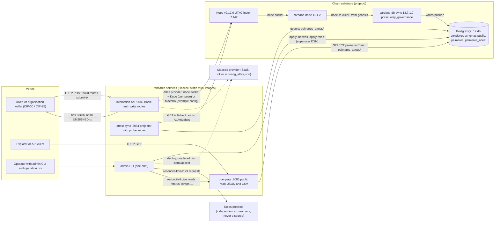
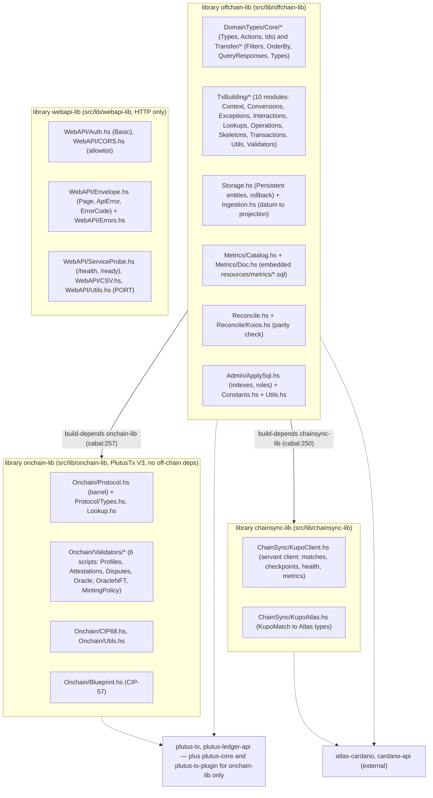
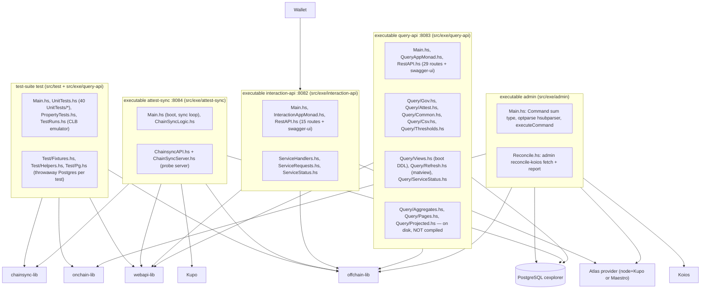
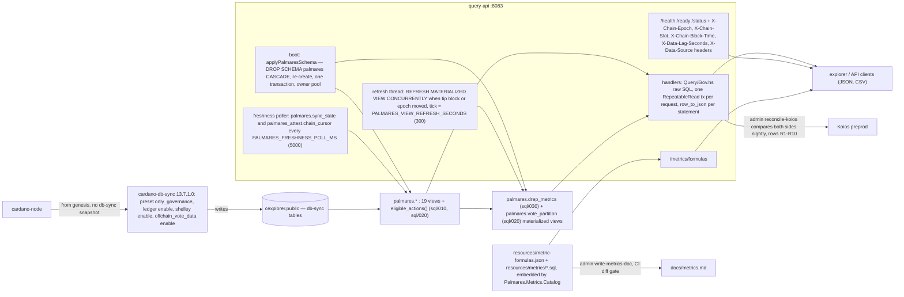
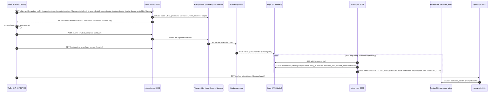
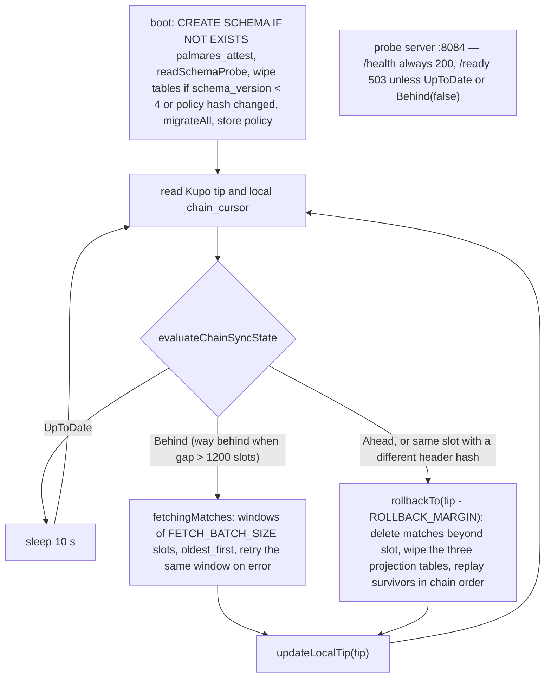
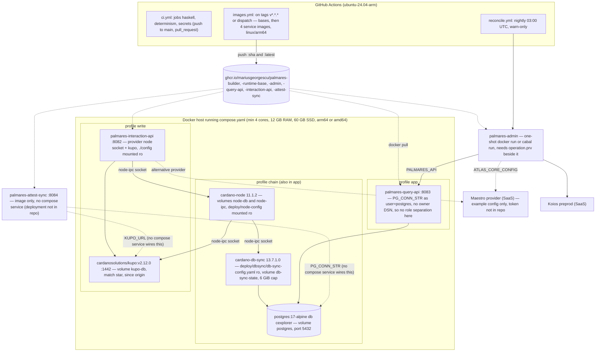
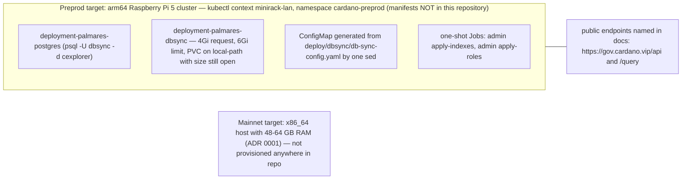
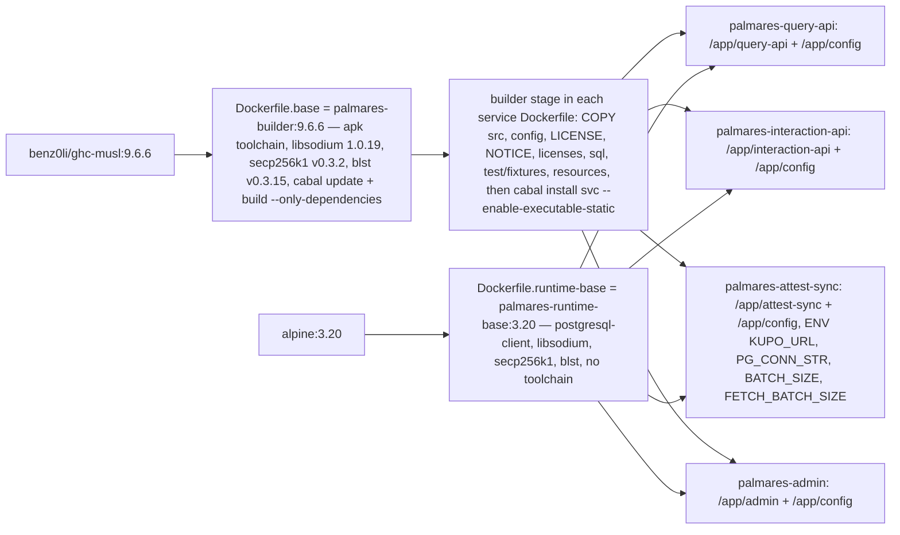
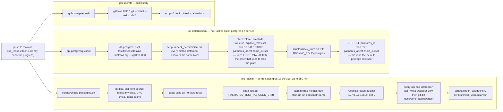

# Palmares — System Overview

Status: architecture reference, written from the source tree at `main` @ `4eb9117` (2026-10-22) and
reconciled against `main` @ `2bf5bde` (2026-10-23); every `path:line` below is the later tree's.
Scope: everything around the validators — services, libraries, data paths, databases, HTTP surface,
deployment and delivery. The on-chain protocol itself is covered by two sibling documents and is only
referenced here:

- [`onchain-protocol.md`](./onchain-protocol.md) — validators, datums, redeemers, minting policy, oracle.
- [`onchain-flows.md`](./onchain-flows.md) — the transaction-level flows (claim, issue, accept, dispute).

Every module list, route, environment name, port, table and dependency edge below was read from the
files cited as `path:line`. Where a document in the repository disagrees with the code, the code's
behaviour is stated and the document is flagged in a one-line "docs say" note; a separate audit under
`docs/audit/` is the place for the full drift list.

---

## 1. Purpose, reading guide, and the two data paths

Palmares is a public, verifiable governance track record for Cardano: every DRep's votes, delegations,
rationale anchors, per-epoch voting power, committee and treasury activity, derived from the chain and
served through a free read API, plus a countersigned attestation protocol in which an organisation's
claim about a subject is recorded only once the subject accepts it (`README.md:3-10`).

There are exactly two data paths and they must not be confused (`CLAUDE.md:20-27`). **Governance is
read-only and holds no state of ours**: `cardano-node` feeds `cardano-db-sync` (`preset: only_governance`,
ledger enabled, synced from genesis), which writes its own `public` schema into the `cexplorer` database;
Palmares adds the `palmares` schema — plain views, two materialized views and SQL functions, as declared
by `sql/` and no longer counted here (the matview count was published as one in four documents while the
schema had two) —
applied by `query-api` at boot and dropped and re-created on every start, so a wrong number is fixed by
editing a view, never by a pipeline (`sql/000_schema.sql:1-11`, `src/exe/query-api/Query/Views.hs:4-14`).
**Attestations are the only stateful path**: the PlutusTx validators emit UTxOs under one minting
policy, Kupo indexes them, `attest-sync` projects them into the `palmares_attest` schema with a cursor,
schema-version wipe and bounded rollback, and `query-api` reads those tables beside the views
(`src/lib/offchain-lib/Palmares/Storage.hs:88-177`, `src/exe/attest-sync/Main.hs:96-170`).

| If you want to… | Read |
| --- | --- |
| see who talks to what, with ports and protocols | §2 context, §3 components |
| understand how a governance number reaches a client | §4, §7.1 |
| understand how an attestation reaches the chain and comes back | §5, §7.2, plus the on-chain documents |
| integrate against the HTTP APIs | §6 |
| configure or operate a deployment | §8, §9 |
| find the file to change | §10 module map, §11 |
| know what is deliberately not done yet | §12 |

---

## 2. Context diagram

Evidence: ports `src/exe/query-api/Main.hs:126`, `src/exe/interaction-api/Main.hs:69`,
`src/exe/attest-sync/Main.hs:72`; Kupo port and image `compose.yaml:171,214`; db-sync image and preset
`compose.yaml:108`, `deploy/dbsync/db-sync-config.yaml:54-58`; Maestro example
`config/config_atlas.example.json`; node+Kupo provider in compose `compose.yaml:240-243`; Koios as check
`src/lib/offchain-lib/Palmares/Reconcile/Koios.hs:9-12`; the 79-request figure
`.github/workflows/reconcile.yml:34`. The wallet never gives a key to any service: every write route
returns an unsigned transaction (`src/exe/CLAUDE.md:32-34`, `docs/deployment/attest-flow-smoke.md:9-11`).

---

## 3. Application architecture — components and modules

### 3.1 Libraries

Dependency direction is read from `build-depends` in `palmares.cabal`: `offchain-lib` depends on
`chainsync-lib` (`palmares.cabal:250`) and `onchain-lib` (`:257`); `onchain-lib` and `chainsync-lib`
depend on no project library (`:120-131`, `:179-194`); `webapi-lib` "keeps NO project-library
dependencies" (`:285`). So the inward direction is onchain-lib + chainsync-lib → offchain-lib, with
webapi-lib a leaf beside them — not downstream of offchain-lib as the root `CLAUDE.md:29` arrow suggests
(docs say `offchain-lib → webapi-lib`; cabal has no such edge).

`onchain-lib` takes **no** `atlas-cardano` and no `cardano-api` (`palmares.cabal:120-131`); the two
external nodes above are therefore separate, not one. `webapi-lib` takes no Cardano dependency at all
(`:295-309`).

### 3.2 Executables and the test suite

Edges per `palmares.cabal`: admin → offchain-lib, onchain-lib (`:317-319`; **not** webapi-lib — docs in
`CLAUDE.md:33-35` say every executable depends on webapi-lib); query-api → offchain-lib, webapi-lib
(`:373-375`, and deliberately no `atlas-cardano`, `:377-379`); interaction-api → offchain-lib, webapi-lib,
atlas-cardano (`:417-419`, `:439`); attest-sync → chainsync-lib, offchain-lib, webapi-lib, atlas-cardano
(`:452-455`, `:471`); test → all four libraries (`:536-541`) and it compiles `Query.*` from
`src/exe/query-api` directly because a test-suite cannot import an executable's modules
(`:477-479`). The three dormant query modules are comment-prefixed in the manifest (`:357-366`) and no
longer compile against the live DTOs (`scripts/check_vocabulary.sh:29-32`). `interaction-api` no longer
takes `http-types` or `wai-extra`, and the test suite no longer takes `warp`: all three were unused and
`-Wunused-packages` was reporting them.

### 3.3 Configuration inputs per service

| Service | Environment (see §8) | Files |
| --- | --- | --- |
| query-api | `PG_CONN_STR`, `PALMARES_PG_OWNER_CONN_STR`, `PORT`, `CORS_ALLOWED_ORIGINS`, `PALMARES_VIEW_REFRESH_SECONDS`, `PALMARES_READY_MAX_LAG_SECONDS`, `PALMARES_AMBER_LAG_SECONDS`, `PALMARES_FRESHNESS_POLL_MS`, `PALMARES_NETWORK_NAME` | none at runtime — `sql/000-040` and `resources/metrics/*.sql` + `resources/metric-formulas.json` are embedded at compile time (`src/exe/query-api/Query/Views.hs:37-48`, `src/lib/offchain-lib/Palmares/Metrics/Catalog.hs:89-107`) |
| interaction-api | `ATLAS_CORE_CONFIG`, `DEPLOYED_VALIDATORS_CONFIG`, `BASIC_USER`, `BASIC_PASS`, `CORS_ALLOWED_ORIGINS`, `PORT` | `config/config_atlas.json`, `config/config_palmares_validators.json` when the env var is unset (`src/exe/interaction-api/Main.hs:58-59`, `src/lib/offchain-lib/Palmares/Constants.hs:5-9`) |
| attest-sync | `PG_CONN_STR`, `KUPO_URL`, `ATLAS_CORE_CONFIG` (network id only), `DEPLOYED_VALIDATORS_CONFIG` (policy hash), `FETCH_BATCH_SIZE`, `ROLLBACK_MARGIN`, `PORT`, `CORS_ALLOWED_ORIGINS` | same two JSON files (`src/exe/attest-sync/Main.hs:81-85`) |
| admin | `ATLAS_CORE_CONFIG`, `DEPLOYED_VALIDATORS_CONFIG`, `PALMARES_ADMIN_CONN_STR`, `PALMARES_OWNER_PASSWORD`, `PALMARES_RO_PASSWORD`, `PALMARES_API`, `KOIOS_API`, `KOIOS_API_TOKEN`, `PALMARES_READY_MAX_LAG_SECONDS` | `operation.prv` (24-word mnemonic, `src/exe/admin/Main.hs:51`), `config/reconcile-sample.preprod.json`, `config/reconcile-exceptions.yaml` |

---

## 4. Governance read path

**Substrate.** db-sync runs with `preset: only_governance`, `offchain_vote_data: enable`,
`shelley.enable: true` and the ledger left enabled (`deploy/dbsync/db-sync-config.yaml:54-61`), from
genesis because pre-upgrade `drep_distribution` values are not reproducible from a snapshot
(`docs/adr/0001-governance-data-substrate.md:15-21`). Mithril bootstraps the node only
(`compose.yaml:28-31`). The `deploy/dbsync/db-sync-config.yaml` file is the single source; the
Kubernetes ConfigMap is generated from it (`compose.yaml:22-23`, `README.md:133-134`).

**Boot-time schema apply.** `query-api` embeds `sql/000_schema.sql`, `010_gov_views.sql`,
`020_views.sql`, `030_metrics.sql`, `040_grants.sql` in that order (`src/exe/query-api/Query/Views.hs:37-48`)
and applies them in one transaction with `SET LOCAL lock_timeout = '10s'` (`:81-84`), dying on failure
(`:87-92`). It uses a second, two-connection pool on `PALMARES_PG_OWNER_CONN_STR` (defaulting to
`PG_CONN_STR`) because DDL and the matview refresh need owner rights while requests should be served
read-only (`src/exe/query-api/Main.hs:95-106`). `040_grants.sql` must be last and is guarded on
`palmares_ro` existing (`sql/040_grants.sql:12-32`). `sql/000_schema.sql` must never mention
`palmares_attest` (`sql/000_schema.sql:7-9`).

**The two materialized views.** `palmares.drep_metrics` (`sql/030_metrics.sql`) and
`palmares.vote_partition` (`sql/020_views.sql`) are refreshed by one thread, on one tick, in that order,
which compares the tip `(block_no, epoch_no)` from `palmares.sync_state` against the mark of the last
successful refresh and runs `REFRESH MATERIALIZED VIEW CONCURRENTLY` for each, outside a transaction,
when it moved; failures are logged and retried next tick (`src/exe/query-api/Query/Refresh.hs:79-106`,
`:109-155`). Interval `PALMARES_VIEW_REFRESH_SECONDS`, default 300. `CONCURRENTLY` requires a unique
index on each — `palmares_idx_drep_metrics_pk` (`sql/030_metrics.sql:272`) and
`palmares_idx_vote_partition_pk` (`sql/020_views.sql:237`) — and is what keeps the API answering during
a rebuild. The tick cost is the sum: ~3.1 s for `drep_metrics` and ~8.9 s for `vote_partition`'s pass
over every vote row.

This paragraph said "the one materialized view" for as long as there were two, and so did three other
documents. `sql/` is the authority on the set, `Query/Refresh.hs:105` on which of them get refreshed,
and `SELECT matviewname FROM pg_matviews WHERE schemaname='palmares'` on what a given deployment
actually has.

**Request plumbing.** Each governance read runs in one `RepeatableRead` transaction and projects one
`row_to_json(...)::text` column that the DTO's `FromJSON` decodes, so a renamed view column fails naming
the field (`src/exe/query-api/Query/Gov.hs:11-30`). A database failure maps to HTTP 503
`db_unavailable` and the exception text goes to stderr only (`src/exe/query-api/QueryAppMonad.hs:72-86`).
Pagination and ordering happen in SQL with clamped limits (`src/exe/query-api/Query/Common.hs:1-16`).

**Probes and thresholds.** `/health` touches nothing (`src/exe/query-api/Query/ServiceStatus.hs:39-41`).
`/ready` is decided from a cached freshness reading by `readyVerdict` (`src/exe/query-api/Query/Gov.hs:345-361`):

| Check | Fails with (503) | Threshold |
| --- | --- | --- |
| no successful poll of `palmares.sync_state` | `db_unavailable` | — |
| tip lag > ceiling | `indexer_behind` | `PALMARES_READY_MAX_LAG_SECONDS`, default 300 (`Gov.hs:364-365`) |
| `drep_distr_epoch < epoch_no - 1` (ledger not producing the distribution) | `indexer_behind` | — |
| `meta.network_name` differs from the expected network | `not_ready` | `PALMARES_NETWORK_NAME`, default `preprod` (`Gov.hs:387-393`) |
| tip lag **plus** the attestation projector's cursor lag > ceiling (only when the cursor exists) | `indexer_behind` | same ceiling, applied to the **sum**: the projector's own number is measured against db-sync's cursor and not the tip, so judging it alone against an absolute ceiling gave it an allowance of `maxLag + dbSyncLag`. `Nothing` still passes (`Gov.hs:345-361`, `Gov.hs:526-542`) |

`PALMARES_AMBER_LAG_SECONDS` (default 120) is a UI band carried in `/status`, never a probe input
(`Gov.hs:367-373`). `/status` always answers from the same inputs and adds `epoch_params`; it returns
`indexer_behind` if no `epoch_param` row exists yet (`ServiceStatus.hs:58-86`). One poller feeds the
probes and the five response headers (`Gov.hs:478-567`). The projector's lag is both folded into
`/ready` and published on `/status` as the nullable `attest_lag_seconds`, reported **as measured**
— the projector's distance from db-sync's cursor — while the probe compares that plus
`governance.lag_seconds` to the ceiling, so both numbers a reader needs are on the one response
(`ServiceStatus.hs:77-84`, `Transfer/QueryResponses.hs:581`). The Haddock at `Gov.hs:498-503` still
describes publishing it as an open follow-up; it is stale.

**Metric catalogue.** `resources/metric-formulas.json` lists eight formulas; six carry a `sql_file`
(`age_days_v1`, `delegator_retention_rate_v1`, `participation_rate_v1`, `rationale_rate_v1`,
`vote_latency_median_hours_v1`, `votes_by_type_v1`) and two (`gov_action_state_v1`, the tally) point at a
view (`sql_object`). All are embedded with one `embedFile` each (`Catalog.hs:89-107`); the catalogue is
resolved at boot and the process dies if a `sql_file` is not embedded (`Catalog.hs:119-131`,
`src/exe/query-api/Main.hs:79-84`). `GET /metrics/formulas` serves the resolved list with the SQL inlined
(`src/exe/query-api/RestAPI.hs:230-254`). `docs/metrics.md` is rendered by `admin write-metrics-doc`
(`src/lib/offchain-lib/Palmares/Metrics/Doc.hs:5-8`) and CI fails on a diff (`.github/workflows/ci.yml:124-128`).
Docs say "`Query.Metrics` looks each statement up by `formula_id` and runs it" (`docs/metrics.md:11-12`);
there is no `Query.Metrics` module — `delegator_retention_rate_v1.sql` is run through `lookupMetricSql`
in `Gov.hs:897`, and the other formulas are embodied in `palmares.drep_metrics`, whose header requires it
to agree with the catalogue files, asserted by `sql/checks/070_drep_metrics.sql` (`sql/030_metrics.sql:28-33`).

**Koios reconcile (nightly).** `admin reconcile-koios` fetches both indexes, compares ten rows R1–R10
against the pinned sample `config/reconcile-sample.preprod.json` with waivers from
`config/reconcile-exceptions.yaml`, and exits 0 clean/explained, 1 unexplained, 2 transport, 3 aborted
(`src/exe/admin/Reconcile.hs:6-22`, `docs/deployment/koios-parity-gate.md:17-33`). The workflow runs at
03:00 UTC with `continue-on-error: true` and uploads `out/` as the `koios-divergences` artifact
(`.github/workflows/reconcile.yml:15, 25, 62-66`); the merge gate is the offline replay over
`test/fixtures/snapshot/` in `cabal test` (`reconcile.yml:9-11`).

---

## 5. Attestation write path and read path

The protocol semantics are in the sibling documents; this section is the service choreography.

**Write routes.** `interaction-api` exposes three generic transaction routes — `POST /build-tx`
(any `Interaction`), `POST /submit-tx` (`AddWitAndSubmitParams`: `tx_unsigned` + `tx_wit`), `GET
/tx-status/{txId}` — and nine dedicated builders: `POST /claim-profile`, `/update-profile`,
`/issue-attestation`, `/accept-attestation`, `/open-dispute`, `/resolve-dispute`, `/expire-dispute`,
`/claim-credential`, `/withdraw-credential`
(`src/exe/interaction-api/RestAPI.hs:73-96, 127-181`). The last three arrived with ADR 0003 and D-A:
a credential binding became an attestation of its own rather than a field on the profile datum, so
claiming and withdrawing one are routes, and a dispute gained a keyless exit once its deadline passes
(`docs/adr/0003-credential-claim-as-attestation.md`). Every builder resolves its request into an
`Interaction` and runs `interactionToHexEncodedCBOR` (`src/exe/interaction-api/ServiceHandlers.hs:5-7`,
`InteractionAppMonad.hs:110-114`). `/submit-tx` rebuilds the body from `tx_unsigned`, attaches the
witness and submits through the provider (`RestAPI.hs:103-107`). `/resolve-dispute` is on HTTP because
the oracle validator requires the admin signature, so the unsigned transaction is the product
(`RestAPI.hs:159`); every other admin action is refused in a request body
(`src/lib/offchain-lib/Palmares/DomainTypes/Core/Actions.hs:449-470`). Every write failure is classified by one pure
function, `Palmares.TxBuilding.Exceptions.classifyWriteFailure` (`OF-05`): a validator's refusal is
`400 ScriptRefused` carrying the trace codes, a wallet that cannot pay is `400 InsufficientFunds`, a
protocol ceiling is `400 TxTooExpensive`/`TxTooLarge`, a provider failure or a rejected submission is
`502 ProviderError`, and anything else is a `500` that still has a `code` in its body.

**Provider.** The server runs inside `withCfgProviders` on `ATLAS_CORE_CONFIG`
(`src/exe/interaction-api/Main.hs:58-61`). The committed example is Maestro
(`config/config_atlas.example.json`, ADR 0002); the compose `write` profile instead injects an inline
`GYNodeKupo` config — node socket plus `http://kupo:1442` — because Ogmios v7 breaks Atlas
(`compose.yaml:152-168, 240-243`). `/status` reports only the provider family (`node-kupo`, `ogmios-kupo`,
`maestro`, `blockfrost`), never its configuration (`src/exe/interaction-api/ServiceStatus.hs:124-128`).

**Indexing.** `attest-sync` derives the Kupo pattern `<minting policy hex>.*` from
`DEPLOYED_VALIDATORS_CONFIG` (`src/exe/attest-sync/Main.hs:84-94, 137`) and runs this loop:

Evidence: boot sequence `Main.hs:101-110`, loop `Main.hs:143-170`, state machine
`ChainSyncLogic.hs:28-39`, fetching `ChainSyncLogic.hs:87-119`, rollback
`src/lib/offchain-lib/Palmares/Storage.hs:522-534`, probe `ChainsyncAPI.hs:44-69`. Every UTxO is
authenticated against the NFT its datum names before it becomes a projection
(`src/lib/offchain-lib/Palmares/Ingestion.hs:4-12`); projection rows carry chain slots, never wall-clock
time (`Storage.hs:118-122`). The service pins `search_path` to `palmares_attest, public` on every
transaction so its unqualified Persistent tables cannot land in the `palmares` schema that `query-api`
drops at boot (`Storage.hs:180-191, 231-244`; the failure this prevents is pinned by
`src/test/UnitTests/AttestSchema.hs`).

**Asynchrony.** Everything after `/submit-tx` is asynchronous: confirmation is polled by the client,
Kupo follows the node, `attest-sync` polls Kupo on its own cadence, and `query-api` reads whatever the
projector has written. `docs/deployment/attest-flow-smoke.md:133-142` says neither service reports
`attest-sync`'s lag anywhere on the read surface; in the code `/ready` folds the projector cursor
lag into its verdict (`Gov.hs:345-361, 508-542`) **and** `/status` publishes it as
`attest_lag_seconds` (`Query/ServiceStatus.hs:77-84`), asserted by `scripts/check_swagger.sh:127-147`.
No header carries it, so the number is on `/status` only; `scripts/smoke_attest_flow.sh:263-288` now
reads that field as its own preflight and still polls the projection with a bounded timeout after it.

---

## 6. HTTP API surface

Both documents under `docs/generated/swagger/` are generated by `--write-swagger-only` from the served
API type and diffed in CI (`src/exe/query-api/Main.hs:39-55`, `src/exe/interaction-api/Main.hs:24-42`,
`.github/workflows/ci.yml:165-170`). Docs say Swagger is "written on startup"
(`src/exe/CLAUDE.md:20, 81`, `CLAUDE.md:83`); it is written only by that flag.

### 6.1 query-api (`docs/generated/swagger/query-swagger-api.json`, title "Palmares Query API" 1.2.0)

Twenty-nine documented paths, asserted by value (`scripts/check_swagger.sh:54`). The version reached
1.2.0 in two additive steps after the route set stopped moving: 1.1.0 for `/status`'s
`attest_lag_seconds`, 1.2.0 for `DisputeVerdict` gaining `expired`
(`src/exe/query-api/RestAPI.hs:1731-1738`). `AttestationType` likewise gained `credential_claim` and
`credential_withdrawal`, so the published kind set is seven, not five (`check_swagger.sh:119-123`).

All routes are `GET`, public (no `BasicAuth` layer and no `WebAPI.Auth` import, `src/exe/query-api/RestAPI.hs:5-10`),
and answer `200 / 400 / 404 / 503`. `Page` = `{items, total (nullable), limit, offset, next_cursor}`
(`src/lib/webapi-lib/Palmares/WebAPI/Envelope.hs:66-74`). Routes marked CSV negotiate `text/csv` on
`Accept` and return the rows only (`WebAPI/CSV.hs:35-36`).

| Path | Summary | Notable params | Response | Type at |
| --- | --- | --- | --- | --- |
| `/health` | liveness, touches nothing | — | `ServiceProbeStatus` | `RestAPI.hs:200` |
| `/ready` | readiness, five checks of §4 | — | `ServiceProbeStatus` or 503 `ApiError` | `RestAPI.hs:200` |
| `/status` | network, `governance` sync block, `attest_lag_seconds`, `epoch_params` | — | `StatusResponse` | `RestAPI.hs:211-219` |
| `/metrics/formulas` | published formulas with SQL inlined | — | `[MetricFormula]` | `RestAPI.hs:230-241` |
| `/dreps` | DRep list, default `voting_power` desc, registered statuses by default | `status[]`, `anchor_status[]`, `has_script`, `min/max_voting_power`, `min_delegators`, `min_participation_rate`, `min_rationale_rate`, `registered_before/after`, `min_age_days`, `voted_on`, `not_voted_on`, `language`, `active_in_epoch`, `q`, `order_by`, `sort_order`, `limit`, `offset` | `Page DRepSummary`, CSV | `RestAPI.hs:265-298` |
| `/drep/{drep-id}` | DRep profile (CIP-129, CIP-105 or hex accepted) | — | `DRepDetailResponse` | `RestAPI.hs:365-375` |
| `/pages/drep/{drep-id}` | same, canonical page path | — | `DRepDetailResponse` | `RestAPI.hs:377-383` |
| `/drep/{drep-id}/power` | voting power per epoch | `from_epoch`, `to_epoch`, `limit`, `sort_order` | `Page EpochPowerPoint` | `RestAPI.hs:385-399` |
| `/drep/{drep-id}/delegators` | delegators | `is_current`, `min_lovelace`, `order_by`, `sort_order` | `Page DelegatorRow`, CSV | `RestAPI.hs:401-418` |
| `/drep/{drep-id}/updates` | certificate history | `kind[]`, `sort_order` | `Page DRepUpdateRow` | `RestAPI.hs:420-433` |
| `/gov-actions` | governance actions | `type[]`, `state[]`, `anchor_status[]`, `proposed_from/to`, `expires_before/after_epoch`, `proposer_stake_address`, `min/max_treasury_amount`, `q`, `order_by` | `Page GovActionSummary`, CSV | `RestAPI.hs:540-567` |
| `/gov-action/{gov-action-id}` | action detail with tallies, withdrawals, param changes, proposer, anchor | — | `GovActionDetailResponse` | `RestAPI.hs:621-637` |
| `/pages/gov-action/{gov-action-id}` | same, canonical page path | — | `GovActionDetailResponse` | `RestAPI.hs:639-645` |
| `/votes` | votes | `voter_role[]`, `voter_id[]`, `gov_action_id[]`, `verdict[]`, `gov_action_type[]`, `anchor_status[]`, `from/to`, `from/to_epoch`, `q`, `order_by` | `Page VoteRecord`, CSV | `RestAPI.hs:709-743` |
| `/activity` | keyset-paged feed (`total` is null) | `before` or `since` cursor (not both), `limit`, `event_type[]`, `source[]`, `actor[]` | `Page ActivityRow` | `RestAPI.hs:813-846` |
| `/search` | command-palette search, six groups | `q` (required), `kinds[]`, `limit_per_group` | `SearchResults` | `RestAPI.hs:889-917` |
| `/delegations` | vote delegations | `drep_id[]`, `stake_address[]`, `is_current`, `from/to`, `min_lovelace`, `order_by` | `Page DelegationRecord`, CSV | `RestAPI.hs:938-966` |
| `/committee` | the constitutional committee in force | — | `CommitteeResponse` | `RestAPI.hs:1015-1031` |
| `/spos` | pools in the voting-power distribution (`ticker` null under this preset) | `min_voting_power`, `min_votes_cast`, `active_in_epoch`, `order_by` | `Page SPOSummary`, CSV | `RestAPI.hs:1047-1073` |
| `/treasury-withdrawals` | withdrawals with `paid_heuristic` | `gov_action_id[]`, `beneficiary[]`, `enacted_from/to_epoch`, `min/max_amount`, `order_by` | `Page TreasuryWithdrawalRecord`, CSV | `RestAPI.hs:1104-1132` |
| `/pages/drep-explorer` | explorer page: list + facets | the `/dreps` filter set | `DRepExplorerPageResponse` | `RestAPI.hs:1170-1205` |
| `/pages/dashboard` | dashboard scalars, top DReps, closing soon, participation series | `top_limit`, `closing_soon_limit`, `epochs` | `DashboardPageResponse` | `RestAPI.hs:1279-1306` |
| `/profiles` | attestation profiles | `kind[]`, `claimed`, `q`, `order_by`, `sort_order` | `Page AttestProfileRow` | `RestAPI.hs:1373-1399` |
| `/profiles/{profile-id}` | one profile | — | `AttestProfileRow` | `RestAPI.hs:1401-1409` |
| `/profiles/by-credential/{credential}` | profiles claiming a credential (CIP-129 only) | `limit`, `offset` | `Page AttestProfileRow` | `RestAPI.hs:1419-1446` |
| `/profiles/{profile-id}/attestations` | a profile's track record | `sort_order` | `Page AttestationRow` | `RestAPI.hs:1448-1465` |
| `/attestations` | attestations | `subject`, `issuer`, `kind[]`, `accepted`, `date_from/to`, `order_by` | `Page AttestationRow` | `RestAPI.hs:1467-1492` |
| `/attestations/{attestation-id}` | one attestation with up to 50 disputes inline | — | `AttestationDetailResponse` | `RestAPI.hs:1494-1511` |
| `/disputes` | disputes (`resolved=true` is now three verdicts: `upheld`, `rejected`, `expired`) | `target`, `resolved`, `sort_order` | `Page DisputeRow` | `RestAPI.hs:1513-1532` |
| `/swagger-ui`, `/swagger-api.json` | served document | — | — | `RestAPI.hs:1863-1865` |

Servant's own parse failures (a bad capture or query parameter) are re-shaped into the documented body
by `palmaresErrorFormatters`, because every `parseUrlPiece` returns the error code as its message
(`RestAPI.hs:1893-1916`, `WebAPI/Errors.hs:53-73`).

### 6.2 interaction-api (`docs/generated/swagger/interaction-swagger-api.json`, "Palmares Interaction API" 3.1.0)

Fifteen documented paths. 3.1.0 is a MINOR bump over 3.0.0 for `DisputeActionType` gaining
`ExpireDisputeAction` and `DisputeVerdict` gaining `expired`, both additive
(`src/exe/interaction-api/RestAPI.hs:239-241`).

Write routes sit behind `BasicAuth "user-realm"` (`src/exe/interaction-api/RestAPI.hs:267-282`) with
credentials from `BASIC_USER`/`BASIC_PASS` compared in constant time (`WebAPI/Auth.hs:37-62`). The
Swagger document is generated from the `PublicAPI` type that excludes the auth wrappers
(`RestAPI.hs:229-233`), so it declares no `securityDefinitions`; the auth column below is from the
served `FullAPI` (`RestAPI.hs:284-293`). Its `info.license` says GPL-3.0 (`RestAPI.hs:243`) while the
repository is Apache-2.0.

| Method | Path | Auth | Summary | Body / params | 200 response |
| --- | --- | --- | --- | --- | --- |
| GET | `/health` | public | always healthy | — | `ServiceProbeStatus` |
| GET | `/ready` | public | all five reference scripts resolve on chain, else 503 | — | `ServiceProbeStatus` (`InteractionAppMonad.hs:137-162`) |
| GET | `/status` | public | provider family, network, `deployed_scripts`, `oracle_paused` (null when unreadable), always 200 | — | `InteractionStatusResponse` (`ServiceStatus.hs:53-67`) |
| POST | `/build-tx` | Basic | build any `Interaction` | `Interaction` (action, user addresses, optional recipient) | `string` hex CBOR, unsigned |
| POST | `/submit-tx` | Basic | add witness and submit | `AddWitAndSubmitParams` `{tx_unsigned, tx_wit}` | `GYTxId` |
| GET | `/tx-status/{txId}` | Basic | one confirmation check | path `txId` hex | `TxStatusResponse` `{tx_id, confirmed}` |
| POST | `/claim-profile` | Basic | mint a profile; under ADR 0003 it claims no credential — that is now a separate call | `ClaimProfileRequest` | `string` |
| POST | `/update-profile` | Basic | description and image only; name immutable | `UpdateProfileRequest` | `string` |
| POST | `/issue-attestation` | Basic | pending attestation about a subject profile (kind, claimed period, other metadata) | `IssueAttestationRequest` | `string` |
| POST | `/accept-attestation` | Basic | subject countersigns | `AcceptAttestationRequest` | `string` |
| POST | `/open-dispute` | Basic | lock the oracle's deposit against an attestation | `OpenDisputeRequest` | `string` |
| POST | `/resolve-dispute` | Basic | verdict transaction for the admin to sign | `ResolveDisputeRequest` | `string` |
| POST | `/expire-dispute` | Basic | close an undecided dispute past its own deadline; needs no authority at all and records `expired`, which is not a finding (D-A) | `ExpireDisputeRequest` | `string` |
| POST | `/claim-credential` | Basic | bind a profile to a CIP-129 credential as an append-only record; needs BOTH the profile's user token and the credential's authorisation (ADR 0003) | `ClaimCredentialRequest` | `string` |
| POST | `/withdraw-credential` | Basic | end a binding, authorised by the CREDENTIAL alone; nothing is deleted, the record is appended beside the claim | `WithdrawCredentialRequest` | `string` |
| GET | `/swagger-ui`, `/swagger-api.json` | public | served document | — | — |

### 6.3 Error envelope

Every non-2xx body from both services is `{"code": <stable tag>, "message": <human text>}` with
`application/json` (`src/lib/webapi-lib/Palmares/WebAPI/Errors.hs:8-12, 33-51`). The read surface's codes
are the 24 constructors of `ErrorCode`, serialised snake_case, each with a fixed status
(`WebAPI/Envelope.hs:118-149, 181-206`; the count is asserted by `scripts/check_swagger.sh:67`):

| Status | Codes |
| --- | --- |
| 400 | `invalid_parameter`, `query_too_short`, `query_too_long`, `offset_too_large`, `limit_too_large`, `invalid_cursor`, `both_cursors_given`, `invalid_drep_id`, `invalid_gov_action_id`, `invalid_asset_class`, `invalid_time_range`, `invalid_epoch_range` |
| 404 | `drep_not_found`, `gov_action_not_found`, `spo_not_found`, `committee_not_found`, `profile_not_found`, `attestation_not_found`, `dispute_not_found` |
| 429 | `rate_limited` (declared; no limiter in this repository — it is the BFF's job, `RestAPI.hs:9-10`) |
| 503 | `not_ready`, `indexer_behind`, `db_unavailable` |
| 500 | `internal_error` |

The write surface's `code` is the `TxBuildingException` constructor name
(`src/lib/offchain-lib/Palmares/TxBuilding/Exceptions.hs:173-174`) mapped by
`txBuildingExceptionToHttpStatus` (`:153-168`), whose last clause is a catch-all `_ = 400`, so a new
constructor is a 400 unless the map names it:

| Status | Codes |
| --- | --- |
| 400 | `WrongProfileType`, `AttestationAlreadyAccepted`, `AttestationOtherMetadataReservedKeys`, `AttestationPeriodInverted`, `CredentialMalformed`, `ScriptCredentialHasNoUtxo`, `DisputeAlreadyOpen`, `DisputeAlreadyResolved`, `InvalidAssetClass`, `MultipleUtxosFound`, `DisputeVerdictNotAFinding`, `ProfileClaimsNoCredential`, `DisputeNotStaleYet`; plus `InsufficientFunds` synthesised from Atlas balancing errors (`InteractionAppMonad.hs:87-108`) |
| 404 | `ProfileNotFound`, `AttestationNotFound`, `SubjectProfileNotFound`, `DisputeNotFound`, `OracleNotFound`, `NFTNotFound`, `NoDustFound` |
| 503 | `DeployedScriptsNotReady`, `ProtocolPaused`; `/ready` also serves `not_ready` on a provider failure (`InteractionAppMonad.hs:151-153`) |
| 500 | `OracleDatumInvalid`, `DatumParseError`, and `internal_error` for anything unexpected (`InteractionAppMonad.hs:94-96`) |

The last three 400s arrived with D-A and ADR 0003: `DisputeVerdictNotAFinding` refuses a resolution
that names `expired` (only a passed deadline writes that), `DisputeNotStaleYet` refuses an
`/expire-dispute` before the dispute's own deadline, and `ProfileClaimsNoCredential` refuses a
withdrawal from a profile that publishes none (`Exceptions.hs:68-85`).

### 6.4 CORS

All three HTTP servers wrap the application in `mkCorsMiddleware` driven by `CORS_ALLOWED_ORIGINS`
(`src/exe/query-api/RestAPI.hs:1871-1874`, `src/exe/interaction-api/RestAPI.hs:289-292`,
`src/exe/attest-sync/ChainsyncAPI.hs:66-69`). An origin not in the comma-separated allowlist gets no CORS
headers at all; an unset or empty variable means an empty allowlist, i.e. every cross-origin request is
denied — fail-closed (`src/lib/webapi-lib/Palmares/WebAPI/CORS.hs:35-44, 60-78`). Credentials are never
allowed; the five `X-Chain-*`/`X-Data-*` headers are exposed explicitly (`CORS.hs:51-58, 72`).

Each service prints the policy it resolved at boot (`describeCorsConfig`, `CORS.hs`), because
fail-closed and misconfigured look identical from outside: a browser console shows a blocked request
either way. The line names the allowed origins or says deny-all explicitly, lists the exposed headers,
and warns per entry that can never match — `*` (not an origin), a trailing slash, or a bare host with
no scheme. `DC-06`: the deny-all default is kept, and only made visible.

---

## 7. Data model

### 7.1 Schema `palmares` (views over db-sync's `public`)

Applied in order `000 → 010 → 020 → 030 → 040` by `query-api` (`src/exe/query-api/Query/Views.hs:37-48`).
`sql/000_schema.sql:10-11` is `DROP SCHEMA IF EXISTS palmares CASCADE; CREATE SCHEMA palmares;`.
Docs say "fourteen read-only views" (`docs/adr/0001-governance-data-substrate.md:12`); the files and
the ADR's own measurement row (`:60, :107`) have nineteen.

| Object | Kind | Purpose (from the file header) | Main sources | Defined at |
| --- | --- | --- | --- | --- |
| `palmares.anchor` | view | one row per voting anchor with one verdict column (`inline` tested first; failure patterns match db-sync's prose) | `public.voting_anchor`, `off_chain_vote_data`, `off_chain_vote_fetch_error` | `sql/010_gov_views.sql:38` |
| `palmares.sync_state` | view | exactly one row: tip block/slot/epoch/time, `lag_seconds`, `drep_distr_epoch`, `network_name`, `schema_version` | `public.block`, `meta`, `schema_version`, `drep_distr` | `010:95` |
| `palmares.drep_cert` | view | DRep certificate log, kind derived from the deposit sign, ordered by `(tx, cert_index)` | `public.drep_registration`, `tx`, `block` | `010:120` |
| `palmares.drep_interval` | view | one row per registration interval, so "registered at T" is a range test | `public.drep_registration`, `tx`, `block` | `010:151` |
| `palmares.drep` | view | one row per real DRep credential with registration status, anchor verdict, latest power; excludes the two reserved options | `public.drep_hash`, `drep_distr`, `off_chain_vote_drep_data` + `palmares.drep_cert`, `anchor`, `sync_state` | `010:200` |
| `palmares.action_window` | view | the authoritative voting window of every action, including the Conway bootstrap test | `public.gov_action_proposal`, `param_proposal`, `epoch_param`, `tx`, `block` | `010:335` |
| `palmares.thresholds` | view | the governance parameters of each epoch, listed explicitly (incl. `pvtpp_security_group`) | `public.epoch_param` | `010:402` |
| `palmares.threshold_map` | view | static table: which threshold parameter decides each (action type, voter role) | `VALUES` over `public.govactiontype`, `voterrole` | `010:459` |
| `palmares.cc_cold_interval` | view | which cold credential a committee hot key belonged to, and when | `public.committee_registration`, `committee_hash` | `010:520` |
| `palmares.vote` | view | every vote certificate with the voter resolved (DRep, SPO, CC cold) and the re-vote sequence numbered | `public.voting_procedure`, `drep_hash`, `pool_hash`, `committee_hash`, `tx`, `block` + `cc_cold_interval` | `010:533` |
| `palmares.drep_epoch_power` | view | DRep stake distribution per epoch, unfiltered (reserved options kept, `target_kind`) | `public.drep_distr`, `drep_hash` | `010:637` |
| `palmares.vote_delegation` | view | every vote-delegation certificate with the target classified | `public.delegation_vote`, `drep_hash`, `stake_address`, `tx`, `block` | `010:658` |
| `palmares.live_delegation` | view | the delegation in force now per stake address; de-registration compared by certificate, not epoch | `public.delegation_vote`, `stake_deregistration`, `tx`, `block` | `010:704` |
| `palmares.eligible_actions(drep_hash_id, as_of_epoch)` | function | the actions a DRep could have voted on: registration overlap, votable, settled | `palmares.action_window`, `drep_interval` | `sql/020_views.sql:24` |
| `palmares.drep_epoch_delegators` | view | delegator count per DRep per epoch from delegation intervals × epoch series | `public.delegation_vote`, `stake_deregistration`, `drep_distr`, `tx`, `block` + `sync_state` | `020:52` |
| `palmares.vote_tally` | view | one row per (action, voter role) over final votes; `basis = cast_votes_only` | `palmares.vote`, `drep_epoch_power`, `action_window`, `thresholds`, `threshold_map`; `public.pool_stat`, `pool_hash` | `020:126` |
| `palmares.gov_action` | view | one row per action with the published `gov_action_state_v1` lifecycle | `public.gov_action_proposal`, `voting_procedure`, `off_chain_vote_gov_action_data`, `stake_address`, `treasury_withdrawal`, `tx` + `action_window`, `anchor` | `020:231` |
| `palmares.committee_member` | view | the committee with cold and hot credentials resolved, `is_enacted`, expiration | `public.committee`, `committee_member`, `committee_hash`, `committee_registration`, `committee_de_registration`, `epoch_state` | `020:318` |
| `palmares.treasury_withdrawal` | view | the withdrawals an action requests and a `paid_heuristic` (display hint only) | `public.treasury_withdrawal`, `stake_address`, `reward_rest` + `gov_action` | `020:372` |
| `palmares.activity` | view | one governance feed: eleven arms, thirteen kinds, one total keyset cursor `(sort_slot, tx_index, arm, item_index)` | `vote`, `vote_delegation`, `drep_cert`, `gov_action`, `treasury_withdrawal`; `public.committee_*`, `block`, `tx` | `020:438` |
| `palmares.drep_metrics` | materialized view | per-DRep metrics batched (participation, rationale, latency, power, delegators, age); must agree with `resources/metrics/*.sql` | `palmares.vote`, `drep`, `drep_interval`, `drep_epoch_power`, `live_delegation`, `anchor`, `action_window`, `eligible_actions`, `sync_state`; `public.block`, `tx`, `drep_registration` | `sql/030_metrics.sql:40`; indexes `:250-256` |

Supporting SQL that is **not** applied at boot:

- `sql/indexes/001_gov_indexes.sql` — 23 `CREATE INDEX CONCURRENTLY IF NOT EXISTS` statements on
  db-sync's own `public` tables (`:21-89`), applied once by `admin apply-indexes` in autocommit, with a
  check for `INVALID` leftovers (`src/lib/offchain-lib/Palmares/Admin/ApplySql.hs:152-205`). Required by
  `sql/checks/030_votes.sql` onwards.
- `sql/checks/010_drep.sql` … `070_drep_metrics.sql` — `ASSERT` suites run by `scripts/verify_views.sh`
  against a caught-up preprod db-sync (tip epoch ≥ 320), the authority on view correctness
  (`src/test/CLAUDE.md:41-49`); `070` asserts the matview agrees with the catalogue statements.
- `test/fixtures/dbsync-skeleton.sql` — the empty-table shape fixture used by `cabal test` and the CI
  `determinism` job (`test/fixtures/dbsync-skeleton.sql:1-14`, `.github/workflows/ci.yml:217-223`).

### 7.2 Schema `palmares_attest` (Persistent entities, owned by attest-sync)

Declared in `src/lib/offchain-lib/Palmares/Storage.hs:88-178`, migrated by `migrateAll`
(`:246-255`); `currentSchemaVersion = 4` (`:278`) and a lower stored version or a changed policy hash
wipes all six tables before migration (`src/exe/attest-sync/Main.hs:96-110`, `Storage.hs:307-324`).
`GYAssetClass`, `GYTime` and the enums are stored as JSON/`timestamptz` columns (`Storage.hs:40-86`).
The bump from 3 to 4 is ADR 0003's: `attestation_projection` gained `attestation_credential`, and
`profile_projection.profile_credential` stopped being read off the profile datum, so an existing
projection is wrong rather than merely incomplete and the version bump is what forces the re-sync
that rebuilds it (`Storage.hs:273-278`).

| Table (entity) | Columns | Unique | Purpose |
| --- | --- | --- | --- |
| `chain_cursor` (`ChainCursor`) | `singleton bool`, `slot_no bigint`, `header_hash text`, `last_tx_id text?`, `last_output_index int?` | `UniqueCursor(singleton)` | the projector's position; also read by `query-api` for the projector lag (`Storage.hs:209-221`) |
| `chain_sync_config` (`ChainSyncConfig`) | `singleton bool`, `policy_hex_text text`, `schema_version int default 1` | `UniqueChainSyncConfig(singleton)` | policy hash + schema version probed at boot to decide a wipe |
| `onchain_match_event` (`OnchainMatchEvent`) | `created_slot`, `created_header`, `created_tx_id`, `created_tx_index`, `created_output_index`, `kupo_match json` | `UniqueKupoMatch(slot, header, tx_id, output_index)` | the raw match log; rollback replays it in `(slot, tx_index, output_index)` order |
| `profile_projection` (`ProfileProjection`) | `created_at_slot`, `created_at_hash`, `profile_id`, `profile_name`, `profile_description`, `profile_image_uri`, `profile_type`, `profile_credential text?` (plain index, deliberately not unique) | `UniqueProfileProjection(profile_id)` | one row per profile NFT; a credential claimed twice is reported as contested, not refused. Since ADR 0003 `profile_credential` is **derived**, not carried by the profile event: a `CredentialClaim` attestation sets it and a `CredentialWithdrawal` naming the same value clears it, in replay order, and a metadata update carries the existing value over rather than erasing it (`Storage.hs:411-414, 485-505`) |
| `attestation_projection` (`AttestationProjection`) | `created_at_slot`, `created_at_hash`, `created_tx_id`, `created_output_index`, `attestation_id`, `subject_profile_id`, `issuer_profile_id`, `attestation_kind`, `attestation_credential text?`, `attestation_date timestamptz`, `claimed_period_from?`, `claimed_period_to?`, `is_accepted`, `attestation_name`, `attestation_description`, `attestation_image_uri`, `other_metadata json?` | `UniqueAttestationProjection(attestation_id)` | one row per attestation; `is_accepted` is the subject's countersignature. `attestation_credential` is the credential a `credential_claim`/`credential_withdrawal` kind names (`Storage.hs:149`) |
| `dispute_projection` (`DisputeProjection`) | `created_at_slot`, `created_at_hash`, `dispute_id`, `target_attestation_id`, `opened_by_profile_id`, `opened_at`, `deposit bigint`, `verdict?`, `dispute_name`, `dispute_description`, `dispute_image_uri` | `UniqueDisputeProjection(dispute_id)` | one row per dispute UTxO, published beside the attestation it contests |

`query-api` reads the three projection tables with schema-qualified `rawSql "SELECT ??"` so persistent's
own decoders apply (`src/exe/query-api/Query/Attest.hs:13-37, 143-145`).

### 7.3 Roles and grants

| Role | Created by | May | May not |
| --- | --- | --- | --- |
| db-sync's superuser (`dbsync` on the cluster, `postgres` in compose) | db-sync / image | everything; runs `admin apply-roles` and `apply-indexes` via `PALMARES_ADMIN_CONN_STR` (`src/exe/admin/Main.hs:911-927`) | — |
| `palmares_owner` | `sql/050_roles.sql:57-65` | `CREATE` on database `cexplorer` (`:69`), owns `palmares_attest` (`:71`, `:76`), `USAGE`/`SELECT` on `public` (`:79-80`), future `public` tables via a default privilege (`:125`), runs the boot DDL and the matview refresh (`PALMARES_PG_OWNER_CONN_STR`) | create anything in `public` (`:145-147`) |
| `palmares_ro` | `sql/050_roles.sql:57-65` | `SELECT` on `public` and `palmares_attest` (`:84-87`), on `palmares` via the per-boot grant (`sql/040_grants.sql:28-34`), future tables via default privileges (`050:91-92`, `:112`, `:124`) | write anywhere; create in `public` |

`sql/050_roles.sql` opens with a guard that **refuses to run as the wrong role** (`:33-44`): it reads
the owner of `public.voting_procedure` and raises unless that is `current_user`, because every
`ALTER DEFAULT PRIVILEGES` below with no `FOR ROLE` is scoped to the current role. Run the file as
some other superuser and every statement succeeds while the default privileges cover nothing.

There are now **two** `ALTER DEFAULT PRIVILEGES … IN SCHEMA palmares_attest` statements, and they are
not redundant. `:91-92` carries `FOR ROLE palmares_owner`; `:112` carries no `FOR ROLE` and therefore
covers the current role — which is the one that matters, because `palmares_attest.chain_cursor` is
created by `attest-sync`, and all four places that configure its connection (`defaultConnStr` in
`src/exe/attest-sync/Main.hs`, `Dockerfile.attest-sync`, `compose.yaml`, `.env.example`) say
`user=postgres`. A default privilege is scoped to the role that creates the object, so neither
statement covers the other's deployment and there is no single statement that covers both. Without
`:112` the failure is silent and blames the wrong service: `GRANT … ON ALL TABLES` resolves when it
runs, so it covers nothing when `apply-roles` precedes `attest-sync`'s first boot — the normal order
— and `information_schema` then shows `palmares_ro` nothing at all, so a missing grant and an absent
table are the same observation and `/status` serves `attest_lag_seconds: null` either way.

Both roles get `search_path = palmares, palmares_attest, public` (`050:136-137`); passwords are set by
`apply-roles` from `PALMARES_OWNER_PASSWORD` / `PALMARES_RO_PASSWORD` as bound parameters
(`src/lib/offchain-lib/Palmares/Admin/ApplySql.hs:207-244`). `scripts/check_roles.sh` asserts the
separation, including the `palmares_attest` default privilege (`:85-95`), and CI runs it
(§9.5). The single-role deployment (`PG_CONN_STR` only) remains supported (`sql/040_grants.sql:19-23`).

**Not provisioned by `compose.yaml`.** Nothing in this repository's only runnable deployment applies
`sql/050_roles.sql` or creates either role: there is no `admin` service, and `query-api` is given
`PG_CONN_STR: host=postgres user=postgres …` with no `PALMARES_PG_OWNER_CONN_STR`
(`compose.yaml:263-274`). So under compose the service connects as the cluster superuser and the
separation above exists on paper only — it is the cluster's shape, applied by the one-shot
`admin apply-roles` Job of §9.3, and the CI `determinism` job is where it is exercised.

---

## 8. Configuration

### 8.1 Environment variables read by the code

| Name | Read by | Default | Fail-closed? | README §11 / note |
| --- | --- | --- | --- | --- |
| `BASIC_USER`, `BASIC_PASS` | interaction-api (`src/exe/interaction-api/Main.hs:64`, `WebAPI/Auth.hs:54-62`) | none | yes, `die` | docs say "interaction-api, admin"; admin never reads them (no `getBasicAuthFromEnv` in `src/exe/admin`); scripts use them as client credentials |
| `CORS_ALLOWED_ORIGINS` | query-api, interaction-api, attest-sync probe (`WebAPI/CORS.hs:37-44`; `attest-sync/Main.hs:73`) | empty = deny all cross-origin | effectively (denies) | all three now ANNOUNCE the resolved policy at boot (`DC-06`), so deny-all is no longer silent |
| `PG_CONN_STR` | query-api (`Main.hs:31-32, 87`), attest-sync (`Main.hs:50-55, 76`) | `host=postgres … dbname=cexplorer` / `host=localhost … dbname=cexplorer` | no — both default | docs say "required" |
| `PALMARES_PG_OWNER_CONN_STR` | query-api (`Main.hs:100-104`) | `PG_CONN_STR` | no | not in README §11 (in `.env.example:12-15`) |
| `PORT` | query-api 8083, interaction-api 8082, attest-sync 8084 (`WebAPI/Utils.hs:18-27`) | per service | no (warns on a bad value) | docs say "all services"; admin reads no port |
| `ATLAS_CORE_CONFIG` | interaction-api (`Main.hs:58`), attest-sync for `networkId` (`Main.hs:81-82`), admin for on-chain commands and `operator-address` (`Main.hs:845, 897`) | file `config/config_atlas.json` | yes in the two services | docs say "interaction-api, admin"; attest-sync requires it too |
| `DEPLOYED_VALIDATORS_CONFIG` | interaction-api (`Main.hs:59`), attest-sync (`Main.hs:84`), admin (optional, `Main.hs:886`) | file `config/config_palmares_validators.json` | yes in the two services | docs say "interaction-api, admin"; attest-sync requires it (policy hash) |
| `KUPO_URL` | attest-sync (`Main.hs:57-58, 75`) | `http://localhost:1442` | no | matches |
| `FETCH_BATCH_SIZE` | attest-sync (`Main.hs:112-114`) | `10000000` slots in code; `100000` via `Dockerfile.attest-sync:57` | no | docs say default `100000` |
| `BATCH_SIZE` | nobody (no reader in `src/`) | — | — | listed in README, `.env.example:19`, `Dockerfile.attest-sync:56`; dead variable |
| `ROLLBACK_MARGIN` | attest-sync (`Main.hs:116-118`, `Constants.hs:33-35`) | `2160` slots | no | matches |
| `PALMARES_VIEW_REFRESH_SECONDS` | query-api (`Query/Refresh.hs:101-106`) | `300` | no | matches |
| `PALMARES_READY_MAX_LAG_SECONDS` | query-api (`Query/Gov.hs:364-366`); admin `reconcile-koios` abort bound (`Reconcile.hs:93`) | `300` | no | matches; admin use not listed |
| `PALMARES_AMBER_LAG_SECONDS` | query-api (`Gov.hs:368-370`) | `120` | no | matches |
| `PALMARES_FRESHNESS_POLL_MS` | query-api (`Gov.hs:372-374`) | `5000` | no | not in README §11 |
| `PALMARES_NETWORK_NAME` | query-api (`Gov.hs:376-382`) | `preprod` | no — a wrong value fails `/ready` instead | not in README §11 |
| `PALMARES_ADMIN_CONN_STR` | admin `apply-indexes`, `apply-roles` (`Main.hs:920-927`) | none | yes, `die` | not in README §11 |
| `PALMARES_OWNER_PASSWORD`, `PALMARES_RO_PASSWORD` | admin `apply-roles` (`Main.hs:737-738, 930-934`) | none | yes, `die` | not in README §11 |
| `PALMARES_API` | admin `reconcile-koios` (`Reconcile.hs:91`) | none (required) | yes | not in README §11 |
| `KOIOS_API` | admin `reconcile-koios` (`Reconcile.hs:92`) | `https://preprod.koios.rest/api/v1` | no | not in README §11 |
| `KOIOS_API_TOKEN` | admin `reconcile-koios` (`Reconcile.hs:201-203, 403`) | unset = unauthenticated | no | not in README §11; CI secret (`reconcile.yml:35`) |
| `PALMARES_TEST_PG_CONN_STR` | test suite (`src/test/Test/Pg.hs:48-53`) | none | yes in tests | CI sets it (`ci.yml:116`) |
| `PALMARES_FIXTURE_PG_CONN_STR` | test suite, epoch-319 fixture gate (`src/test/UnitTests/MetricFixture.hs:241`) | unset = skipped | no | — |

`MAESTRO_API_KEY` is read by nothing; the token lives inside the Atlas core config as
`coreProvider.maestroToken` (`config/config_atlas.example.json`, `README.md:158-160`). Shell-only
variables (not read by Haskell): compose's `POSTGRES_PASSWORD`, `POSTGRES_PORT`, `RESTORE_SNAPSHOT`,
`KUPO_SINCE`, `KUPO_MATCH`, `KUPO_PORT`, `GH_OWNER`, `TAG`, `CARDANO_NETWORK`, `INTERACTION_API_PORT`,
`QUERY_API_PORT` (`compose.yaml`); the scripts' `PALMARES_SIGN_CMD`, `PALMARES_ADMIN_SIGN_CMD`,
`PALMARES_ADMIN_CMD`, `ATTEST_SMOKE_*`, `PALMARES_INTERACTION_API`, `PALMARES_QUERY_API`, `PSQL`,
`DBSYNC_ROLE`, `K`, `CONTAINERS`, `IMAGE_PREFIX`, `PUSH`.

### 8.2 JSON / YAML configuration files

| File | Shape | Produced by | Consumed by |
| --- | --- | --- | --- |
| `config/config_atlas.json` (gitignored; template `config_atlas.example.json`) | Atlas `GYCoreConfig`: `coreProvider` (Maestro token, or `socketPath` + `kupoUrl`), `networkId`, `logging` | operator | interaction-api, admin, attest-sync (`networkId`) |
| `config/config_palmares_validators.json` | `DeployedScriptsContext`: five `(hash, reference UTxO)` pairs + `oracleNFTAssetClass` (`src/lib/offchain-lib/Palmares/TxBuilding/Context.hs:23-32`) | `admin deploy-reference-scripts` (`compose.yaml:8-10, 248-249`) | interaction-api, attest-sync, admin |
| `config/reconcile-sample.preprod.json` | pinned, deterministic sample of DReps and actions for R1–R10 | hand-pinned (header `_about`) | `admin reconcile-koios` |
| `config/reconcile-exceptions.yaml` | waivers: `row`, `key`, optional `field`, required `reason`/`opened`/`owner` | humans | `admin reconcile-koios` |
| `deploy/dbsync/db-sync-config.yaml` | upstream preprod config with exactly three deltas | pinned from db-sync 13.7.1.0 | db-sync (compose), k8s ConfigMap (generated, not in repo) |
| `deploy/node-config/*.json` + `SOURCES.sha256` | node config, topology, four genesis files, peer snapshot | pinned from the official preprod set | cardano-node, db-sync, Kupo |
| `resources/metric-formulas.json`, `resources/metrics/*.sql` | the metric catalogue | humans; embedded at compile time | query-api, admin `write-metrics-doc` |

### 8.3 Secrets and where they are ignored

| Secret | Location | `.gitignore` | `.dockerignore` | Pre-push hook |
| --- | --- | --- | --- | --- |
| provider token | `config/config_atlas.json` | `:44` | **not listed** — only `config/*.prv` is; the service Dockerfiles `COPY config ./config` (`Dockerfile.query-api:22, 51`), so a real file on the build host would enter an image. Docs say both ignore files exclude it (`docs/adr/0002-write-path-provider.md:28`) | asserted ignored (`.githooks/pre-push:11-13`) |
| admin key | `operation.prv` (24-word mnemonic, `src/exe/admin/Main.hs:51`) | `:40-41` | yes | asserted ignored and untracked (`:11, :25-27`) |
| `.env` | repo root | `:37-39` | yes | asserted ignored |
| role and DB passwords | environment only | — | — | regex scan for token shapes (`:20-22`) |

CI additionally runs gitleaks over the full history with a rule-scoped allowlist that is itself
tested (`.github/workflows/ci.yml:259-295`, `.gitleaks.toml`, `scripts/check_gitleaks_allowlist.sh`).

---

## 9. Deployment and delivery

### 9.1 Compose profiles (`compose.yaml`)

Docs say two profiles (`README.md:113-119`); the file defines three (`compose.yaml:4-6`). `attest-sync`
and `admin` have no compose service: `attest-sync` is only an image, `admin` runs as a one-shot
`docker run` (`.github/workflows/reconcile.yml:55-58`, `docs/deployment/attest-flow-smoke.md:59, 113`).

| Profile | Services | Notes |
| --- | --- | --- |
| `chain` | `cardano-node` (Mithril by default, `RESTORE_SNAPSHOT`), `postgres` (`cexplorer`, `:5432`), `cardano-db-sync` (6144M limit) | `compose.yaml:32-150`; the whole read substrate |
| `app` | the three above + `query-api` (`:8083`, `PG_CONN_STR` pointing at the `postgres` service **as `user=postgres`**, with no `PALMARES_PG_OWNER_CONN_STR`) | `compose.yaml:263-283`, DSN at `:267` |
| `write` | `kupo` (`:1442`, `--match *`, `--since origin`) + `interaction-api` (`:8082`, inline node+Kupo `ATLAS_CORE_CONFIG`, `./config` bind-mounted read-only) | `compose.yaml:169-261`; Kupo **is** provisioned here, only in this profile; needs `config_palmares_validators.json` from a prior `admin deploy-reference-scripts` |

Volumes: `node-db`, `node-ipc` (named, because a UNIX socket in a macOS bind mount does not work),
`postgres`, `db-sync-state`, `kupo-db` (`compose.yaml:285-290`). Bind mounts: `deploy/node-config` and
`deploy/dbsync` read-only into node, db-sync and Kupo; `./config` into interaction-api.

### 9.2 Deployment diagram

Evidence: host minimum and profiles `compose.yaml:1-6`; images pinned by digest `compose.yaml:34, 71, 108`;
Kupo `compose.yaml:169-225`; interaction-api `compose.yaml:233-261`; query-api `compose.yaml:263-283`;
GHCR namespace `.github/workflows/images.yml:31-32`; arm64-only images `images.yml:74, 116`,
`reconcile.yml:20-22`. Kupo's image is the one line in the file **not** pinned by digest
(`cardanosolutions/kupo:v2.12.0`, `compose.yaml:171`).

**What `compose.yaml` does not provision**, stated plainly because the diagram above reads as if it
did. Two of the four executables have no service in the file: `attest-sync`, so its
`KUPO_URL`/`PG_CONN_STR` edges above are what a deployment would have to wire (hence the dotted
arrows), and `admin`, which runs as a one-shot `docker run`. Nothing in the file applies
`sql/050_roles.sql` either, so neither `palmares_owner` nor `palmares_ro` exists in a compose stack
and `query-api` connects as the database superuser — `PG_CONN_STR: host=postgres user=postgres …`,
with no `PALMARES_PG_OWNER_CONN_STR`, so the one pool serves both the boot DDL and the requests
(`compose.yaml:267`). The two-role separation of §7.3 is the cluster's shape, not this file's.
`compose.yaml` is nonetheless the only runnable deployment definition in the repository (§9.3).

### 9.3 Target environments (described, not provisioned here)

Evidence: `scripts/check_roles.sh:21`, `scripts/measure_substrate.sh:21-22, 108-109`,
`experiments/dbsync-preprod/README.md:4-6, 25-26` (the manifests live in a separate
`apps-k8s-configs` repository), `compose.yaml:22-23`, `src/exe/admin/Main.hs:715-718` (Jobs),
`docs/adr/0001-governance-data-substrate.md:94-96, 111`, `docs/deployment/attest-flow-smoke.md:105-106`,
`.github/workflows/reconcile.yml:31`. Nothing in this repository deploys to Kubernetes; the only
runnable deployment definition is `compose.yaml`.

### 9.4 Image layering

Evidence: `Dockerfile.base:4, 89-91`; `Dockerfile.runtime-base:5-57`; the service files share one
shape (`Dockerfile.query-api:8-9` build args, `:21-37` COPYs that must mirror `extra-source-files`,
`:39-44` static install, `:47-55` runtime stage); `Dockerfile.attest-sync:54-57` defaults.
`scripts/build-images.sh` builds both bases locally and then the four services for the host
architecture only, tags `ghcr.io/mariusgeorgescu/palmares-<svc>:<git short sha or given tag>`, and
refuses `PUSH=true` (`scripts/build-images.sh:1-80`). CI publishes the bases under `:sha` and
`:version` and the services under `:sha` and `:latest` (`images.yml:78-80, 119-124`).
`scripts/check_packaging.sh` guards the COPY list against `extra-source-files` because a miss only
fails the image build (`ci.yml:31-41`).

### 9.5 CI pipeline (`.github/workflows/ci.yml`)

What each job gates: `haskell` gates compilation, the test suite (unit, property, emulator and
throwaway-Postgres tests), and the three generated-document contracts (`ci.yml:11-184`); `determinism`
gates the SQL catalogue's reproducibility over the shape fixture **and, since `5d50895`, the role
separation** (`:186-257`); `secrets` gates leaked credentials (`:259-295`). The role step
(`ci.yml:234-257`) is in `determinism` rather than `haskell` because it needs no Haskell build, and it
runs in its own `cexplorer` database because `sql/050_roles.sql` names that database by hand; the
`DBSYNC_ROLE=postgres` it passes to `check_roles.sh` is the same role the file's own opening guard
insists on. Before it, role separation had **no** gate at all. The nightly `reconcile` workflow is
warn-only and reads `PALMARES_API`,
`KOIOS_API`, `KOIOS_API_TOKEN` (`reconcile.yml:29-59`). The pre-push hook, enabled per clone with
`git config core.hooksPath .githooks`, checks that the secret set is ignored, that nothing
credential-shaped is tracked, and that no `.env`/key file is tracked (`.githooks/pre-push:10-27`).

### 9.6 Operational scripts (`scripts/`)

| Script | One line |
| --- | --- |
| `build-images.sh` | build the two bases and the four service images locally for the host arch; no push |
| `check_determinism.sh` | F1 check 3: run every catalogue statement twice over the pinned epoch-320 cursor and diff; exit 0/1/2 |
| `check_gitleaks_allowlist.sh` | plant decoys to prove the `.gitleaks.toml` narrowing is rule-scoped, not a hole |
| `check_packaging.sh` | every `extra-source-files` path and `license-file` is COPYed by all four service Dockerfiles |
| `check_roles.sh` | assert the `palmares_owner` / `palmares_ro` separation against the cluster or the experiment |
| `check_swagger.sh` | jq contract assertions on the query Swagger: path set, 24 error codes, parameters that must or must not exist |
| `check_vocabulary.sh` | the domain noun is "attestation" everywhere outside the listed dormant files |
| `measure_substrate.sh` | reproduce ADR 0001's size and memory figures against the experiment or the cluster |
| `reconcile_koios.sh` | wrapper over `admin reconcile-koios` that prints the row table and propagates the exit code |
| `smoke_attest_flow.sh` | F1 check 11: claim → attest → accept → dispute → resolve end to end against a live deployment, signing via `PALMARES_SIGN_CMD` |
| `smoke_interaction_api.sh` | the write API answers, refuses admin actions in bodies, and `/status` stays 200; builds no transaction |
| `smoke_query_api.sh` | the query API answers with the values a client depends on (preprod figures marked) |
| `smoke_views.sh` | post-deploy: the `palmares` schema is present, complete, and the matview is being refreshed |
| `verify_views.sh` | run `sql/checks/*.sql` in order against a synced db-sync; never `--single-transaction` |

---

## 10. Module map

"Compiled?" is read from `palmares.cabal`; every `.hs` under `src/` is listed.

### onchain-lib (`palmares.cabal:101-161`)

| Module | Responsibility | Compiled? |
| --- | --- | --- |
| `Palmares.Onchain.Blueprint` | CIP-57 blueprint generation, deployment-independent | yes |
| `Palmares.Onchain.CIP68` | CIP-68 datum metadata standard and ref/user token names | yes |
| `Palmares.Onchain.Protocol` | re-export barrel for types and datum lookups (two members, not three) | yes |
| `Palmares.Onchain.Protocol.Lookup` | typed datum lookups from inputs; `feeFor` | yes |
| `Palmares.Onchain.Protocol.Types` | core on-chain datum/redeemer types, stable indices | yes |
| `Palmares.Onchain.Utils` | shared on-chain helpers, output-index checks | yes |
| `Palmares.Onchain.Validators.AttestationsValidator` | acceptance and permissionless cleanup | yes |
| `Palmares.Onchain.Validators.DisputesValidator` | deposit in, admin verdict, deposit back | yes |
| `Palmares.Onchain.Validators.MintingPolicy` | the parameterised minting policy | yes |
| `Palmares.Onchain.Validators.OracleNFTPolicy` | one-shot oracle NFT policy (inlined, never deployed) | yes |
| `Palmares.Onchain.Validators.OracleValidator` | oracle state, admin-signed updates incl. `SetAdmin` | yes |
| `Palmares.Onchain.Validators.ProfilesValidator` | profile lifecycle | yes |

`Palmares.Onchain.Protocol.Id` was a thirteenth module and is **gone** (`3654f57`). It held
`deriveSeededId` and `deriveIndexedId`, neither of which ever had a caller: every deterministic name
in this protocol is `Utils.nameFromTxOutRef` wrapped by `CIP68.generateRefAndUserTN`, which is where
the CIP-67 prefixes are applied. Removing it was hash-neutral for the same reason it was dead — nothing
reached it, so nothing inlined it (`src/lib/onchain-lib/Palmares/Onchain/Protocol.hs:5-11`).

### chainsync-lib (`palmares.cabal:163-194`)

| Module | Responsibility | Compiled? |
| --- | --- | --- |
| `Palmares.ChainSync.KupoClient` | servant client for Kupo: matches, checkpoints, health, metrics; `KupoMatch` JSON | yes |
| `Palmares.ChainSync.KupoAtlas` | `KupoMatch` → Atlas types (`AtlasMatch`, datum/script hash decoding) | yes |

### offchain-lib (`palmares.cabal:196-272`)

| Module | Responsibility | Compiled? |
| --- | --- | --- |
| `Palmares.Constants` | default config paths, `appVersion`, `defaultRollbackMargin` | yes |
| `Palmares.DomainTypes.Core.Actions` | `ProfileActionType`, `DisputeActionType`, `AdminActionType` (refused over HTTP), claim witness | yes |
| `Palmares.DomainTypes.Core.Ids` | CIP-129 / CIP-105 governance identifier codecs | yes |
| `Palmares.DomainTypes.Core.Types` | off-chain domain types (profiles, attestations, DRep/gov-action ids, enums) | yes |
| `Palmares.DomainTypes.Transfer.Filters` | list filter records and `*FromParams` | yes |
| `Palmares.DomainTypes.Transfer.OrderBy` | sort enums and `SortOrder` | yes |
| `Palmares.DomainTypes.Transfer.QueryResponses` | query-api response DTOs (`StatusResponse`, `DRepSummary`, …) | yes |
| `Palmares.DomainTypes.Transfer.Types` | protocol status DTO and other transfer types | yes |
| `Palmares.Ingestion` | datum → `ChainEventProjection`, NFT authentication before projection | yes |
| `Palmares.Admin.ApplySql` | statement splitter; apply indexes and roles in autocommit | yes |
| `Palmares.Metrics.Catalog` | embedded metric catalogue, `resolvedMetricCatalog`, `retentionWindowEpochs` | yes |
| `Palmares.Metrics.Doc` | render `docs/metrics.md` | yes |
| `Palmares.Reconcile` | keyed comparison, waivers, freshness guard, report (R1–R10) | yes |
| `Palmares.Reconcile.Koios` | Koios wire types and mappings | yes |
| `Palmares.Storage` | Persistent entities, cursor, schema version, wipe, upsert, rollback/replay | yes |
| `Palmares.TxBuilding.Context` | `DeployedScriptsContext`, `ProviderCtx`, `TxBuildingContext`, `runQuery`/`runTx` | yes |
| `Palmares.TxBuilding.Conversions` | on-chain ↔ domain conversions | yes |
| `Palmares.TxBuilding.Exceptions` | `TxBuildingException`, HTTP status map, stable codes | yes |
| `Palmares.TxBuilding.Interactions` | `Interaction` → skeleton dispatch; `AddWitAndSubmitParams` | yes |
| `Palmares.TxBuilding.Lookups` | on-chain and oracle lookups (profiles, attestations, dust) | yes |
| `Palmares.TxBuilding.Operations` | skeleton building per operation, readiness of deployed scripts | yes |
| `Palmares.TxBuilding.Skeletons` | reusable skeleton parts (CIP-68, validity, ref inputs, mints) | yes |
| `Palmares.TxBuilding.Transactions` | build/sign/submit; witness-set helpers for `sign-tx` | yes |
| `Palmares.TxBuilding.Utils` | datum parsing, GY/Plutus conversions, `slotToUTC` | yes |
| `Palmares.TxBuilding.Validators` | compile the six scripts to `GYScript`, hashes, `ProtocolParams` | yes |
| `Palmares.Utils` | coloured output, `decodeConfigEnvOrFile`, JSON enum helpers | yes |

### webapi-lib (`palmares.cabal:274-309`)

| Module | Responsibility | Compiled? |
| --- | --- | --- |
| `Palmares.WebAPI.Auth` | Basic auth check, `getBasicAuthFromEnv` (fail-closed) | yes |
| `Palmares.WebAPI.CORS` | allowlist CORS middleware, exposed freshness headers | yes |
| `Palmares.WebAPI.CSV` | `text/csv` content type, `MimeRender CSV (Page a)`, `safeCell` | yes |
| `Palmares.WebAPI.Envelope` | `Page`, `Cursor`, `ApiError`, `ErrorCode`, status map | yes |
| `Palmares.WebAPI.Errors` | `mkServantErr`, `mkServantErrBody`, parser-message decoding | yes |
| `Palmares.WebAPI.ServiceProbe` | `/health` + `/ready` API type and helpers | yes |
| `Palmares.WebAPI.Utils` | `PORT` reader, shared Swagger descriptions, `escapeLikePattern` | yes |

### Executables

| Component | Module | Responsibility | Compiled? |
| --- | --- | --- | --- |
| admin | `Main` | command parser, non-provider commands, provider commands, `adminPool` | yes (`:313`) |
| admin | `Reconcile` | `reconcile-koios` fetch, exit codes 0/1/2/3, snapshot dump | yes (`:315`) |
| query-api | `Main` | boot order, `--write-swagger-only`, two pools, threads | yes (`:349`) |
| query-api | `QueryAppMonad` | context (pool, freshness, thresholds), `runRead` → 503 | yes (`:370`) |
| query-api | `RestAPI` | all route types, handlers, Swagger, error formatters, WAI app | yes (`:371`) |
| query-api | `Query.Gov` | governance SQL, readiness verdict, freshness poll and headers | yes (`:362`) |
| query-api | `Query.Attest` | reads over the three `palmares_attest` tables | yes (`:359`) |
| query-api | `Query.Common` | page bounds, ordering helpers, text bounding | yes (`:360`) |
| query-api | `Query.Csv` | orphan `ToNamedRecord` instances for the governance DTOs | yes (`:361`) |
| query-api | `Query.Thresholds` | (voter role, action type) → threshold column table | yes (`:364`) |
| query-api | `Query.Refresh` | matview refresh thread | yes (`:367`) |
| query-api | `Query.ServiceStatus` | `/health`, `/ready`, `/status` incl. `attest_lag_seconds` | yes (`:368`) |
| query-api | `Query.Views` | embedded `sql/*.sql`, boot apply | yes (`:369`) |
| query-api | `Query.Aggregates` | inherited page aggregates over Belt-System projections | **no** (`:358`, on disk) |
| query-api | `Query.Pages` | inherited explorer page aggregates | **no** (`:365`, on disk) |
| query-api | `Query.Projected` | inherited esqueleto reads; references DTO fields that no longer exist | **no** (`:366`, on disk) |
| interaction-api | `Main` | config load, `withCfgProviders`, auth, CORS, port | yes (`:406`) |
| interaction-api | `InteractionAppMonad` | context, exception → HTTP mapping, submit, tx-status, readiness | yes (`:411`) |
| interaction-api | `RestAPI` | `Transactions`, `ServiceAPI`, probes, `/status`, Basic-auth wrappers, Swagger | yes (`:412`) |
| interaction-api | `ServiceHandlers` | request → `Interaction` per dedicated route | yes (`:413`) |
| interaction-api | `ServiceRequests` | the nine request DTOs with Swagger descriptions | yes (`:414`) |
| interaction-api | `ServiceStatus` | `InteractionStatusResponse`, provider family, pause probe | yes (`:415`) |
| attest-sync | `Main` | boot, schema probe/wipe/migrate, sync loop | yes (`:443`) |
| attest-sync | `ChainSyncLogic` | tip comparison, batch fetching, `applyMatches` | yes (`:448`) |
| attest-sync | `ChainSyncServer` | warp probe server | yes (`:449`) |
| attest-sync | `ChainsyncAPI` | `SyncMetrics`, `ChainSyncState`, probe handlers | yes (`:450`) |

### test-suite (`palmares.cabal:473-583`; all 52 listed modules exist on disk and no test file is unlisted)

| Module | Responsibility |
| --- | --- |
| `Main`, `UnitTests`, `PropertyTests`, `TestRuns` | tasty entry; the unit group; on-chain/off-chain rule equivalence; CLB emulator harness driving the production `Interaction` pipeline |
| `Test.Fixtures`, `Test.Helpers`, `Test.Pg` | emulator fixture content; assertions incl. `failedWithTrace`; one throwaway Postgres database per test seeded with the db-sync skeleton |
| `Query.Attest`, `Query.Common`, `Query.Gov`, `Query.Refresh`, `Query.Thresholds`, `Query.Views` | query-api modules compiled into the suite from `src/exe/query-api` |
| `UnitTests.Activity`, `Anchor`, `Views`, `Refresh`, `ThresholdMap`, `GovThresholds`, `MetricCatalog`, `MetricDoc`, `MetricFixture` | governance views, matview and refresh thread, threshold table, catalogue drift gates, epoch-319 regression |
| `UnitTests.GovDto`, `GovIds`, `QueryHardening`, `ApiHardening`, `InteractionApi`, `WritePath`, `SignTx` | wire vocabulary goldens, CIP-129/105 goldens, input bounds and CSV trust boundary, webapi helpers, interaction surface, write-path refusals, `sign-tx` witness shape |
| `UnitTests.Attestation`, `Claim`, `Profile`, `Dispute`, `DisputeRules`, `Oracle`, `OracleRules`, `Pause`, `Cleanup`, `Fees`, `MintInputs`, `MutationGuards`, `Satisfaction`, `MetadataLimits`, `ScriptSize`, `Blueprint`, `Conversions` | the protocol in a real emulated ledger and at the validator lambdas; script sizes; blueprint invariants |
| `UnitTests.AttestRead`, `AttestSchema`, `ChainSyncReplay`, `Projections`, `StorageRoundtrip`, `ApplySql`, `Reconcile` | attestation read surface, schema placement, replay/rollback order, ingestion authentication, SQLite round-trips, SQL splitter, Koios replay |

Note: `scripts/check_vocabulary.sh:24-32` still describes `TestRuns`, `Test.Fixtures` and
`UnitTests.{Attestation,Cleanup,Oracle}` as comment-prefixed out of the suite; `palmares.cabal:484, 493,
505, 507, 530` list them and `src/test/UnitTests.hs` imports them, so they compile. The suite's
`build-depends` no longer names `warp` (`a9bfd71`): it was unused, and `-Wunused-packages` said so.

---

## 11. Where to change what

The root `CLAUDE.md:45-65` table, corrected to files that exist and compile. On-chain rows are kept
for completeness; their detail is in the sibling documents.

| Change | Files |
| --- | --- |
| New on-chain type | `src/lib/onchain-lib/Palmares/Onchain/Protocol/Types.hs` (stable indices, `HasBlueprintDefinition`). There is no `Protocol/Id.hs` any more: the only derivation path is `Onchain/Utils.hs` (`nameFromTxOutRef`) wrapped by `Onchain/CIP68.hs` (`generateRefAndUserTN`), which both `CLAUDE.md:50` and `src/lib/onchain-lib/CLAUDE.md:26-29` now say |
| New validator | `Onchain/Validators/<Name>Validator.hs`, `Onchain/Protocol.hs`, `offchain-lib/Palmares/TxBuilding/Validators.hs`, `TxBuilding/Context.hs`, `TxBuilding/Transactions.hs`, `palmares.cabal` `exposed-modules`; then `admin deploy-reference-scripts` and `config/config_palmares_validators.json` |
| New minting redeemer / fee type | `Onchain/Validators/MintingPolicy.hs`; fees also `Onchain/Protocol/Types.hs` (`FeeConfig`), `Onchain/Protocol/Lookup.hs` (`feeFor`), `TxBuilding/Operations.hs` |
| New off-chain domain type / action | `offchain-lib/Palmares/DomainTypes/Core/Types.hs`, `Core/Actions.hs` |
| New governance identifier form | `DomainTypes/Core/Ids.hs` + `src/test/UnitTests/GovIds.hs` golden |
| New tx operation | `TxBuilding/Operations.hs`, `Lookups.hs`, `Interactions.hs`, `Conversions.hs`; an HTTP route for it in `src/exe/interaction-api/RestAPI.hs` + `ServiceRequests.hs` + `ServiceHandlers.hs` |
| New write-path error | `TxBuilding/Exceptions.hs` (constructor, `displayException`, status) |
| New read-path error code | `webapi-lib/Palmares/WebAPI/Envelope.hs` (`ErrorCode`, `errorCodeToHttpStatus`), `WebAPI/Errors.hs` (`genericErrorMessage`), `scripts/check_swagger.sh:67` (the count) |
| **New governance metric** | `resources/metrics/<name>.sql` + entry in `resources/metric-formulas.json` + `embedFile` line in `src/lib/offchain-lib/Palmares/Metrics/Catalog.hs:93-107` + `palmares.cabal` `extra-source-files` + the matching arithmetic in `sql/030_metrics.sql` + `sql/checks/070_drep_metrics.sql`; regenerate `docs/metrics.md` with `admin write-metrics-doc`. Docs say the catalog is `query-api/Metrics/Catalog.hs` (`CLAUDE.md:57`); no such file exists |
| **New governance view** | `sql/010_gov_views.sql` or `sql/020_views.sql` (a new file also goes into `src/exe/query-api/Query/Views.hs:37-48` before `040_grants.sql`), a check in `sql/checks/`, and `test/fixtures/dbsync-skeleton.sql` if it reads a new db-sync table |
| New governance query endpoint | `src/exe/query-api/RestAPI.hs` (route type, handler, `CoreFunctionAPI`, `coreFunctionServer`), `Query/Gov.hs`; DTOs in `offchain-lib/Palmares/DomainTypes/Transfer/QueryResponses.hs`, filters in `Transfer/Filters.hs`, sort enums in `Transfer/OrderBy.hs`, CSV instance in `Query/Csv.hs`; then regenerate the Swagger and extend `scripts/check_swagger.sh`. Docs point at `Query/Aggregates.hs` and `Query/Pages.hs` (`CLAUDE.md:59`); both are dormant — page routes are handled in `RestAPI.hs:1170-1306` with queries in `Query/Gov.hs` |
| New attestation query endpoint | `src/exe/query-api/RestAPI.hs`, `Query/Attest.hs` (docs say `Query/Projected.hs`, `CLAUDE.md:60`; dormant), helpers in `Query/Common.hs` |
| New attestation projection | `offchain-lib/Palmares/Ingestion.hs`, `Storage.hs` (entity, `put*`, `putMatchAndProjections`, `rollbackTo` wipe, `chainSyncTableNames`, bump `currentSchemaVersion`), `src/test/UnitTests/AttestSchema.hs` |
| New admin command | `src/exe/admin/Main.hs` (`Command`, parser, dispatch); `src/exe/admin/Reconcile.hs` for the parity command |
| New environment variable | the reading service's `Main.hs` (or `Query/Gov.hs`, `Query/Refresh.hs`), `.env.example`, `README.md` §11, `compose.yaml` |
| New test | `src/test/UnitTests.hs`, `UnitTests/<Topic>.hs`, `TestRuns.hs` for an emulator runner, and `palmares.cabal` `other-modules` |
| Deployment | `compose.yaml`, `Dockerfile.*` (+ `scripts/check_packaging.sh` if `extra-source-files` changes), `.github/workflows/*.yml`, `deploy/` |

---

## 12. Known limitations and open decisions

- **Preprod only.** The first milestone runs on preprod; mainnet needs a 48–64 GB x86_64 host and the
  arm64 Pi cluster is preprod-only (`README.md:41-44`, `docs/adr/0001-governance-data-substrate.md:111`).
  The PVC size for the cluster is still open pending the memory decision (`ADR 0001:71-96`).
- **Write path needs a provider.** ADR 0002 (status *proposed*) picks Maestro with the token supplied
  from the environment and leaves a local-node spike open (`docs/adr/0002-write-path-provider.md:8-22`);
  `compose.yaml`'s `write` profile already runs the node+Kupo provider instead (`compose.yaml:152-168`),
  so the ADR's outcome section has not caught up with the file. Kupo v2.12.0 against node 11.1.2 is
  measured, not documented upstream, and must be re-probed after a node bump (`compose.yaml:160-168`);
  Kupo's from-origin index size and time are not measured (`compose.yaml:204-205`).
- **No frontend in this repository.** The README's "explorer" and the Swagger's `gen:api` consumer live
  elsewhere (`README.md:5-7`, `src/exe/query-api/Main.hs:39`); rate limiting is delegated to a BFF that is
  not here either (`src/exe/query-api/RestAPI.hs:9-10`).
- **No Kubernetes manifests here.** Only `compose.yaml`; the cluster manifests are in a separate
  repository (`experiments/dbsync-preprod/README.md:4-6`). `attest-sync` has no compose service at all.
- **Attestation projector lag: published on `/status`, absent from the headers.** This was the open
  item at `4eb9117` and `9a8d79b` closed half of it: `/status` now carries the nullable
  `attest_lag_seconds` beside the `governance` block, and `/ready` folds the same reading into its
  verdict (`src/exe/query-api/Query/ServiceStatus.hs:77-84`). None of the five `X-Chain-*`/`X-Data-*`
  headers carries it, and `null` still cannot be told from "this deployment runs no projector"
  (`Query/Gov.hs:494-503`) — a projector that stopped is caught, one that never started is not.
- **Blueprint committed, still not gated.** `docs/generated/palmares-blueprint.json` is present (it was
  not at `4eb9117`, which is what this entry used to say) and its four unparameterised validators carry
  a `hash` and a `compiledCode` matching `config/config_palmares_validators.json` and the pinned sizes
  in `UnitTests.ScriptSize`. The minting policy is declared by `parameters` with no `compiledCode`, by
  design. Nothing in CI regenerates it or fails when it drifts, so it is a committed artefact on trust
  (`src/exe/admin/Main.hs`, `admin write-blueprint`).
- **Two published names for one value: `beneficiary` and `stake_address`.** A treasury withdrawal's
  payee is `beneficiary` on `/treasury-withdrawals` and on `/gov-action/{id}`'s inlined withdrawals
  (`QueryResponses.hs:1118,1713`, the `?beneficiary=` filter at `RestAPI.hs:1155`, the CSV header at
  `Query/Csv.hs:300,317`), while the same bech32 value is `stake_address` on
  `ResolvedLevelOneAnchor` (`:1996`), on `/delegations` and `/delegators`, on `proposer_stake_address`,
  in the column the SQL reads (`palmares.treasury_withdrawal.stake_address`, aliased `AS beneficiary`
  at `Query/Gov.hs:1317,2631`) and in the frozen on-chain metadata key
  `palmares:level1_stake_address`. It has already cost one defect: `f72af4e` records step 7 of the
  smoke flow reading `stake_address` off a withdrawal row that publishes `beneficiary`.
  **Open by decision, not by neglect.** `stake_address` is the API's word for this value — ten uses in
  the generated Swagger against `beneficiary`'s five, and the chain froze it in the anchor key, where
  nothing burns, so every anchored attestation on preprod carries `palmares:level1_stake_address` for
  good. But `beneficiary` is not simply wrong either: it names the ROLE, and this API already has a
  convention for that, `proposer_stake_address`. By that convention the correct name is
  `beneficiary_stake_address`, which neither route uses, so "align them" is a three-way rename and not
  a two-way one. Against that: both names are published, the Swagger is the frontend's codegen input,
  and a renamed CSV header breaks saved spreadsheets silently. So the **recommendation is not to
  rename now** — document the synonym (done here and in
  `docs/deployment/attest-flow-smoke.md` step 7) and, if a breaking window opens, rename
  `beneficiary` → `beneficiary_stake_address` across the two response DTOs, the query parameter, the
  two CSV sites, the two SQL aliases, `Reconcile.hs`'s `WWithdrawal` (which parses our own
  `/gov-action/{id}`, so it is an internal consumer and would break too), `check_swagger.sh`, the
  Swagger version, and the frontend in lockstep. The defect it caused was discoverability, and
  discoverability is the half that is fixable for free.
- **Dormant modules.** `Query/Aggregates.hs`, `Query/Pages.hs`, `Query/Projected.hs` are kept on disk,
  excluded from the build, and no longer compile against the DTOs (`palmares.cabal:353-366`,
  `scripts/check_vocabulary.sh:29-32`).
- **Accepted substrate limitations.** Under `only_governance`: `tx.fee` is 0, SPO tickers are null
  (`off_chain_pool_data` empty), constitution anchors are never fetched (`ADR 0001:109-110`);
  `/activity` cannot count its tail, so `total` is null (`WebAPI/Envelope.hs:58-61`); 90 of 294 registered
  preprod DReps have no ledger deadline and are published as `status = unknown`
  (`docs/deployment/koios-parity-gate.md:92-110`).
- **Koios parity is warn-only.** The nightly cannot block merges; the release gate is the artifact
  (`docs/deployment/koios-parity-gate.md:35-57`).
- **Dead configuration.** `BATCH_SIZE` is read by nothing (§8.1); the service Dockerfiles create
  `/app/docs/generated/swagger` although nothing writes there at runtime (`Dockerfile.query-api:53`).

### Doc-versus-code notes collected while writing

| Where the docs say | What the code does |
| --- | --- |
| `README.md:70` — Swagger **and** CIP-57 blueprint committed under `docs/generated/` | only the two Swagger files; no blueprint, no CI gate (`src/exe/admin/Main.hs:701-703`) |
| `README.md:113-119` — two compose profiles | three: `chain`, `app`, `write` (`compose.yaml:4-6`) |
| `README.md:143-144` — `BASIC_USER`/`BASIC_PASS` used by admin | admin never reads them |
| `README.md:147-148` — Atlas and validators config used by interaction-api, admin | attest-sync requires both as well (`src/exe/attest-sync/Main.hs:81-85`) |
| `README.md:146` — `PG_CONN_STR` required | defaulted in both readers |
| `README.md:151-152` — `BATCH_SIZE` default 1000000; `FETCH_BATCH_SIZE` default 100000 | `BATCH_SIZE` unread; code default for `FETCH_BATCH_SIZE` is 10000000 (`Main.hs:114`) |
| `README.md:141-156` — the variable list | misses `PALMARES_PG_OWNER_CONN_STR`, `PALMARES_FRESHNESS_POLL_MS`, `PALMARES_NETWORK_NAME`, `PALMARES_ADMIN_CONN_STR`, `PALMARES_OWNER_PASSWORD`, `PALMARES_RO_PASSWORD`, `PALMARES_API`, `KOIOS_API`, `KOIOS_API_TOKEN` |
| `CLAUDE.md:29, 33-35` — `offchain-lib → webapi-lib`; every executable depends on webapi-lib | no cabal edge from offchain-lib to webapi-lib; admin depends on offchain-lib + onchain-lib only |
| `CLAUDE.md:57, 59-60` — `query-api/Metrics/Catalog.hs`, `Query/Aggregates.hs`, `Query/Pages.hs`, `Query/Projected.hs` | catalogue is `offchain-lib/Palmares/Metrics/Catalog.hs`; the three query modules are not compiled; attestation reads are `Query/Attest.hs` |
| `src/exe/CLAUDE.md:20, 42-47, 55-57, 81` — Swagger written at startup; `QueryAppContext` has auth + provider; `Query/Projected.hs`; `Query/Metrics.hs` | `--write-swagger-only` only; no auth and no provider in query-api (`QueryAppMonad.hs:5-15`); `Query/Attest.hs`; no `Query/Metrics.hs` — `/metrics/formulas` is served by `RestAPI.hs:235-259` |
| `docs/metrics.md:11-12`, `Catalog.hs:11` — `Query.Metrics` runs each statement by `formula_id` | no such module; one statement is run via `lookupMetricSql` (`Gov.hs:897`), the rest are embodied in `palmares.drep_metrics` and the views |
| `docs/adr/0001:12` — fourteen views | nineteen (`sql/010`, `sql/020`). **Rewritten 2026-10-24**: the ADR now points at `sql/` instead of counting, because the matview count beside it had been wrong in four documents at once |
| **`scripts/smoke_views.sh:44` — `expect "materialized views" 1`** | **the schema has TWO** (`drep_metrics`, `vote_partition`), so this assertion fails against a correct deployment — and `expect` exits 1, so none of the checks after it run. The only one of these rows that is a broken test rather than stale prose. Patch: `expect "materialized views" 2`, and add `vote_partition`'s populated/unique-index pair beside `drep_metrics`'s |
| `src/exe/CLAUDE.md:59` — "the one materialized view's `REFRESH … CONCURRENTLY` loop" | two, refreshed on one tick, `drep_metrics` first (`Query/Refresh.hs:105`, whose own header says "the schema's two matviews") |
| `src/exe/query-api/QueryAppMonad.hs:9` — "the one matview" | two, as above |
| `docs/spec/decisions.md:20` (`D-1`) — "plus a single materialized view (`palmares.drep_metrics`)" | two; `vote_partition` arrived for `votes_cast` and the `is_final` filter (`sql/020_views.sql:221`). `D-1`'s actual decision — no governance projection **tables** — is unaffected |
| `docs/adr/0002:28` — token excluded by `.gitignore` and `.dockerignore` | TRUE as of 2026-10-24 (`TD-01`): `.dockerignore` now excludes `config/config_atlas.json` and the validators config from the build context, the four runtime stages no longer `COPY ./config`, and `scripts/build-images.sh` refuses to build if either line is missing. It was false when the audit looked |
| ~~`docs/deployment/attest-flow-smoke.md:138-142` — no service reports attest-sync lag~~ | **FIXED.** That page now describes `/status.attestation` and the three `X-Attest-*` headers (`DC-32`). The same false claim survived in `scripts/smoke_attest_flow.sh:144,157` — where the same script read `attest_lag_seconds` 120 lines later — and was corrected 2026-10-24 |
| `src/exe/query-api/Query/Gov.hs:498-503` — publishing the projector's lag is "a follow-up, deliberately not smuggled in here" | it was published, in `9a8d79b`, with the Swagger bump and the `check_swagger.sh` assertion the comment asks for; the comment is stale |
| `scripts/check_vocabulary.sh:24-32` — five test modules dormant | all listed in the cabal test-suite and imported |
| `src/exe/interaction-api/RestAPI.hs:243` — Swagger license GPL-3.0 | repository license is Apache-2.0 (`LICENSE`, `palmares.cabal:9`) |
